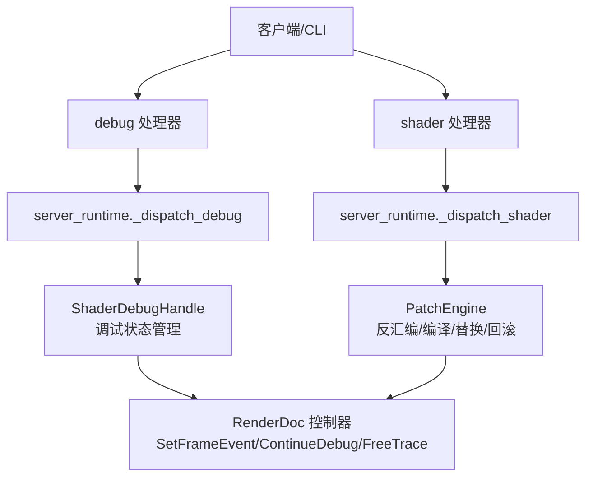
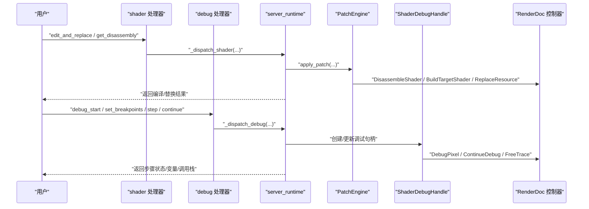
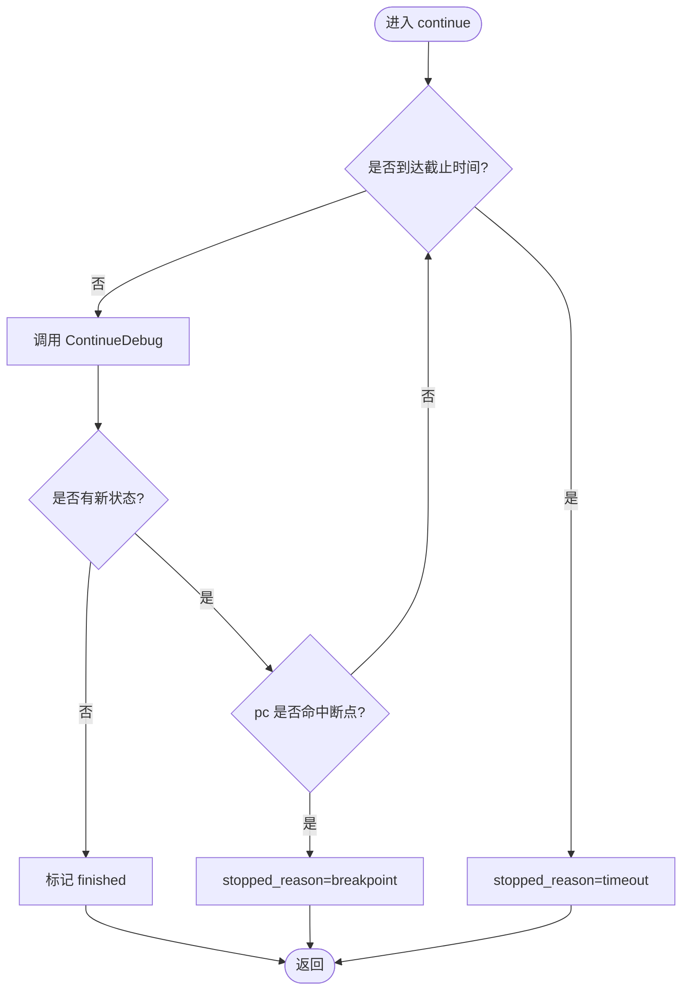
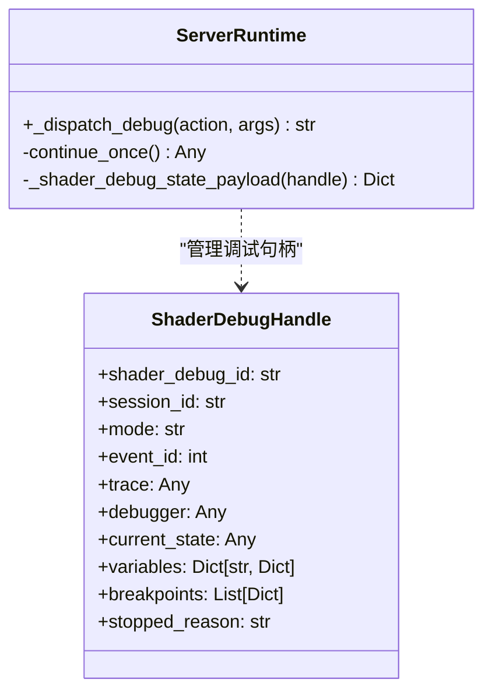
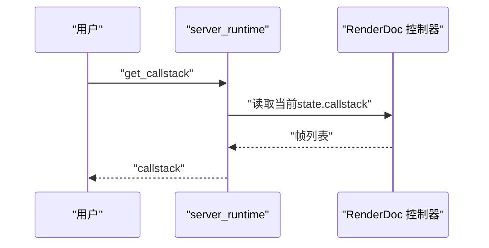
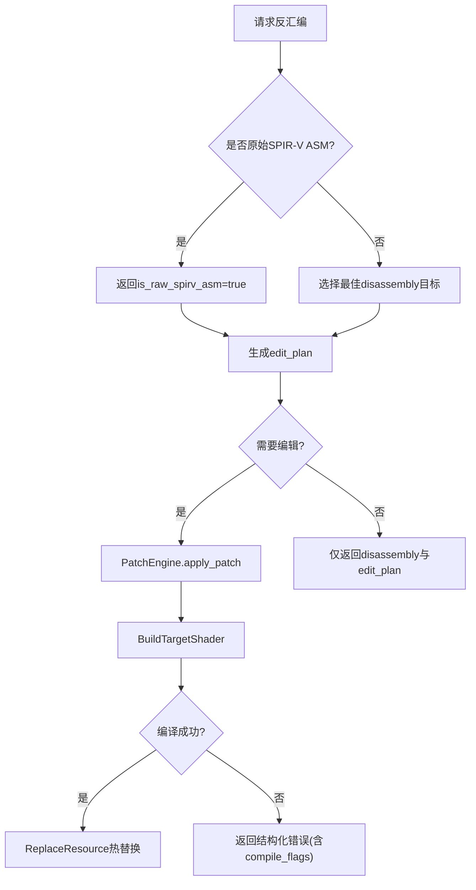
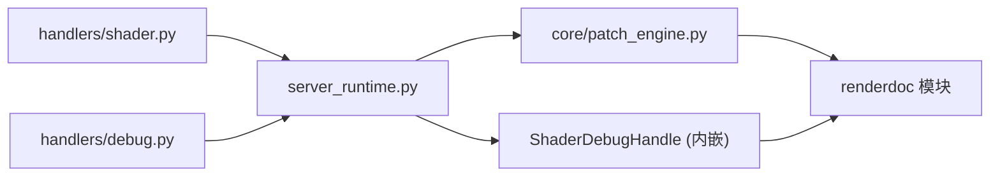

# Shader调试处理器

<cite>
**本文引用的文件**
- [rdc_tool/handlers/shader.py](file://rdc_tool/handlers/shader.py)
- [rdc_tool/handlers/debug.py](file://rdc_tool/handlers/debug.py)
- [rdc_tool/server_runtime.py](file://rdc_tool/server_runtime.py)
- [rdc_tool/core/patch_engine.py](file://rdc_tool/core/patch_engine.py)
- [rdc_tool/operation_definitions.py](file://rdc_tool/operation_definitions.py)
- [tests/test_shader_replace_contracts.py](file://tests/test_shader_replace_contracts.py)
- [docs/rdc-native-agent-playbook.md](file://docs/rdc-native-agent-playbook.md)
</cite>

## 更新摘要
**变更内容**
- 移除了对已删除文件 `rdc_tool/core/debug_service.py` 的所有引用
- 更新了架构描述，反映调试功能已整合到 `server_runtime.py` 和 `patch_engine.py` 中
- 修正了断点管理、变量检查和调用栈分析的代码位置引用
- 更新了操作定义引用，指向 `operation_definitions.py` 中的完整调试操作列表
- 调整了架构图和数据流图以匹配当前实现

## 目录
1. [简介](#简介)
2. [项目结构](#项目结构)
3. [核心组件](#核心组件)
4. [架构总览](#架构总览)
5. [详细组件分析](#详细组件分析)
6. [依赖关系分析](#依赖关系分析)
7. [性能考虑](#性能考虑)
8. [故障排查指南](#故障排查指南)
9. [结论](#结论)
10. [附录](#附录)

## 简介
本文件系统性介绍着色器调试处理器的实现与能力，覆盖断点管理、变量检查、调用栈分析、SPIR-V工具链集成、调试信息解析以及性能影响评估。该处理器基于 RenderDoc 的调试原语，通过 `server_runtime` 模块直接封装异步服务，支持像素级逐步执行、断点命中、变量快照与调用栈回溯，并通过 PatchEngine 在回放环境中对着色器进行源级修改与热替换，从而形成"可观察、可干预、可回滚"的完整调试闭环。

调试功能不再依赖独立的 `DebugService` 类，而是直接在 `server_runtime.py` 中通过 `_dispatch_debug` 函数实现，并与 `ShaderDebugHandle` 数据结构协同工作，提供完整的调试状态管理和生命周期控制。

## 项目结构
- 入口层：
  - shader 处理器将动作转发到运行时调度器。
  - debug 处理器将动作转发到运行时调试调度器。
- 运行时层：
  - server_runtime 提供 `_dispatch_shader` 与 `_dispatch_debug`，负责参数校验、会话控制、目标选择、断点与步进、变量与调用栈读取、资源释放等。
  - `ShaderDebugHandle` 数据类维护调试会话状态，包括 trace、debugger、current_state、variables、breakpoints 等字段。
- 服务层：
  - PatchEngine 负责反汇编、应用 patch（如精度提升、guard 插入）、编译、替换与回滚。
  - 调试逻辑内嵌于 `server_runtime._dispatch_debug`，直接调用 RenderDoc 控制器的 ContinueDebug、FreeTrace 等方法。
- 操作定义层：
  - operation_definitions.py 定义了所有调试操作的输入输出规范，包括 set_breakpoints、get_variables、get_callstack、step、continue、run_to、finish 等。
- 测试与文档：
  - 大量用例验证 edit_and_replace、get_source、get_disassembly、断点与步进行为、SPIR-V 二进制/文本路径、DXIL 只读场景等。
  - 使用手册给出像素调试与编辑流程示例。

**图表来源**
- [rdc_tool/handlers/shader.py:8-9](file://rdc_tool/handlers/shader.py#L8-L9)
- [rdc_tool/handlers/debug.py:8-9](file://rdc_tool/handlers/debug.py#L8-L9)
- [rdc_tool/server_runtime.py:184-199](file://rdc_tool/server_runtime.py#L184-L199)
- [rdc_tool/server_runtime.py:9518-10897](file://rdc_tool/server_runtime.py#L9518-L10897)
- [rdc_tool/server_runtime.py:11603-11740](file://rdc_tool/server_runtime.py#L11603-L11740)
- [rdc_tool/core/patch_engine.py:175-300](file://rdc_tool/core/patch_engine.py#L175-L300)

**章节来源**
- [rdc_tool/handlers/shader.py:1-11](file://rdc_tool/handlers/shader.py#L1-L11)
- [rdc_tool/handlers/debug.py:1-11](file://rdc_tool/handlers/debug.py#L1-L11)
- [rdc_tool/server_runtime.py:184-199](file://rdc_tool/server_runtime.py#L184-L199)
- [rdc_tool/server_runtime.py:9518-10897](file://rdc_tool/server_runtime.py#L9518-L10897)
- [rdc_tool/server_runtime.py:11603-11740](file://rdc_tool/server_runtime.py#L11603-L11740)

## 核心组件
- 调试处理器路由
  - shader 处理器：统一转发至 `_dispatch_shader`，支持 compile、get_source、get_disassembly、edit_and_replace 等。
  - debug 处理器：统一转发至 `_dispatch_debug`，支持 step、continue、run_to、set_breakpoints、clear_breakpoints、get_variables、evaluate_expression、get_callstack、finish。
- 调试状态管理
  - `ShaderDebugHandle`：数据类维护调试会话的完整状态，包括 shader_debug_id、session_id、mode、event_id、trace、debugger、current_state、variables、breakpoints、stopped_reason 等字段。
  - `_require_shader_debug_handle`：验证调试句柄的有效性，防止跨会话或过期句柄被重用。
- 补丁引擎
  - PatchEngine：反汇编（优先 SPIR-V ASM），应用 patch（force_full_precision、insert_guard），编译并 ReplaceResource 热替换，记录 PatchRecord 以便回滚。
- 运行时调度
  - server_runtime：会话与控制器管理、目标纹理配置、像素历史聚合、断点与步进循环、变量与调用栈读取、资源释放。
- 操作定义
  - operation_definitions.py：定义所有调试操作的输入输出契约，包括参数类型、必填项、作用域和影响范围。

**章节来源**
- [rdc_tool/server_runtime.py:184-199](file://rdc_tool/server_runtime.py#L184-L199)
- [rdc_tool/server_runtime.py:9975-9987](file://rdc_tool/server_runtime.py#L9975-L9987)
- [rdc_tool/server_runtime.py:11603-11740](file://rdc_tool/server_runtime.py#L11603-L11740)
- [rdc_tool/core/patch_engine.py:175-300](file://rdc_tool/core/patch_engine.py#L175-L300)
- [rdc_tool/operation_definitions.py:600-825](file://rdc_tool/operation_definitions.py#L600-L825)

## 架构总览
下图展示从用户发起调试到渲染驱动执行的端到端流程，包括断点设置、步进、变量读取与调用栈获取。

**图表来源**
- [rdc_tool/handlers/shader.py:8-9](file://rdc_tool/handlers/shader.py#L8-L9)
- [rdc_tool/handlers/debug.py:8-9](file://rdc_tool/handlers/debug.py#L8-L9)
- [rdc_tool/server_runtime.py:9518-10897](file://rdc_tool/server_runtime.py#L9518-L10897)
- [rdc_tool/server_runtime.py:11603-11740](file://rdc_tool/server_runtime.py#L11603-L11740)
- [rdc_tool/core/patch_engine.py:196-300](file://rdc_tool/core/patch_engine.py#L196-L300)

## 详细组件分析

### 断点管理机制
- 断点设置与清除
  - `set_breakpoints`：接收 breakpoints 列表（每个断点仅包含 pc 字段），写入当前调试句柄的 breakpoints 字段。断点验证要求 pc 为非负整数。
  - `clear_breakpoints`：清空当前调试句柄的 breakpoints 列表。
- 触发处理
  - `continue`：循环调用 ContinueDebug，若当前 stepIndex 命中任意断点的 pc，则停止并返回 stopped_reason="breakpoint"；否则继续直到结束或超时。
  - `run_to`：运行到指定的 target.pc，不支持后退操作。若当前 pc 已等于目标 pc，则立即返回。
- 句柄生命周期
  - `finish`：释放 trace（调用 FreeTrace），并从运行时移除调试句柄。

**图表来源**
- [rdc_tool/server_runtime.py:11660-11675](file://rdc_tool/server_runtime.py#L11660-L11675)
- [rdc_tool/server_runtime.py:11676-11695](file://rdc_tool/server_runtime.py#L11676-L11695)
- [rdc_tool/server_runtime.py:11730-11735](file://rdc_tool/server_runtime.py#L11730-L11735)

**章节来源**
- [rdc_tool/server_runtime.py:11696-11702](file://rdc_tool/server_runtime.py#L11696-L11702)
- [rdc_tool/server_runtime.py:11660-11695](file://rdc_tool/server_runtime.py#L11660-L11695)
- [rdc_tool/server_runtime.py:11730-11735](file://rdc_tool/server_runtime.py#L11730-L11735)

### 变量检查功能
- 变量提取
  - `get_variables`：从当前调试句柄的 variables 字典中提取变量，支持 name_filter 按名称子串过滤，expand_depth 限制结构成员展开深度，max_variables 限制返回数量防止过大响应。
  - `evaluate_expression`：支持直接读取变量名或 JSON 字面量表达式。先调用 get_variables 获取所有变量，然后在内存中查找匹配的值。
- 数据清洗
  - 变量值通过 `_shader_variable_payload` 函数转换为 JSON 安全的格式，避免 NaN/Inf 导致序列化失败。
  - 变量更新机制：在每次 ContinueDebug 后，遍历 state.changes，根据 before.name 和 after.name 更新 variables 字典，确保变量值的最新状态。
- 变量范围
  - 通过 RenderDoc 的 SourceVariableMapping 暴露的局部寄存器/中间值；Uniform 通常由管线常量接口提供，不在本调试句柄变量中直接显示。

**图表来源**
- [rdc_tool/server_runtime.py:184-199](file://rdc_tool/server_runtime.py#L184-L199)
- [rdc_tool/server_runtime.py:11557-11602](file://rdc_tool/server_runtime.py#L11557-L11602)

**章节来源**
- [rdc_tool/server_runtime.py:11703-11712](file://rdc_tool/server_runtime.py#L11703-L11712)
- [rdc_tool/server_runtime.py:11713-11727](file://rdc_tool/server_runtime.py#L11713-L11727)
- [rdc_tool/server_runtime.py:11645-11656](file://rdc_tool/server_runtime.py#L11645-L11656)

### 调用栈分析能力
- 调用栈读取
  - `get_callstack`：从 state.callstack 逐帧提取 function 名称，file 和 line 在当前实现中保持 null（因为原生 trace 未提供这些信息），pc 为 trace stepIndex。
- 参数传递检查
  - 结合 get_variables 与调用栈，可在某一层函数内查看传入参数的寄存器/变量快照。
- 执行路径分析
  - 配合断点与步进，沿调用栈自顶向下定位异常分支或数值异常源头。

**图表来源**
- [rdc_tool/server_runtime.py:11728-11735](file://rdc_tool/server_runtime.py#L11728-L11735)

**章节来源**
- [rdc_tool/server_runtime.py:11728-11735](file://rdc_tool/server_runtime.py#L11728-L11735)

### SPIR-V工具链集成与调试信息解析
- 反汇编与编辑计划
  - `get_disassembly`：根据后端能力选择最佳目标（优先 SPIR-V ASM），返回 is_raw_spirv_asm 与 edit_plan，指导后续编辑操作。
  - `get_source`：当调试源码不可用时，自动建议回退到 disassembly 并携带 source_encoding/target。
- 补丁与编译
  - PatchEngine.apply_patch：反汇编 -> 应用 patch -> BuildTargetShader -> ReplaceResource，失败时不替换并清理临时资源。
  - 支持 SPIR-V 二进制与文本两种路径；当后端仅接受二进制时，内部会组装 SPIR-V ASM 再编译。
- 调试信息
  - 通过 reflection 获取编译标志（如 optimization、target），辅助诊断构建失败原因。

**图表来源**
- [rdc_tool/server_runtime.py:10850-10897](file://rdc_tool/server_runtime.py#L10850-L10897)
- [rdc_tool/core/patch_engine.py:196-300](file://rdc_tool/core/patch_engine.py#L196-L300)
- [tests/test_shader_replace_contracts.py:1551-1582](file://tests/test_shader_replace_contracts.py#L1551-L1582)

**章节来源**
- [rdc_tool/server_runtime.py:10850-10897](file://rdc_tool/server_runtime.py#L10850-L10897)
- [rdc_tool/core/patch_engine.py:196-300](file://rdc_tool/core/patch_engine.py#L196-L300)
- [tests/test_shader_replace_contracts.py:1551-1582](file://tests/test_shader_replace_contracts.py#L1551-L1582)

### 着色器级别调试与优化实践示例
- 像素调试
  - 使用 `debug_start` 指定像素坐标与目标输出，支持像素历史聚合与跨事件匹配策略；运行后通过 step/continue 逐步执行，必要时设置断点。
  - `debug_start` 会尝试多个目标候选（用户指定、事件输出、默认目标），并为每个目标收集像素历史，然后尝试 DebugPixel 调用，直到获得有效的 trace。
- 变量与调用栈
  - 在断点处调用 get_variables 查看局部变量，调用 get_callstack 确认函数上下文，结合 evaluate_expression 快速取值。
- 源级修改与回滚
  - 通过 get_disassembly 获取可编辑 IR，使用 edit_and_replace 应用 force_full_precision 或 insert_guard 等操作；成功后可 revert_patch 恢复原始着色器。
- 参考命令
  - 像素值与历史查询、着色器源码/反汇编/常量查看、截图导出等，详见使用手册。

**章节来源**
- [docs/rdc-native-agent-playbook.md:98-115](file://docs/rdc-native-agent-playbook.md#L98-L115)
- [tests/test_shader_replace_contracts.py:276-304](file://tests/test_shader_replace_contracts.py#L276-L304)
- [tests/test_shader_replace_contracts.py:571-628](file://tests/test_shader_replace_contracts.py#L571-L628)
- [rdc_tool/server_runtime.py:10350-10840](file://rdc_tool/server_runtime.py#L10350-L10840)

## 依赖关系分析
- 模块耦合
  - handlers 仅做轻量转发，核心逻辑集中在 server_runtime。
  - server_runtime 直接管理 ShaderDebugHandle 和 PatchEngine，二者分别封装 RenderDoc 调试与编译替换能力。
  - 调试功能不再依赖独立的 DebugService 类，所有调试逻辑内嵌于 server_runtime。
- 外部依赖
  - RenderDoc Python 模块延迟导入，避免在无渲染环境加载失败。
  - SPIR-V 工具链（spirv-as/spirv-dis）在 CLI 探测阶段报告可用性，影响 raw SPIR-V ASM 工作流。
- 潜在循环依赖
  - 无直接循环；服务间通过 session_manager/controller 松耦合交互。

**图表来源**
- [rdc_tool/handlers/shader.py:8-9](file://rdc_tool/handlers/shader.py#L8-L9)
- [rdc_tool/handlers/debug.py:8-9](file://rdc_tool/handlers/debug.py#L8-L9)
- [rdc_tool/server_runtime.py:184-199](file://rdc_tool/server_runtime.py#L184-L199)
- [rdc_tool/server_runtime.py:9518-10897](file://rdc_tool/server_runtime.py#L9518-L10897)
- [rdc_tool/server_runtime.py:11603-11740](file://rdc_tool/server_runtime.py#L11603-L11740)
- [rdc_tool/core/patch_engine.py:50-60](file://rdc_tool/core/patch_engine.py#L50-L60)

**章节来源**
- [rdc_tool/core/patch_engine.py:50-60](file://rdc_tool/core/patch_engine.py#L50-L60)

## 性能考虑
- 步进与超时
  - continue/run_to 支持 timeout_ms 限制，避免长时间阻塞；默认超时保护确保 UI/进程稳定性。
- 步数上限
  - ContinueDebug 批次逐项保留在 pending_states 队列中，防止失控；可根据场景调优。
- 资源释放
  - 每次调试完成后调用 FreeTrace 释放驱动侧资源，避免泄漏。
- 反汇编与编译
  - 优先选择 SPIR-V ASM 以减少中间转换开销；DXIL/DXBC 路径需完整 HLSL 输入，编译失败不替换且保留上下文证据。
- 变量与调用栈
  - get_variables 限制 max_variables 以控制响应大小；调用栈仅在可用时返回，避免不必要开销。

**章节来源**
- [rdc_tool/server_runtime.py:11660-11675](file://rdc_tool/server_runtime.py#L11660-L11675)
- [rdc_tool/server_runtime.py:11730-11735](file://rdc_tool/server_runtime.py#L11730-L11735)

## 故障排查指南
- 常见错误与定位
  - 断点未命中：检查断点 pc 是否与当前 stepIndex 一致；确认 continue 超时设置合理。
  - 变量为空：确认当前 state 存在 changes；必要时先 step 一次使 current_state 更新。
  - 反汇编不可用：当调试源码不可用时，按 edit_plan 提示回退到 disassembly；DXIL 路径可能只读。
  - 编译失败：查看结构化错误中的 compiler_output 与 compile_flags，修正源或目标编码。
  - 调试句柄无效：确认 shader_debug_id 属于当前活跃会话；过期或跨会话句柄会被拒绝。
- 日志与工件
  - server_runtime 记录远程能力矩阵与尝试日志，包括 pixel_history_summary、attempts_log 等详细信息。
  - PatchEngine 在替换失败时会尝试清理临时资源；必要时手动 revert_patch 恢复原始着色器。
- 回滚与清理
  - PatchEngine 在替换失败时会尝试清理临时资源；必要时手动 revert_patch 恢复原始着色器。

**章节来源**
- [tests/test_shader_replace_contracts.py:1420-1464](file://tests/test_shader_replace_contracts.py#L1420-L1464)
- [tests/test_shader_replace_contracts.py:1551-1582](file://tests/test_shader_replace_contracts.py#L1551-L1582)
- [rdc_tool/server_runtime.py:9975-9987](file://rdc_tool/server_runtime.py#L9975-L9987)

## 结论
该着色器调试处理器以 RenderDoc 为核心，提供了完整的断点管理、变量检查、调用栈分析与源级修改能力。通过 SPIR-V 工具链集成与结构化错误反馈，开发者可以在回放环境中高效定位着色器问题并进行针对性优化。建议在复杂场景中结合像素历史、断点与变量快照，形成"观察—假设—验证—修复"的闭环流程。

调试功能已从独立的 DebugService 类重构为内嵌于 server_runtime 的实现，通过 ShaderDebugHandle 数据类和 _dispatch_debug 函数提供更直接的调试状态管理和更清晰的代码结构。这种重构简化了依赖关系，提高了代码的可维护性，同时保持了原有的功能完整性。

## 附录
- 术语
  - 反汇编：将二进制着色器转换为可读文本（如 SPIR-V ASM）。
  - 热替换：在不重启进程的情况下替换着色器资源。
  - 调用栈：函数调用的层次结构，包含函数名、文件、行号与地址。
  - ShaderDebugHandle：调试会话的状态容器，维护 trace、debugger、variables、breakpoints 等关键信息。
- 相关工具
  - spirv-as/spirv-dis：SPIR-V 汇编/反汇编工具，影响 raw SPIR-V ASM 工作流可用性。
- 调试操作列表
  - rd.debug.step：单步执行
  - rd.debug.continue：继续执行直到断点/结束/超时
  - rd.debug.run_to：运行到指定 pc
  - rd.debug.set_breakpoints：设置断点
  - rd.debug.clear_breakpoints：清除所有断点
  - rd.debug.get_variables：获取变量快照
  - rd.debug.evaluate_expression：求值表达式
  - rd.debug.get_callstack：获取调用栈
  - rd.debug.finish：结束调试会话

**章节来源**
- [rdc_tool/operation_definitions.py:600-825](file://rdc_tool/operation_definitions.py#L600-L825)