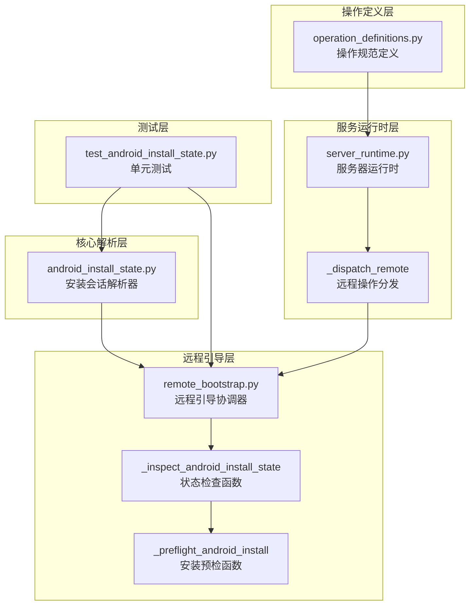
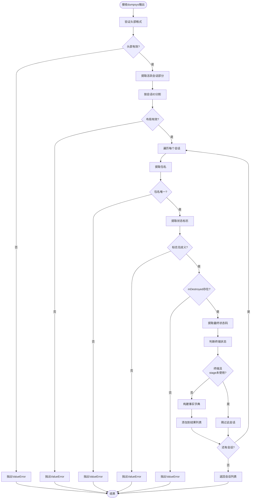
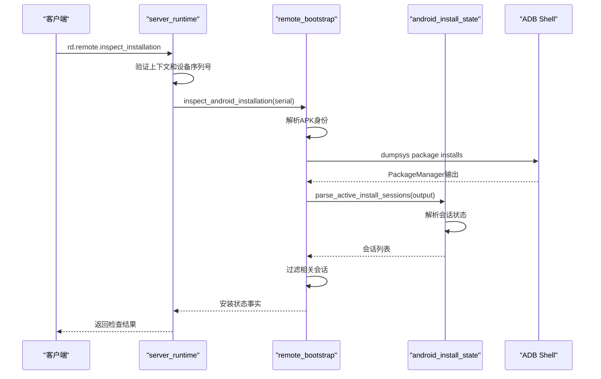
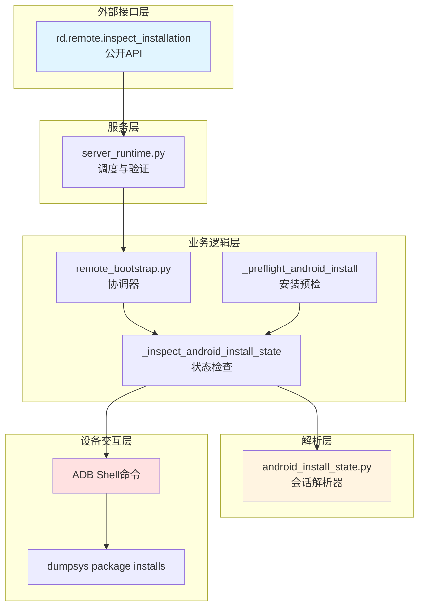
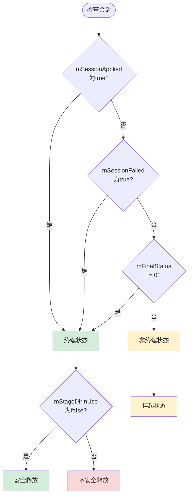
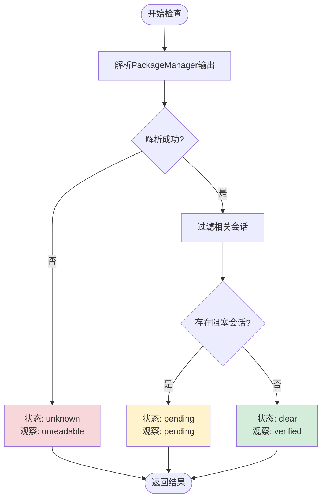
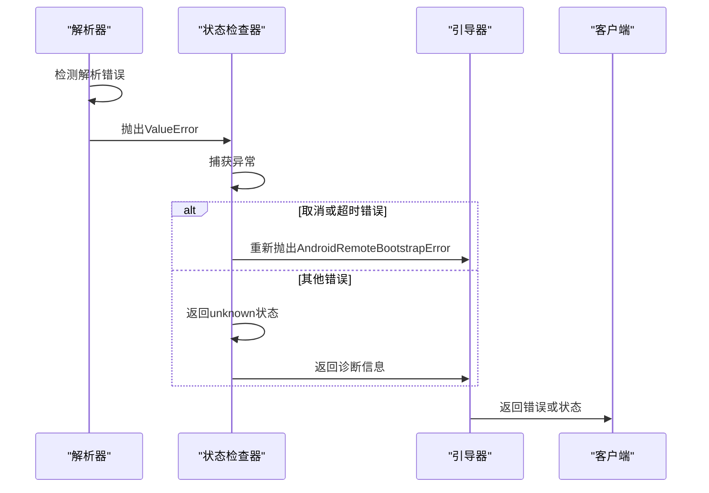
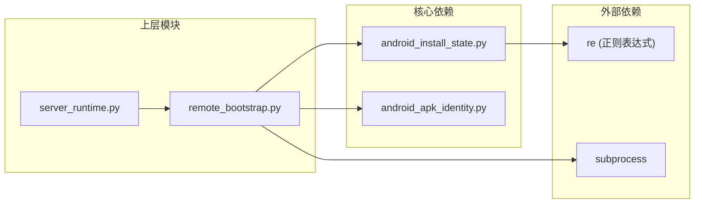
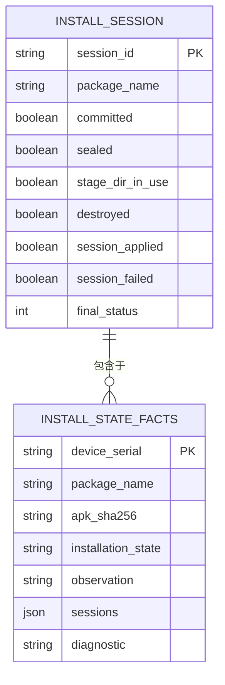

# Android安装状态管理

<cite>
**本文档引用的文件**
- [android_install_state.py](file://rdc_tool/android_install_state.py)
- [remote_bootstrap.py](file://rdc_tool/remote_bootstrap.py)
- [test_android_install_state.py](file://tests/test_android_install_state.py)
- [server_runtime.py](file://rdc_tool/server_runtime.py)
- [operation_definitions.py](file://rdc_tool/operation_definitions.py)
</cite>

## 目录

1. [简介](#简介)
2. [项目结构](#项目结构)
3. [核心组件](#核心组件)
4. [架构概览](#架构概览)
5. [详细组件分析](#详细组件分析)
6. [依赖分析](#依赖分析)
7. [性能考虑](#性能考虑)
8. [故障排除指南](#故障排除指南)
9. [结论](#结论)

## 简介

Android安装状态管理模块提供了一套只读解析机制，用于检测Android PackageManager活跃安装会话的状态。该模块通过解析`dumpsys package installs`命令输出，识别关键状态标志（如`mCommitted`、`mSealed`、`mStageDirInUse`、`mDestroyed`等），判断安装会话是否处于终端状态，并验证stage目录是否已安全释放，从而防止安装冲突。

该功能主要用于远程引导过程中的安装预检，确保在启动新的安装操作之前，没有与之冲突的挂起会话。这是一个纯只读操作，不会触发任何安装、卸载或修改设备状态的行为。

## 项目结构

**图表来源**
- [android_install_state.py:1-50](file://rdc_tool/android_install_state.py#L1-L50)
- [remote_bootstrap.py:23-350](file://rdc_tool/remote_bootstrap.py#L23-L350)
- [server_runtime.py:87-13173](file://rdc_tool/server_runtime.py#L87-L13173)
- [operation_definitions.py:2005-2014](file://rdc_tool/operation_definitions.py#L2005-L2014)
- [test_android_install_state.py:1-240](file://tests/test_android_install_state.py#L1-L240)

**章节来源**
- [android_install_state.py:1-50](file://rdc_tool/android_install_state.py#L1-L50)
- [remote_bootstrap.py:23-350](file://rdc_tool/remote_bootstrap.py#L23-L350)
- [server_runtime.py:87-13173](file://rdc_tool/server_runtime.py#L87-L13173)
- [operation_definitions.py:2005-2014](file://rdc_tool/operation_definitions.py#L2005-L2014)
- [test_android_install_state.py:1-240](file://tests/test_android_install_state.py#L1-L240)

## 核心组件

### 1. 安装会话解析器 (android_install_state.py)

这是整个系统的核心解析引擎，负责从PackageManager的输出中提取和验证安装会话信息。

#### 主要功能

**parse_active_install_sessions函数**：解析`dumpsys package installs`命令的输出，提取活跃安装会话的详细信息。

该函数执行以下关键步骤：

1. **头部验证**：确认输出以"Active install sessions:"开头
2. **会话分割**：使用正则表达式按"Active Session {ID}:"模式分割多个会话
3. **包名提取**：从每个会话块中提取`appPackageName`字段
4. **状态标志解析**：提取六个关键状态标志：
   - `mCommitted`：会话是否已提交
   - `mSealed`：会话是否已密封
   - `mStageDirInUse`：stage目录是否仍在使用中
   - `mDestroyed`：会话是否已销毁
   - `mSessionApplied`：会话是否已成功应用
   - `mSessionFailed`：会话是否已失败
5. **终端状态判断**：根据`mSessionApplied`、`mSessionFailed`和`mFinalStatus`判断会话是否处于终端状态
6. **安全性验证**：只有当会话处于终端状态且`mStageDirInUse`为false时，才认为stage目录已安全释放

#### 数据流图

**图表来源**
- [android_install_state.py:5-50](file://rdc_tool/android_install_state.py#L5-L50)

**章节来源**
- [android_install_state.py:1-50](file://rdc_tool/android_install_state.py#L1-L50)

### 2. 远程引导协调器 (remote_bootstrap.py)

该模块协调整个Android远程引导过程，包括安装状态检查和预检逻辑。

#### 关键函数

**_inspect_android_install_state函数**：执行实际的安装状态检查

该函数调用`parse_active_install_sessions`解析PackageManager输出，并根据解析结果确定安装状态：
- 如果存在与目标包名匹配或包名为null的阻塞会话，则状态为"pending"
- 否则状态为"clear"

**_preflight_android_install函数**：安装预检

在安装操作之前调用，等待所有挂起的安装完成或确认没有冲突的安装会话。

**inspect_android_installation函数**：公开的检查接口

提供一个只读的安装状态检查接口，不执行任何安装、卸载或修改操作。

#### 状态转换序列

**图表来源**
- [remote_bootstrap.py:256-273](file://rdc_tool/remote_bootstrap.py#L256-L273)
- [remote_bootstrap.py:802-820](file://rdc_tool/remote_bootstrap.py#L802-L820)
- [server_runtime.py:13163-13173](file://rdc_tool/server_runtime.py#L13163-L13173)

**章节来源**
- [remote_bootstrap.py:256-350](file://rdc_tool/remote_bootstrap.py#L256-L350)
- [remote_bootstrap.py:802-820](file://rdc_tool/remote_bootstrap.py#L802-L820)
- [server_runtime.py:13163-13173](file://rdc_tool/server_runtime.py#L13163-L13173)

## 架构概览

**图表来源**
- [operation_definitions.py:2005-2014](file://rdc_tool/operation_definitions.py#L2005-L2014)
- [server_runtime.py:13163-13173](file://rdc_tool/server_runtime.py#L13163-L13173)
- [remote_bootstrap.py:256-350](file://rdc_tool/remote_bootstrap.py#L256-L350)
- [android_install_state.py:5-50](file://rdc_tool/android_install_state.py#L5-L50)

## 详细组件分析

### 状态标志解析

安装会话包含多个关键状态标志，每个标志都有特定的含义：

| 状态标志 | 类型 | 含义 | 重要性 |
|---------|------|------|--------|
| mCommitted | boolean | 会话是否已提交到PackageManager | 高 |
| mSealed | boolean | 会话是否已密封（不可修改） | 高 |
| mStageDirInUse | boolean | stage目录是否仍在使用中 | 关键 |
| mDestroyed | boolean | 会话是否已销毁 | 关键 |
| mSessionApplied | boolean | 会话是否已成功应用 | 高 |
| mSessionFailed | boolean | 会话是否已失败 | 高 |
| mFinalStatus | integer | 最终状态码（0表示成功） | 中 |

#### 终端状态判断逻辑

**图表来源**
- [android_install_state.py:38-45](file://rdc_tool/android_install_state.py#L38-L45)

**章节来源**
- [android_install_state.py:1-50](file://rdc_tool/android_install_state.py#L1-L50)

### 安装状态分类

系统将会话分为三种状态：

1. **clear（清晰）**：没有相关的挂起安装会话，可以安全进行新安装
2. **pending（挂起）**：存在与目标包名匹配或包名为null的阻塞会话
3. **unknown（未知）**：无法读取或解析PackageManager状态

#### 状态决策流程

**图表来源**
- [remote_bootstrap.py:256-273](file://rdc_tool/remote_bootstrap.py#L256-L273)

**章节来源**
- [remote_bootstrap.py:256-273](file://rdc_tool/remote_bootstrap.py#L256-L273)

### 错误处理策略

系统采用严格的错误处理策略，确保在任何异常情况下都不会误判安装状态：

1. **头部缺失**：如果输出不以"Active install sessions:"开头，抛出ValueError
2. **布局未知**：如果无法正确分割会话，抛出ValueError
3. **包名重复**：如果检测到重复的会话ID，抛出ValueError
4. **包名不明确**：如果找到零个或多个包名，抛出ValueError
5. **状态标志歧义**：如果同一个标志出现多次，抛出ValueError
6. **生命周期未知**：如果缺少mDestroyed标志，抛出ValueError

#### 错误传播链

**图表来源**
- [android_install_state.py:8-40](file://rdc_tool/android_install_state.py#L8-L40)
- [remote_bootstrap.py:256-268](file://rdc_tool/remote_bootstrap.py#L256-L268)

**章节来源**
- [android_install_state.py:1-50](file://rdc_tool/android_install_state.py#L1-L50)
- [remote_bootstrap.py:256-273](file://rdc_tool/remote_bootstrap.py#L256-L273)

## 依赖分析

### 模块依赖关系

**图表来源**
- [android_install_state.py:1-5](file://rdc_tool/android_install_state.py#L1-L5)
- [remote_bootstrap.py:1-30](file://rdc_tool/remote_bootstrap.py#L1-L30)
- [server_runtime.py:82-92](file://rdc_tool/server_runtime.py#L82-L92)

**章节来源**
- [android_install_state.py:1-5](file://rdc_tool/android_install_state.py#L1-L5)
- [remote_bootstrap.py:1-30](file://rdc_tool/remote_bootstrap.py#L1-L30)
- [server_runtime.py:82-92](file://rdc_tool/server_runtime.py#L82-L92)

### 数据模型

**章节来源**
- [android_install_state.py:42-49](file://rdc_tool/android_install_state.py#L42-L49)
- [remote_bootstrap.py:256-273](file://rdc_tool/remote_bootstrap.py#L256-L273)

## 性能考虑

### 超时策略

系统实现了多层超时控制：

1. **ADB命令超时**：默认15秒用于dumpsys命令
2. **连接预算超时**：基于DEFAULT_ANDROID_TIMEOUT_MS（默认120秒）
3. **安装验证超时**：在等待安装完成时使用动态剩余时间计算

### 优化建议

1. **缓存解析结果**：对于频繁检查同一设备的场景，可以考虑短期缓存
2. **并行会话处理**：当前实现串行处理会话，可以考虑并行化以提高性能
3. **增量解析**：对于大型输出，可以实现流式解析而非一次性加载

**章节来源**
- [remote_bootstrap.py:258-260](file://rdc_tool/remote_bootstrap.py#L258-L260)
- [remote_bootstrap.py:275-305](file://rdc_tool/remote_bootstrap.py#L275-L305)

## 故障排除指南

### 常见问题

#### 1. PackageManager输出格式未知

**症状**：抛出"PackageManager active session layout is unknown"错误

**原因**：
- Android版本差异导致输出格式变化
- 设备厂商自定义PackageManager实现

**解决方案**：
- 检查设备Android版本兼容性
- 验证dumpsys命令输出格式
- 更新解析器以支持新格式

#### 2. 会话状态不明确

**症状**：抛出"PackageManager session state is ambiguous"错误

**原因**：
- 同一个状态标志在输出中出现多次
- PackageManager内部状态不一致

**解决方案**：
- 重启设备以清除不一致状态
- 检查是否有多个安装进程同时运行
- 手动清理挂起的安装会话

#### 3. 安装状态无法读取

**症状**：返回installation_state为"unknown"，observation为"unreadable"

**原因**：
- ADB权限不足
- 设备离线或无响应
- dumpsys命令执行失败

**解决方案**：
- 验证ADB连接状态
- 检查设备权限配置
- 尝试重新启动ADB服务器

### 调试技巧

1. **启用详细日志**：检查完整的dumpsys输出以了解解析失败的原因
2. **手动执行命令**：直接在设备上运行`adb shell dumpsys package installs`查看原始输出
3. **验证会话ID**：确保会话ID格式符合预期（纯数字）
4. **检查包名格式**：验证包名是否符合Android包命名规范

**章节来源**
- [android_install_state.py:8-40](file://rdc_tool/android_install_state.py#L8-L40)
- [remote_bootstrap.py:256-268](file://rdc_tool/remote_bootstrap.py#L256-L268)
- [test_android_install_state.py:30-50](file://tests/test_android_install_state.py#L30-L50)

## 结论

Android安装状态管理模块提供了一套健壮、安全的只读解析机制，用于检测和管理Android PackageManager的活跃安装会话。通过严格的状态标志解析和终端状态判断，系统能够有效防止安装冲突，确保远程引导过程的可靠性。

### 关键特性

1. **只读操作**：不修改任何设备状态，仅提供观察能力
2. **严格验证**：多重验证确保解析结果的准确性
3. **错误隔离**：清晰的错误分类和传播机制
4. **终端状态识别**：准确判断会话是否可以安全释放
5. **上下文绑定**：需要在守护进程上下文中执行，确保操作的安全性

### 应用场景

- 远程设备安装前的预检
- 安装冲突检测和处理
- 设备状态监控和诊断
- 自动化测试中的安装验证

该模块是整个Android远程引导系统的重要组成部分，为后续的安装、连接和操作提供了可靠的状态基础。