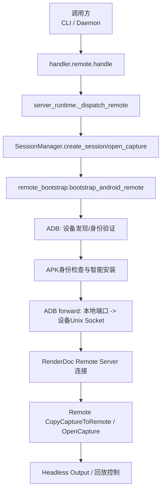
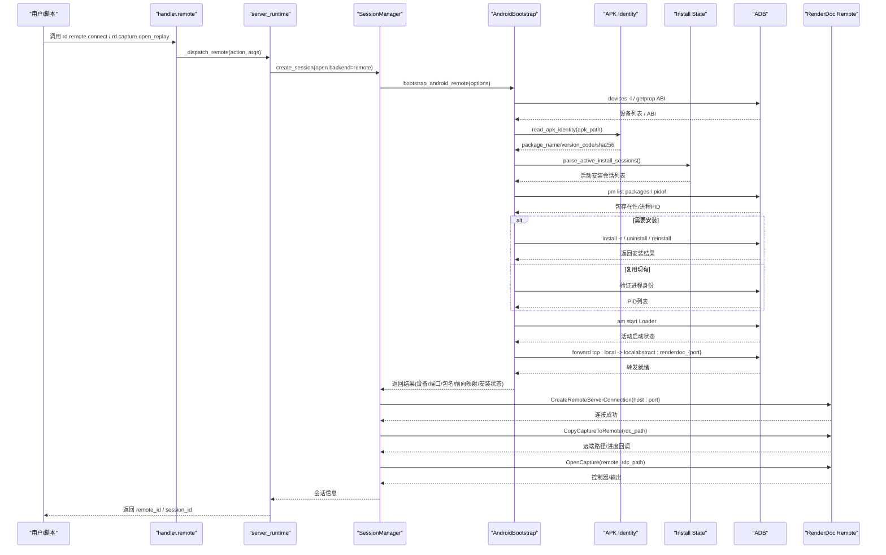
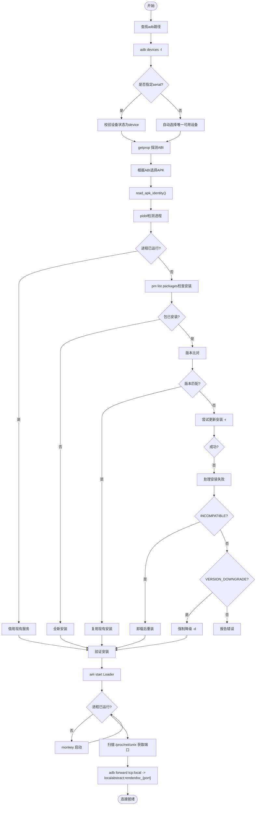
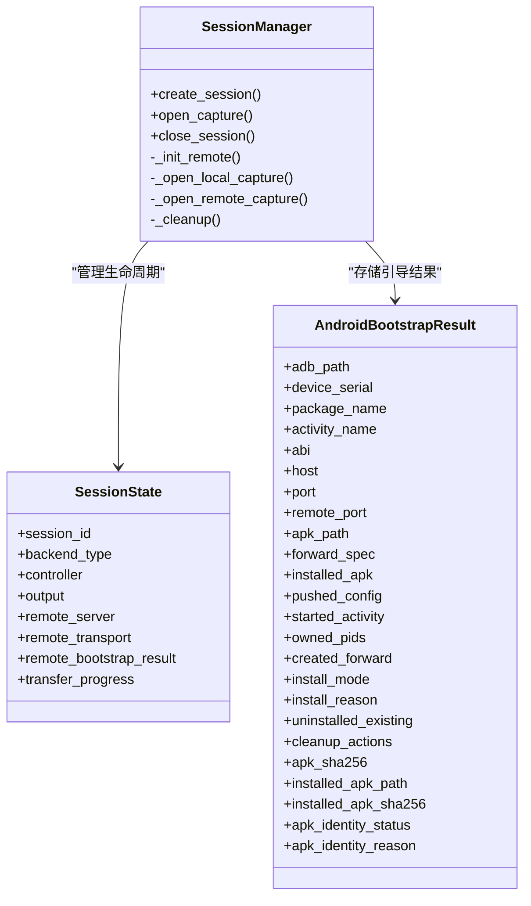
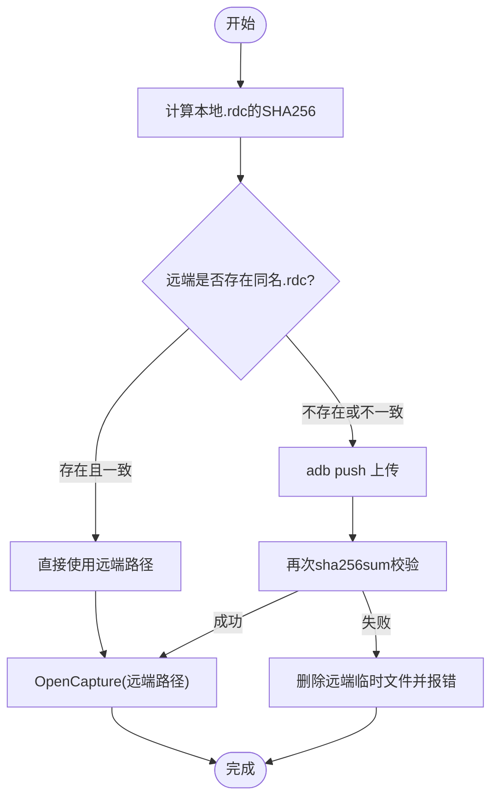
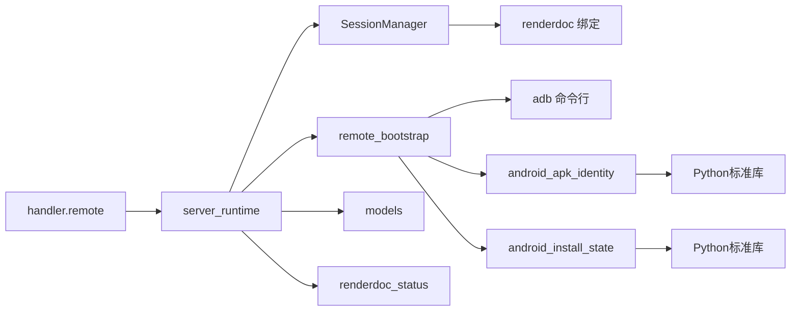

# 远程处理器

<cite>
**本文引用的文件**
- [remote.py](file://rdc_tool/handlers/remote.py)
- [remote_bootstrap.py](file://rdc_tool/remote_bootstrap.py)
- [capture.py](file://rdc_tool/handlers/capture.py)
- [session_manager.py](file://rdc_tool/core/session_manager.py)
- [server_runtime.py](file://rdc_tool/server_runtime.py)
- [models.py](file://rdc_tool/models.py)
- [renderdoc_status.py](file://rdc_tool/core/renderdoc_status.py)
- [android_apk_identity.py](file://rdc_tool/android_apk_identity.py)
- [android_install_state.py](file://rdc_tool/android_install_state.py)
- [android-remote-cli-smoke-prompt.md](file://docs/android-remote-cli-smoke-prompt.md)
</cite>

## 更新摘要
**变更内容**
- **新增自动化APK安装/覆盖/替换机制**：引入智能安装策略，自动处理签名冲突、版本降级和安装包不兼容问题
- **引入结构化安装收据跟踪**：通过`AndroidBootstrapResult`数据类记录完整的安装生命周期状态
- **区分借用服务/忙碌状态/未知所有权边界/确认安装事实**：精确识别已运行进程并复用，避免不必要的重启
- **消除手动桌面修复依赖**：集成`android_apk_identity`和`android_install_state`模块实现精确身份验证
- **增强连接预算管理**：所有安装操作均受统一超时控制，支持取消信号传播
- **新增APK身份验证机制**：基于SHA256哈希的精确包身份比对，确保安装一致性

## 目录
1. [简介](#简介)
2. [项目结构](#项目结构)
3. [核心组件](#核心组件)
4. [架构总览](#架构总览)
5. [详细组件分析](#详细组件分析)
6. [依赖关系分析](#依赖关系分析)
7. [性能与网络优化](#性能与网络优化)
8. [安全考虑](#安全考虑)
9. [故障排查指南](#故障排查指南)
10. [结论](#结论)
11. [附录：示例工作流](#附录示例工作流)

## 简介
本文件系统性介绍 RDC-Tool 的"远程处理器"实现，重点覆盖：
- Android 设备连接机制：设备发现、连接建立、通信协议（ADB + RenderDoc 远程服务）。
- 远程捕获控制：启动、停止与管理远程设备的捕获会话。
- 数据传输机制：捕获文件的上传/下载、进度监控与错误重试策略。
- 网络通信优化、安全性与跨平台兼容性处理。
- 具体示例：远程调试、设备管理与分布式分析工作流的搭建。
- **新增**：自动化APK安装管理机制，包括身份验证、状态跟踪和智能修复。

## 项目结构
围绕远程能力的关键代码分布在以下模块：
- 远端入口与分发：handlers/remote.py、handlers/capture.py
- Android 引导与连接：remote_bootstrap.py
- APK身份验证：android_apk_identity.py、android_install_state.py
- 会话与回放管理：core/session_manager.py
- 运行时服务与工具注册：server_runtime.py
- 数据模型与枚举：models.py
- RenderDoc 状态封装：core/renderdoc_status.py
- Android 远程 CLI 冒烟流程说明：docs/android-remote-cli-smoke-prompt.md

图表来源
- [remote.py:8-9](file://rdc_tool/handlers/remote.py#L8-L9)
- [server_runtime.py:137-162](file://rdc_tool/server_runtime.py#L137-L162)
- [session_manager.py:175-206](file://rdc_tool/core/session_manager.py#L175-L206)
- [remote_bootstrap.py:820-870](file://rdc_tool/remote_bootstrap.py#L820-L870)

章节来源
- [remote.py:1-11](file://rdc_tool/handlers/remote.py#L1-L11)
- [capture.py:1-11](file://rdc_tool/handlers/capture.py#L1-L11)
- [remote_bootstrap.py:1-1199](file://rdc_tool/remote_bootstrap.py#L1-L1199)
- [android_apk_identity.py:1-77](file://rdc_tool/android_apk_identity.py#L1-L77)
- [android_install_state.py:1-50](file://rdc_tool/android_install_state.py#L1-L50)
- [session_manager.py:1-569](file://rdc_tool/core/session_manager.py#L1-L569)
- [server_runtime.py:1-800](file://rdc_tool/server_runtime.py#L1-L800)
- [models.py:1-584](file://rdc_tool/models.py#L1-L584)
- [renderdoc_status.py:1-105](file://rdc_tool/core/renderdoc_status.py#L1-L105)
- [android-remote-cli-smoke-prompt.md:1-49](file://docs/android-remote-cli-smoke-prompt.md#L1-L49)

## 核心组件
- **远端处理器入口**：将 action 转发到 server_runtime 的远程分发器。
- **Android 引导器**：负责 adb 路径解析、设备发现、ABI 探测、APK 安装/升级、Activity 启动、Unix Socket 探测、ADB forward 建立。
- **APK身份验证模块**：从APK文件中直接读取包名、版本代码和SHA256哈希，无需外部工具。
- **安装状态跟踪模块**：解析PackageManager活动安装会话，区分待处理、已完成和活跃状态。
- **会话管理器**：统一创建本地/远程会话、打开捕获、复制捕获到远端、打开远端回放、清理资源。
- **运行时服务**：维护远程句柄、上下文、配置、进度上报、工具注册与调度。
- **数据模型**：后端类型、图形 API、会话能力等结构化定义。
- **RenderDoc 状态封装**：统一判断成功/失败并生成可诊断的错误详情。

章节来源
- [remote.py:8-9](file://rdc_tool/handlers/remote.py#L8-L9)
- [remote_bootstrap.py:133-167](file://rdc_tool/remote_bootstrap.py#L133-L167)
- [remote_bootstrap.py:294-339](file://rdc_tool/remote_bootstrap.py#L294-L339)
- [remote_bootstrap.py:495-698](file://rdc_tool/remote_bootstrap.py#L495-L698)
- [android_apk_identity.py:15-77](file://rdc_tool/android_apk_identity.py#L15-L77)
- [android_install_state.py:5-50](file://rdc_tool/android_install_state.py#L5-L50)
- [session_manager.py:175-206](file://rdc_tool/core/session_manager.py#L175-L206)
- [session_manager.py:373-440](file://rdc_tool/core/session_manager.py#L373-L440)
- [models.py:28-39](file://rdc_tool/models.py#L28-L39)
- [renderdoc_status.py:10-34](file://rdc_tool/core/renderdoc_status.py#L10-L34)

## 架构总览
远程处理器通过"处理器->运行时->会话->Android引导->ADB/RenderDoc"的分层协作完成端到端能力。

图表来源
- [remote.py:8-9](file://rdc_tool/handlers/remote.py#L8-L9)
- [server_runtime.py:137-162](file://rdc_tool/server_runtime.py#L137-L162)
- [session_manager.py:175-206](file://rdc_tool/core/session_manager.py#L175-L206)
- [session_manager.py:373-440](file://rdc_tool/core/session_manager.py#L373-L440)
- [remote_bootstrap.py:820-870](file://rdc_tool/remote_bootstrap.py#L820-L870)
- [android_apk_identity.py:15-77](file://rdc_tool/android_apk_identity.py#L15-L77)
- [android_install_state.py:5-50](file://rdc_tool/android_install_state.py#L5-L50)

## 详细组件分析

### Android 设备连接机制
- **设备发现**：通过 `adb devices -l` 解析设备序列号与状态；支持多设备时要求显式指定 `device_serial`。
- **ABI 探测**：依次查询 `ro.product.cpu.abilist64` / `ro.product.cpu.abilist` / `ro.product.cpu.abi`，选择 arm64 或 arm32 对应 APK。
- **APK身份验证**：使用 `android_apk_identity.read_apk_identity()` 直接从APK文件读取包名、版本代码和SHA256哈希，无需外部工具依赖。
- **安装状态检查**：通过 `android_install_state.parse_active_install_sessions()` 解析PackageManager的活动安装会话，区分待处理、已完成和活跃状态。
- **智能安装策略**：
  - **首次安装**：若包不存在，执行 `install -g --force-queryable`
  - **更新安装**：若版本不匹配，尝试 `install -r`（保留数据）
  - **强制替换**：遇到 `INSTALL_FAILED_UPDATE_INCOMPATIBLE` 时，先卸载再重装
  - **版本降级**：遇到 `INSTALL_FAILED_VERSION_DOWNGRADE` 时，添加 `-d` 标志重试
- **Activity 启动**：使用 `am start -W -n` 启动 Loader 活动，参数注入 `renderdoccmd remoteserver`；若失败则回退 monkey 启动。
- **进程借用检测**：通过 `pidof` 检测是否已有RenderDocCmd进程运行，若存在则复用而非重复安装/启动。
- **Unix Socket 探测**：读取 `/proc/net/unix`，匹配 `@renderdoc_{port}` 正则，确定远程服务监听端口。
- **ADB Forward**：将本地 TCP 端口转发到设备上的 `localabstract:renderdoc_{port}`，形成本地可达的渲染回放通道。
- **超时与取消**：`ConnectionBudget` 提供统一截止时间与取消信号，所有子步骤均受其约束。

图表来源
- [remote_bootstrap.py:133-167](file://rdc_tool/remote_bootstrap.py#L133-L167)
- [remote_bootstrap.py:294-339](file://rdc_tool/remote_bootstrap.py#L294-L339)
- [remote_bootstrap.py:341-372](file://rdc_tool/remote_bootstrap.py#L341-L372)
- [remote_bootstrap.py:401-423](file://rdc_tool/remote_bootstrap.py#L401-L423)
- [remote_bootstrap.py:425-449](file://rdc_tool/remote_bootstrap.py#L425-L449)
- [remote_bootstrap.py:451-492](file://rdc_tool/remote_bootstrap.py#L451-L492)
- [remote_bootstrap.py:599-698](file://rdc_tool/remote_bootstrap.py#L599-L698)
- [android_apk_identity.py:15-77](file://rdc_tool/android_apk_identity.py#L15-L77)
- [android_install_state.py:5-50](file://rdc_tool/android_install_state.py#L5-L50)

章节来源
- [remote_bootstrap.py:133-167](file://rdc_tool/remote_bootstrap.py#L133-L167)
- [remote_bootstrap.py:294-339](file://rdc_tool/remote_bootstrap.py#L294-L339)
- [remote_bootstrap.py:401-423](file://rdc_tool/remote_bootstrap.py#L401-L423)
- [remote_bootstrap.py:451-492](file://rdc_tool/remote_bootstrap.py#L451-L492)
- [remote_bootstrap.py:599-698](file://rdc_tool/remote_bootstrap.py#L599-L698)
- [android_apk_identity.py:15-77](file://rdc_tool/android_apk_identity.py#L15-L77)
- [android_install_state.py:5-50](file://rdc_tool/android_install_state.py#L5-L50)

### 自动化APK安装与身份验证

#### APK身份读取机制
`android_apk_identity.read_apk_identity()` 函数直接从APK文件中提取关键身份信息，无需依赖外部工具如 `aapt` 或 `apkanalyzer`：

- **SHA256哈希计算**：对整个APK文件进行哈希，用于精确比对
- **二进制XML解析**：直接解析 `AndroidManifest.xml` 的二进制格式
- **关键字段提取**：包名（package）、版本代码（versionCode）、版本名称（versionName）
- **轻量级实现**：仅使用Python标准库（zipfile、struct、hashlib），无第三方依赖

章节来源
- [android_apk_identity.py:15-77](file://rdc_tool/android_apk_identity.py#L15-L77)

#### 安装状态跟踪
`android_install_state.parse_active_install_sessions()` 函数解析 `dumpsys package installs` 输出，识别活跃的PackageManager会话：

- **会话分类**：区分Active、Finalized、Historical和Legacy会话
- **状态标志**：检查 `mCommitted`、`mSealed`、`mStageDirInUse`、`mDestroyed` 等标志
- **终端状态判断**：结合 `mSessionApplied`、`mSessionFailed` 和 `mFinalStatus` 判断会话是否完成
- **阻塞检测**：识别可能阻止新安装的活跃会话

章节来源
- [android_install_state.py:5-50](file://rdc_tool/android_install_state.py#L5-L50)

#### 智能安装策略
`_ensure_android_helper_installed()` 函数实现了多层安装决策逻辑：

1. **包存在性检查**：通过 `pm list packages` 确认包是否已安装
2. **版本比对**：若指定了 `expected_version`，比对已安装版本与目标版本
3. **身份验证**：使用 `_helper_snapshot()` 读取已安装包的完整身份信息
4. **条件更新**：仅在版本不匹配时触发更新，避免不必要的重装
5. **错误恢复**：
   - `INSTALL_FAILED_UPDATE_INCOMPATIBLE`：卸载后重装
   - `INSTALL_FAILED_VERSION_DOWNGRADE`：添加 `-d` 标志强制降级
   - 其他错误：直接抛出异常，由上层决定重试策略

章节来源
- [remote_bootstrap.py:375-449](file://rdc_tool/remote_bootstrap.py#L375-L449)

#### 进程借用与服务复用
系统优先检测并复用已运行的RenderDocCmd进程，避免不必要的重启：

- **PID检测**：通过 `pidof` 命令获取进程ID列表
- **身份比对**：比对当前PID与之前记录的PID，防止误用其他进程
- **所有权跟踪**：在 `AndroidBootstrapResult.owned_pids` 中记录借用的进程ID
- **清理保护**：清理时验证PID未变化，防止误杀其他进程

章节来源
- [remote_bootstrap.py:650-680](file://rdc_tool/remote_bootstrap.py#L650-L680)
- [remote_bootstrap.py:1100-1140](file://rdc_tool/remote_bootstrap.py#L1100-L1140)

### 远程捕获控制功能
- **会话创建**：根据后端类型区分本地/远程；远程会话会记录 remote_host/port、transport、bootstrap 信息等。
- **打开捕获**：
  - 本地：直接打开 .rdc 文件并创建 headless 输出。
  - 远程：先复制捕获到远端（或直接使用远端路径），再打开回放。
- **关闭会话**：按顺序关闭输出、控制器、捕获文件、远端连接；必要时关闭本地回放子系统。

图表来源
- [session_manager.py:118-140](file://rdc_tool/core/session_manager.py#L118-L140)
- [session_manager.py:175-206](file://rdc_tool/core/session_manager.py#L175-L206)
- [session_manager.py:208-251](file://rdc_tool/core/session_manager.py#L208-L251)
- [session_manager.py:309-345](file://rdc_tool/core/session_manager.py#L309-L345)
- [session_manager.py:347-382](file://rdc_tool/core/session_manager.py#L347-L382)
- [session_manager.py:517-569](file://rdc_tool/core/session_manager.py#L517-L569)
- [remote_bootstrap.py:110-132](file://rdc_tool/remote_bootstrap.py#L110-L132)

章节来源
- [session_manager.py:175-206](file://rdc_tool/core/session_manager.py#L175-L206)
- [session_manager.py:208-251](file://rdc_tool/core/session_manager.py#L208-L251)
- [session_manager.py:309-345](file://rdc_tool/core/session_manager.py#L309-L345)
- [session_manager.py:347-382](file://rdc_tool/core/session_manager.py#L347-L382)
- [session_manager.py:517-569](file://rdc_tool/core/session_manager.py#L517-L569)

### 数据传输机制（上传/下载、进度、重试）
- **上传到远端**：
  - 非 ADB Android 传输：调用远端服务的 CopyCaptureToRemote，并通过回调报告进度 fraction。
  - ADB Android 传输：计算本地文件 SHA256，以哈希命名远端文件；若存在且一致则复用；否则 push 并再次校验；失败时清理已创建的远端文件。
- **下载/导出**：由上层工具通过回放输出或导出接口获取图像/事件数据；此处聚焦捕获文件传输。
- **进度监控**：通过 transfer_progress 回调上报 capture_transfer_started / capture_transfer_progress / capture_transfer_done。
- **错误重试**：
  - ADB push 失败会触发清理并抛出异常，调用方可据此重试。
  - 远端 CopyCaptureToRemote 失败会构造包含 copy_error 的结构化错误，便于上层识别与重试。

图表来源
- [session_manager.py:384-440](file://rdc_tool/core/session_manager.py#L384-L440)
- [session_manager.py:442-507](file://rdc_tool/core/session_manager.py#L442-L507)

章节来源
- [session_manager.py:384-440](file://rdc_tool/core/session_manager.py#L384-L440)
- [session_manager.py:442-507](file://rdc_tool/core/session_manager.py#L442-L507)

### 网络通信优化
- **连接预算与超时**：`ConnectionBudget` 限制整个连接过程的耗时，避免长时间阻塞。
- **端口复用与冲突规避**：优先使用请求端口，否则从新出现的 socket 列表中推断；避免重复绑定。
- **进程/服务借用**：若检测到已有 RenderDocCmd 进程，则复用而非重复安装/启动，减少开销。
- **头窗口无头输出**：创建固定分辨率的 headless 输出，避免 GUI 依赖，提升稳定性。
- **批量操作与最小化往返**：在 ADB 操作中合并必要的 shell 命令，减少多次交互。
- **安装预检**：在安装前检查PackageManager活动会话，避免与正在进行的安装冲突。

章节来源
- [remote_bootstrap.py:37-58](file://rdc_tool/remote_bootstrap.py#L37-L58)
- [remote_bootstrap.py:476-492](file://rdc_tool/remote_bootstrap.py#L476-L492)
- [remote_bootstrap.py:521-543](file://rdc_tool/remote_bootstrap.py#L521-L543)
- [session_manager.py:509-515](file://rdc_tool/core/session_manager.py#L509-L515)
- [remote_bootstrap.py:260-292](file://rdc_tool/remote_bootstrap.py#L260-L292)

### 安全考虑
- **仅本地转发**：ADB forward 将本地端口映射到设备 Unix Socket，默认仅在本地环回地址暴露，降低外部访问风险。
- **权限与签名**：安装 APK 时使用 `-g` 授予必要权限；遇到签名不匹配时强制卸载后重装，避免混用不同签名应用。
- **输入校验**：对 host/port/device_serial/ABI 等进行严格校验与规范化，防止非法输入导致意外行为。
- **错误信息脱敏**：错误详情中不包含敏感路径或密钥，仅保留诊断所需的最小信息。
- **APK身份验证**：通过SHA256哈希精确验证APK完整性，防止中间人攻击或文件篡改。
- **进程所有权保护**：清理时验证PID未变化，防止误杀其他进程或恶意进程替换。

章节来源
- [remote_bootstrap.py:217-230](file://rdc_tool/remote_bootstrap.py#L217-L230)
- [remote_bootstrap.py:529-543](file://rdc_tool/remote_bootstrap.py#L529-L543)
- [remote_bootstrap.py:686-698](file://rdc_tool/remote_bootstrap.py#L686-L698)
- [android_apk_identity.py:15-77](file://rdc_tool/android_apk_identity.py#L15-L77)

### 跨平台兼容性处理
- **ADB 路径解析**：支持环境变量 RDC_TOOL_ANDROID_ADB_PATH、ADB、ANDROID_SDK_ROOT、ANDROID_HOME、Windows LOCALAPPDATA 等多种来源。
- **ABI 兼容**：同时支持 arm32/arm64，并在缺失或未支持时报错提示。
- **文本编码**：subprocess 输出使用 utf-8 解码，errors="replace" 避免不可编码字符中断流程。
- **时间与时区**：使用 monotonic 时间进行超时控制，避免系统时钟变化影响。
- **Windows控制台隐藏**：在Windows上使用 `STARTUPINFO` 隐藏ADB进程的控制台窗口。

章节来源
- [remote_bootstrap.py:133-167](file://rdc_tool/remote_bootstrap.py#L133-L167)
- [remote_bootstrap.py:341-372](file://rdc_tool/remote_bootstrap.py#L341-L372)
- [remote_bootstrap.py:169-202](file://rdc_tool/remote_bootstrap.py#L169-L202)

## 依赖关系分析
- handler.remote 依赖 server_runtime 的远程分发。
- server_runtime 依赖 SessionManager、remote_bootstrap、models、renderdoc_status。
- SessionManager 依赖 RenderDoc Python 绑定（renderdoc 模块）与 ADB 子进程。
- remote_bootstrap 依赖 ADB 命令行工具、Android 系统属性、android_apk_identity 和 android_install_state。
- android_apk_identity 仅依赖Python标准库（zipfile、struct、hashlib），无第三方依赖。
- android_install_state 仅依赖Python标准库（re），无第三方依赖。

图表来源
- [remote.py:8-9](file://rdc_tool/handlers/remote.py#L8-L9)
- [server_runtime.py:73-82](file://rdc_tool/server_runtime.py#L73-L82)
- [session_manager.py:27-30](file://rdc_tool/core/session_manager.py#L27-L30)
- [remote_bootstrap.py:17-26](file://rdc_tool/remote_bootstrap.py#L17-L26)
- [android_apk_identity.py:1-10](file://rdc_tool/android_apk_identity.py#L1-L10)
- [android_install_state.py:1-5](file://rdc_tool/android_install_state.py#L1-L5)

章节来源
- [remote.py:8-9](file://rdc_tool/handlers/remote.py#L8-L9)
- [server_runtime.py:73-82](file://rdc_tool/server_runtime.py#L73-L82)
- [session_manager.py:27-30](file://rdc_tool/core/session_manager.py#L27-L30)
- [remote_bootstrap.py:17-26](file://rdc_tool/remote_bootstrap.py#L17-L26)
- [android_apk_identity.py:1-10](file://rdc_tool/android_apk_identity.py#L1-L10)
- [android_install_state.py:1-5](file://rdc_tool/android_install_state.py#L1-L5)

## 性能与网络优化
- **连接预算**：统一超时与取消，避免长尾任务拖垮整体流程。
- **复用现有服务**：检测并借用已运行的 RenderDocCmd，减少安装/启动成本。
- **捕获缓存**：基于 SHA256 的远端缓存，避免重复上传相同文件。
- **无头输出**：固定分辨率的 headless 输出，减少 GUI 开销。
- **最小化 ADB 调用**：合并必要的 shell 命令，减少往返次数。
- **安装预检**：在安装前检查PackageManager状态，避免与活跃会话冲突导致的等待超时。
- **身份快速比对**：使用SHA256哈希快速判断APK是否需要更新，避免不必要的安装操作。

[本节为通用指导，不直接分析具体文件]

## 安全考虑
- **本地转发**：仅通过 localhost 暴露本地端口，降低暴露面。
- **权限与签名**：安装时授予必要权限，处理签名冲突以避免安全风险。
- **输入校验**：严格校验 host/port/device_serial/ABI，防止注入或越权。
- **错误信息**：仅输出必要诊断信息，避免泄露敏感数据。
- **APK完整性验证**：通过SHA256哈希确保APK未被篡改。
- **进程所有权保护**：清理时验证PID一致性，防止误杀或恶意替换。

[本节为通用指导，不直接分析具体文件]

## 故障排查指南
- **常见错误分类**：
  - **ADB 不可用**：检查环境变量与 platform-tools 安装。
  - **设备未就绪**：确认设备状态为 device，或指定正确的 serial。
  - **ABI 不支持**：确认设备 ABI 为 arm32/arm64。
  - **APK 安装失败**：
    - `INSTALL_FAILED_UPDATE_INCOMPATIBLE`：签名不匹配，需卸载后重装
    - `INSTALL_FAILED_VERSION_DOWNGRADE`：版本降级，需添加 `-d` 标志
    - `INSTALL_FAILED_ALREADY_EXISTS`：包已存在但无法更新，需检查权限
  - **活动启动失败**：检查 activity 名称与参数，或使用 monkey 回退。
  - **Socket 未找到**：等待一段时间并重试，或检查是否有其他实例占用。
  - **捕获复制失败**：检查网络连通性、远端路径权限与磁盘空间。
  - **安装状态未知**：检查PackageManager是否返回有效输出，或设备是否处于特殊状态。
  - **APK身份无效**：检查APK文件是否损坏或不是有效的Android包。
- **诊断要点**：
  - 使用 `ConnectionBudget` 记录的剩余时间与取消状态定位超时点。
  - 查看 `cleanup_actions` 了解已执行的操作，辅助定位失败阶段。
  - 利用 `renderdoc_status` 中的 result_code/status_text 快速定位底层错误。
  - 检查 `AndroidBootstrapResult` 中的 `apk_identity_status` 和 `apk_identity_reason` 了解身份验证结果。
  - 查看 `install_mode` 和 `install_reason` 了解安装决策过程。
  - 检查 `owned_pids` 确认进程借用状态。

章节来源
- [remote_bootstrap.py:29-35](file://rdc_tool/remote_bootstrap.py#L29-L35)
- [remote_bootstrap.py:169-202](file://rdc_tool/remote_bootstrap.py#L169-L202)
- [remote_bootstrap.py:217-285](file://rdc_tool/remote_bootstrap.py#L217-L285)
- [remote_bootstrap.py:599-698](file://rdc_tool/remote_bootstrap.py#L599-L698)
- [renderdoc_status.py:57-105](file://rdc_tool/core/renderdoc_status.py#L57-L105)
- [remote_bootstrap.py:110-132](file://rdc_tool/remote_bootstrap.py#L110-L132)

## 结论
远程处理器通过清晰的层次化设计，将 Android 设备发现、连接建立、会话管理与数据传输解耦，结合严格的超时与错误处理，提供了稳定可靠的远程调试与分析能力。借助 ADB forward 与 RenderDoc 远程服务，可在本地无缝操控远端设备并进行捕获回放。通过捕获缓存、无头输出与连接预算等手段，系统在性能与可靠性之间取得平衡。

**重大改进**：新增的自动化APK安装机制通过精确的身份验证和智能安装策略，消除了手动桌面修复依赖，显著提升了远程连接的可靠性和用户体验。结构化安装收据跟踪使得安装过程完全可观测，便于问题诊断和自动化运维。

[本节为总结性内容，不直接分析具体文件]

## 附录：示例工作流
- **Android 远程冒烟流程（CLI）**：
  - 初始化与连接：`rdc-tool --json doctor`；`rdc-tool call rd.remote.connect --args-file ...`；`rdc-tool call rd.remote.ping --args-file ...`
  - 打开捕获与回放：`rdc-tool call rd.capture.open_file ...`；`rdc-tool call rd.capture.open_replay ...`
  - 上下文查询：`rdc-tool call rd.session.get_context`
- **注意事项**：
  - 对于 adb_android 传输，`options.transport` 应设置为 `"adb_android"`，可选 `device_serial`/`local_port`/`install_apk`/`push_config`。
  - 保持 `remote_id` 明确，避免远端回放回落到本地。
  - 观察远程显示能力边界：当前客户端无法确认 Android 屏幕呈现，需记录为 unsupported。
  - **新增**：可通过 `inspect_android_installation(device_serial)` 函数仅检查安装状态而不触发任何修改操作，适用于预检和诊断场景。
  - **新增**：`AndroidBootstrapResult` 中的 `apk_identity_status` 字段可用于确认APK是否与预期一致，值为 `"matched"` 表示完全匹配，`"different"` 表示不匹配，`"unavailable"` 表示无法验证。

章节来源
- [android-remote-cli-smoke-prompt.md:5-24](file://docs/android-remote-cli-smoke-prompt.md#L5-L24)
- [operation_definitions.py:1962-1975](file://rdc_tool/operation_definitions.py#L1962-L1975)
- [operation_definitions.py:2169-2189](file://rdc_tool/operation_definitions.py#L2169-L2189)
- [remote_bootstrap.py:810-830](file://rdc_tool/remote_bootstrap.py#L810-L830)
- [remote_bootstrap.py:1160-1199](file://rdc_tool/remote_bootstrap.py#L1160-L1199)