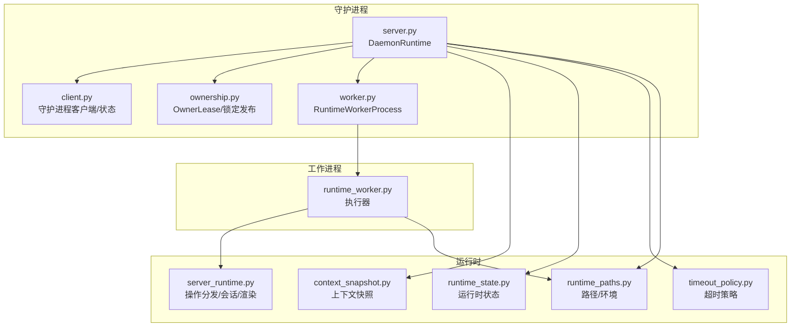
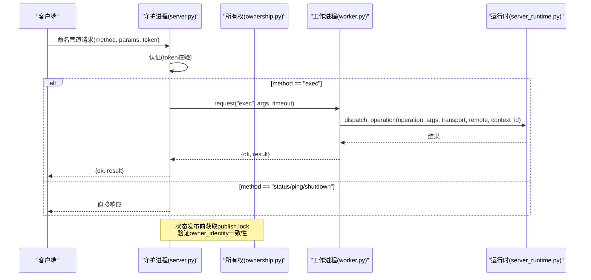
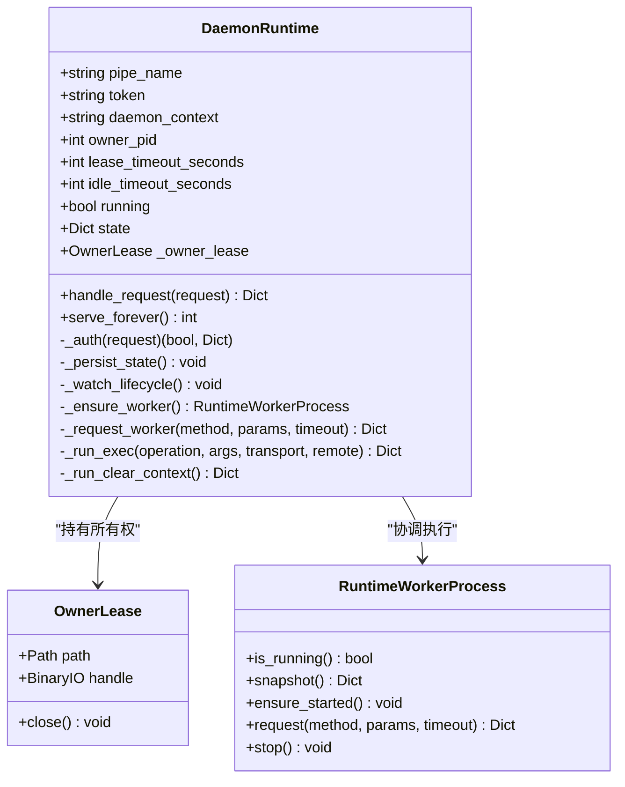
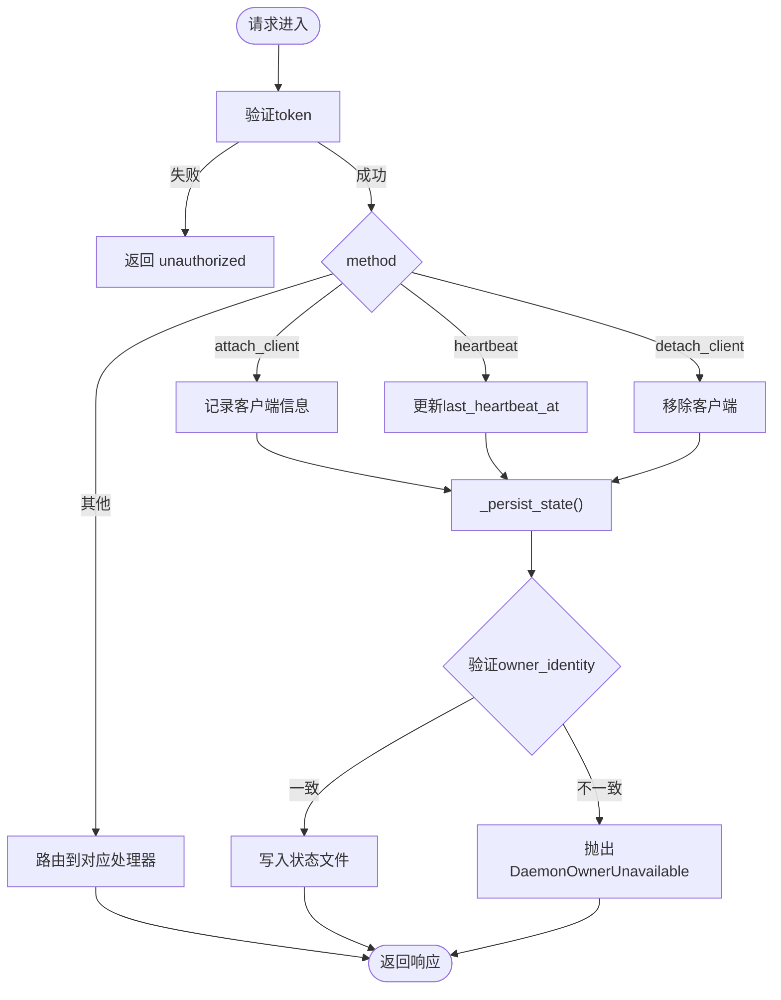
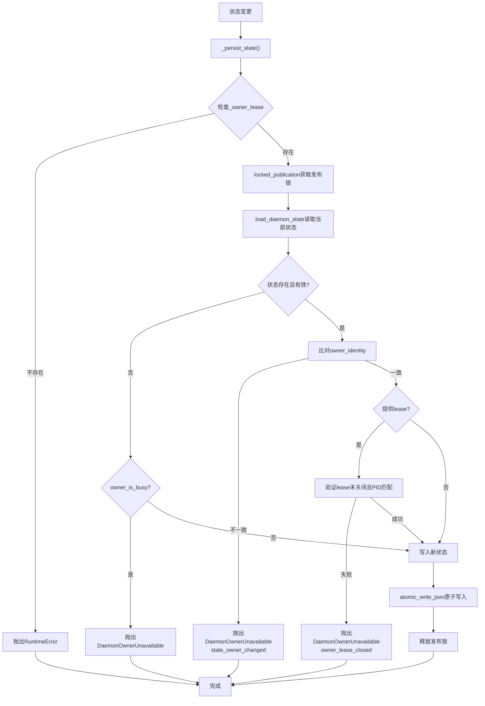
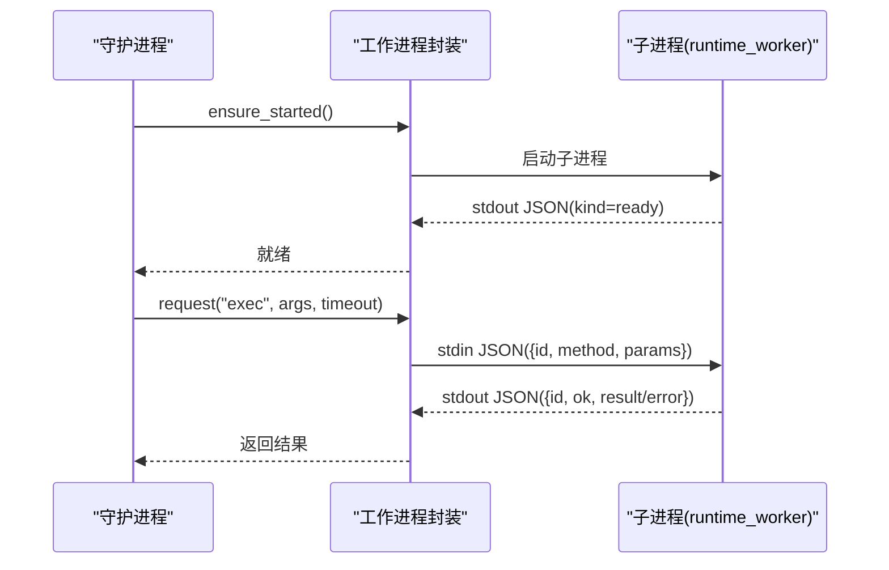
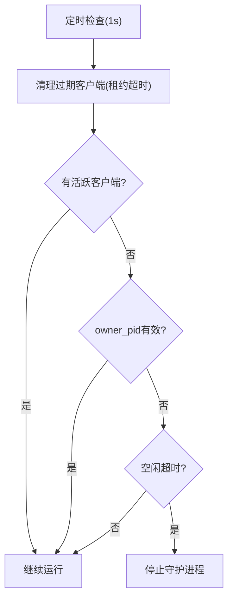
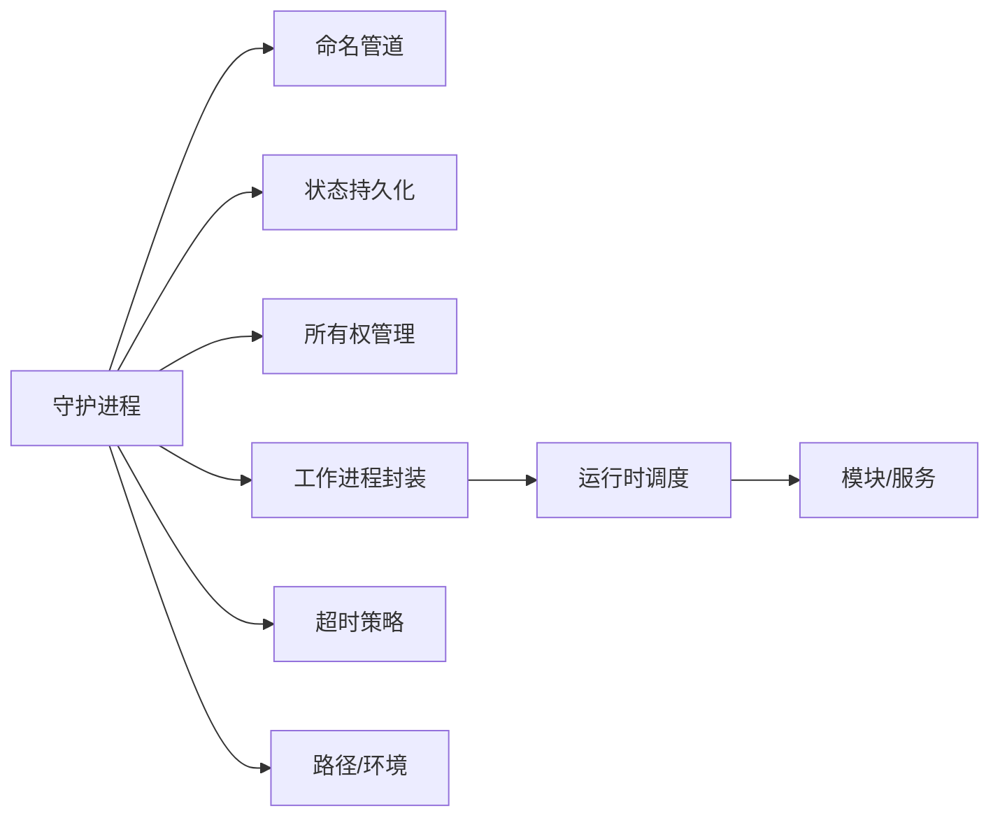

# 守护进程服务器

<cite>
**本文引用的文件**
- [rdc_tool/daemon/server.py](file://rdc_tool/daemon/server.py)
- [rdc_tool/daemon/client.py](file://rdc_tool/daemon/client.py)
- [rdc_tool/daemon/worker.py](file://rdc_tool/daemon/worker.py)
- [rdc_tool/daemon/ownership.py](file://rdc_tool/daemon/ownership.py)
- [rdc_tool/runtime_worker.py](file://rdc_tool/runtime_worker.py)
- [rdc_tool/context_snapshot.py](file://rdc_tool/context_snapshot.py)
- [rdc_tool/runtime_state.py](file://rdc_tool/runtime_state.py)
- [rdc_tool/timeout_policy.py](file://rdc_tool/timeout_policy.py)
- [rdc_tool/server_runtime.py](file://rdc_tool/server_runtime.py)
- [rdc_tool/runtime_paths.py](file://rdc_tool/runtime_paths.py)
</cite>

## 更新摘要
**变更内容**
- 状态发布现在是原子且序列化的，通过OwnerLease和locked_publication机制确保PID、管道名称和认证nonce必须标识同一所有者
- 延迟的客户端响应不再写入守护进程状态，避免覆盖更新的活跃心跳或其他代次数据
- 新增daemon_owner_unavailable错误码及恢复提示，用于处理所有者不可用场景
- 增强了状态一致性验证，在保存和清除状态时进行所有者身份比对

## 目录
1. [简介](#简介)
2. [项目结构](#项目结构)
3. [核心组件](#核心组件)
4. [架构总览](#架构总览)
5. [详细组件分析](#详细组件分析)
6. [依赖关系分析](#依赖关系分析)
7. [性能与超时控制](#性能与超时控制)
8. [故障排查指南](#故障排查指南)
9. [结论](#结论)
10. [附录：API方法参考](#附录api方法参考)

## 简介
本文件面向守护进程服务器的实现，重点解释基于Windows命名管道的服务机制、DaemonRuntime类的架构设计（监听、请求处理循环、生命周期管理）、认证与客户端连接管理、状态持久化（上下文快照保存与恢复）、工作进程管理（进程池创建、任务分发、资源清理）、超时控制策略（租约超时、空闲超时、所有者丢失检测），以及完整的API方法参考（ping、status、exec等）和错误处理与异常恢复机制。同时提供性能监控与调试工具的使用说明。

**更新** 守护进程实现了原子且序列化的状态发布机制，确保PID、管道名称和认证令牌三者必须标识同一所有者进程。延迟的客户端响应被过滤以避免覆盖最新状态，并引入了daemon_owner_unavailable错误码提供更明确的恢复指导。

## 项目结构
守护进程相关代码主要分布在以下模块：
- 守护进程服务端：rdc_tool/daemon/server.py
- 守护进程客户端与状态管理：rdc_tool/daemon/client.py
- 所有权管理与状态发布：rdc_tool/daemon/ownership.py
- 工作进程封装：rdc_tool/daemon/worker.py
- 工作进程实际执行器：rdc_tool/runtime_worker.py
- 上下文快照与运行时状态：rdc_tool/context_snapshot.py、rdc_tool/runtime_state.py
- 超时策略：rdc_tool/timeout_policy.py
- 运行时调度与服务：rdc_tool/server_runtime.py
- 路径与环境：rdc_tool/runtime_paths.py

图表来源
- [rdc_tool/daemon/server.py:102-741](file://rdc_tool/daemon/server.py#L102-L741)
- [rdc_tool/daemon/client.py:467-1115](file://rdc_tool/daemon/client.py#L467-L1115)
- [rdc_tool/daemon/ownership.py:1-98](file://rdc_tool/daemon/ownership.py#L1-L98)
- [rdc_tool/daemon/worker.py:24-203](file://rdc_tool/daemon/worker.py#L24-L203)
- [rdc_tool/runtime_worker.py:65-167](file://rdc_tool/runtime_worker.py#L65-L167)
- [rdc_tool/context_snapshot.py:214-475](file://rdc_tool/context_snapshot.py#L214-L475)
- [rdc_tool/runtime_state.py:388-416](file://rdc_tool/runtime_state.py#L388-L416)
- [rdc_tool/timeout_policy.py:56-104](file://rdc_tool/timeout_policy.py#L56-L104)
- [rdc_tool/runtime_paths.py:60-123](file://rdc_tool/runtime_paths.py#L60-L123)

章节来源
- [rdc_tool/daemon/server.py:102-741](file://rdc_tool/daemon/server.py#L102-L741)
- [rdc_tool/daemon/client.py:467-1115](file://rdc_tool/daemon/client.py#L467-L1115)
- [rdc_tool/daemon/ownership.py:1-98](file://rdc_tool/daemon/ownership.py#L1-L98)
- [rdc_tool/daemon/worker.py:24-203](file://rdc_tool/daemon/worker.py#L24-L203)
- [rdc_tool/runtime_worker.py:65-167](file://rdc_tool/runtime_worker.py#L65-L167)
- [rdc_tool/context_snapshot.py:214-475](file://rdc_tool/context_snapshot.py#L214-L475)
- [rdc_tool/runtime_state.py:388-416](file://rdc_tool/runtime_state.py#L388-L416)
- [rdc_tool/timeout_policy.py:56-104](file://rdc_tool/timeout_policy.py#L56-L104)
- [rdc_tool/runtime_paths.py:60-123](file://rdc_tool/runtime_paths.py#L60-L123)

## 核心组件
- DaemonRuntime：守护进程主类，负责命名管道监听、请求路由、认证、状态持久化、工作进程协调、生命周期监控。
- OwnerLease：进程级所有权租约，通过文件锁机制确保只有一个进程可以持有特定上下文的守护进程所有权。
- RuntimeWorkerProcess：工作进程封装，负责启动/停止子进程、请求转发、就绪等待、状态持久化。
- runtime_worker：工作进程执行器，接收JSON命令并调用server_runtime的dispatch_operation执行具体操作。
- context_snapshot/runtime_state：上下文快照与运行时状态的持久化与规范化，支持多上下文隔离。
- timeout_policy：按操作类型计算超时时间，区分重/极重操作。
- server_runtime：运行时调度中心，注册并分发各类操作，维护会话、捕获、远程连接等。

章节来源
- [rdc_tool/daemon/server.py:102-741](file://rdc_tool/daemon/server.py#L102-L741)
- [rdc_tool/daemon/ownership.py:1-98](file://rdc_tool/daemon/ownership.py#L1-L98)
- [rdc_tool/daemon/worker.py:24-203](file://rdc_tool/daemon/worker.py#L24-L203)
- [rdc_tool/runtime_worker.py:65-167](file://rdc_tool/runtime_worker.py#L65-L167)
- [rdc_tool/context_snapshot.py:214-475](file://rdc_tool/context_snapshot.py#L214-L475)
- [rdc_tool/runtime_state.py:388-416](file://rdc_tool/runtime_state.py#L388-L416)
- [rdc_tool/timeout_policy.py:56-104](file://rdc_tool/timeout_policy.py#L56-L104)
- [rdc_tool/server_runtime.py:1-120](file://rdc_tool/server_runtime.py#L1-L120)

## 架构总览
守护进程通过Windows命名管道对外暴露RPC接口，内部将"执行"类请求委派给独立的工作进程，工作进程使用异步事件循环执行具体操作，并通过stdout JSON流与守护进程通信。守护进程维护进程内状态、附加客户端列表、活动操作、租约与空闲超时，并在后台线程中监控生命周期。状态发布采用原子序列化机制，确保PID、管道名称和认证令牌的一致性。

图表来源
- [rdc_tool/daemon/server.py:572-643](file://rdc_tool/daemon/server.py#L572-L643)
- [rdc_tool/daemon/ownership.py:76-98](file://rdc_tool/daemon/ownership.py#L76-L98)
- [rdc_tool/daemon/worker.py:144-170](file://rdc_tool/daemon/worker.py#L144-L170)
- [rdc_tool/runtime_worker.py:97-155](file://rdc_tool/runtime_worker.py#L97-L155)
- [rdc_tool/server_runtime.py:1-120](file://rdc_tool/server_runtime.py#L1-L120)

## 详细组件分析

### DaemonRuntime 架构设计
- 命名管道监听：在serve_forever中创建AF_PIPE监听器，接受连接后为每个连接启动线程处理请求。
- 请求处理循环：handle_request统一解析method与params，进行token认证，然后分派到对应处理方法。
- 生命周期管理：_watch_lifecycle后台线程每1秒检查：
  - 清理过期客户端（基于心跳与租约超时）
  - 检测所有者丢失（owner_pid不存在且无活跃客户端且超过租约）
  - 空闲超时（无活跃请求且最后活动时间超过idle_timeout）
  - 满足任一条件则触发_stop()关闭监听、清理状态并退出。
- 状态持久化：每次关键状态变更调用_persist_state()写入daemon_state.json（或按上下文命名的文件），该过程受OwnerLease保护并使用locked_publication确保原子性。
- 工作进程协调：_ensure_worker确保RuntimeWorkerProcess存在并启动；_request_worker封装exec调用并处理异常重试。

**更新** 状态持久化现在要求守护进程必须先获取OwnerLease，并且在_save_daemon_state时通过locked_publication获取发布锁，验证当前状态的所有者身份（PID、管道名称、令牌三元组）与现有状态一致，防止并发写入导致的状态不一致。

图表来源
- [rdc_tool/daemon/server.py:102-741](file://rdc_tool/daemon/server.py#L102-L741)
- [rdc_tool/daemon/ownership.py:42-65](file://rdc_tool/daemon/ownership.py#L42-L65)
- [rdc_tool/daemon/worker.py:24-203](file://rdc_tool/daemon/worker.py#L24-L203)

章节来源
- [rdc_tool/daemon/server.py:102-741](file://rdc_tool/daemon/server.py#L102-L741)
- [rdc_tool/daemon/ownership.py:42-65](file://rdc_tool/daemon/ownership.py#L42-L65)
- [rdc_tool/daemon/worker.py:24-203](file://rdc_tool/daemon/worker.py#L24-L203)

### 认证机制与客户端连接管理
- 认证：所有请求必须携带token字段，服务端比对守护进程的token，不匹配返回unauthorized。
- 客户端附着：attach_client记录client_id、client_type、pid、attached_at、last_heartbeat_at、lease_timeout_seconds；heartbeat更新心跳；detach_client移除。
- 租约与心跳：_prune_clients_locked根据last_heartbeat_at与lease_timeout_seconds清理过期客户端；_watch_lifecycle结合owner_lost_should_stop决定是否停止守护进程。

**更新** 客户端响应的状态更新经过严格验证：_update_saved_state_from_response函数在从RPC响应提取状态前，会比对expected状态与normalized状态的所有者身份（通过owner_identity函数返回的PID、管道名称、令牌三元组）。如果检测到所有者变更，抛出DaemonOwnerUnavailable异常，防止延迟的响应覆盖最新的活跃状态。

图表来源
- [rdc_tool/daemon/server.py:166-176](file://rdc_tool/daemon/server.py#L166-L176)
- [rdc_tool/daemon/server.py:376-450](file://rdc_tool/daemon/server.py#L376-L450)
- [rdc_tool/daemon/server.py:532-570](file://rdc_tool/daemon/server.py#L532-L570)
- [rdc_tool/daemon/client.py:762-776](file://rdc_tool/daemon/client.py#L762-L776)
- [rdc_tool/daemon/ownership.py:91-98](file://rdc_tool/daemon/ownership.py#L91-L98)

章节来源
- [rdc_tool/daemon/server.py:166-176](file://rdc_tool/daemon/server.py#L166-L176)
- [rdc_tool/daemon/server.py:376-450](file://rdc_tool/daemon/server.py#L376-L450)
- [rdc_tool/daemon/server.py:532-570](file://rdc_tool/daemon/server.py#L532-L570)
- [rdc_tool/daemon/client.py:762-776](file://rdc_tool/daemon/client.py#L762-L776)
- [rdc_tool/daemon/ownership.py:91-98](file://rdc_tool/daemon/ownership.py#L91-L98)

### 状态持久化机制（上下文快照与恢复）
- 上下文快照：context_snapshot_path生成快照文件路径，load/save/clear提供原子读写与锁保护；normalize_context_snapshot规范化数据并保留最近产物。
- 运行时状态：runtime_state提供session/capture/recovery/preview/limits/metrics等结构化状态，支持加载、保存、清理与日志追加。
- 守护进程状态：daemon_state.json（或按上下文命名）保存pipe_name、token、pid、active_operation、attached_clients、worker信息等；_refresh_state_from_runtime_locked从runtime_state同步session/capture/后端等信息。

**更新** 状态持久化现在采用双重锁定机制：
1. **OwnerLease**：进程级所有权锁，确保只有一个守护进程实例可以持有特定上下文的所有权。该锁在守护进程启动时获取，在进程退出时释放。
2. **locked_publication**：发布锁，在每次写入状态文件前获取.publish.lock文件锁，确保状态写入的原子性和串行化。

save_daemon_state函数在写入前执行以下验证：
- 检查当前文件中的状态是否存在且有效
- 比对现有状态的所有者身份（PID、管道名称、令牌）与新状态是否一致
- 如果提供了OwnerLease，验证租约未关闭且PID匹配
- 只有通过所有验证才允许写入

clear_daemon_state函数同样执行所有者身份验证，防止误删其他进程的状态文件。

图表来源
- [rdc_tool/daemon/server.py:171-176](file://rdc_tool/daemon/server.py#L171-L176)
- [rdc_tool/daemon/client.py:356-379](file://rdc_tool/daemon/client.py#L356-L379)
- [rdc_tool/daemon/client.py:381-402](file://rdc_tool/daemon/client.py#L381-L402)
- [rdc_tool/daemon/ownership.py:76-98](file://rdc_tool/daemon/ownership.py#L76-L98)
- [rdc_tool/context_snapshot.py:447-475](file://rdc_tool/context_snapshot.py#L447-L475)
- [rdc_tool/runtime_state.py:388-416](file://rdc_tool/runtime_state.py#L388-L416)

章节来源
- [rdc_tool/daemon/server.py:171-176](file://rdc_tool/daemon/server.py#L171-L176)
- [rdc_tool/daemon/client.py:356-402](file://rdc_tool/daemon/client.py#L356-L402)
- [rdc_tool/daemon/ownership.py:76-98](file://rdc_tool/daemon/ownership.py#L76-L98)
- [rdc_tool/context_snapshot.py:447-475](file://rdc_tool/context_snapshot.py#L447-L475)
- [rdc_tool/runtime_state.py:388-416](file://rdc_tool/runtime_state.py#L388-L416)

### 工作进程管理（进程池、任务分发、资源清理）
- 进程创建：RuntimeWorkerProcess._spawn设置环境变量（RDC_TOOL_CONTEXT_ID、RDC_TOOL_DAEMON_PID、RDC_TOOL_RUNTIME_DLL_DIR、RDC_TOOL_RENDERDOC_PATH、RDC_TOOL_WORKER_SOURCE_MANIFEST），启动子进程执行rdc_tool.runtime_worker。
- 就绪等待：_await_ready读取子进程stdout JSON，等待kind=ready或startup_error。
- 任务分发：request序列化请求并写入stdin，阻塞等待队列中的响应（带超时）。
- 资源清理：stop尝试优雅shutdown，若失败则kill进程，关闭句柄并清除worker状态。

图表来源
- [rdc_tool/daemon/worker.py:69-143](file://rdc_tool/daemon/worker.py#L69-L143)
- [rdc_tool/daemon/worker.py:144-170](file://rdc_tool/daemon/worker.py#L144-L170)
- [rdc_tool/runtime_worker.py:65-167](file://rdc_tool/runtime_worker.py#L65-L167)

章节来源
- [rdc_tool/daemon/worker.py:69-170](file://rdc_tool/daemon/worker.py#L69-L170)
- [rdc_tool/runtime_worker.py:65-167](file://rdc_tool/runtime_worker.py#L65-L167)

### 超时控制策略（租约超时、空闲超时、所有者丢失检测）
- 租约超时：客户端心跳间隔超过lease_timeout_seconds视为失效，被_prune_clients_locked清理。
- 空闲超时：若无活跃请求且last_activity_at超过idle_timeout_seconds，守护进程自动停止。
- 所有者丢失：owner_lost_should_stop判断owner_pid是否存活、是否有活跃客户端、是否超过租约；若满足停止条件则停止守护进程。
- 操作超时：timeout_policy.operation_timeout_s根据operation前缀与参数计算超时；daemon_exec_timeout_s用于守护进程委派给工作进程的超时。

图表来源
- [rdc_tool/daemon/server.py:181-211](file://rdc_tool/daemon/server.py#L181-L211)
- [rdc_tool/daemon/server.py:532-570](file://rdc_tool/daemon/server.py#L532-L570)
- [rdc_tool/daemon/client.py:402-415](file://rdc_tool/daemon/client.py#L402-L415)
- [rdc_tool/timeout_policy.py:56-104](file://rdc_tool/timeout_policy.py#L56-L104)

章节来源
- [rdc_tool/daemon/server.py:181-211](file://rdc_tool/daemon/server.py#L181-L211)
- [rdc_tool/daemon/server.py:532-570](file://rdc_tool/daemon/server.py#L532-L570)
- [rdc_tool/daemon/client.py:402-415](file://rdc_tool/daemon/client.py#L402-L415)
- [rdc_tool/timeout_policy.py:56-104](file://rdc_tool/timeout_policy.py#L56-L104)

### API方法参考
- ping：返回pong与context_id，更新last_activity_at。
- status：返回running与state快照，包含attached_clients、active_operation、worker信息等。
- shutdown：停止守护进程，清理状态并退出。
- claim_owner：设置owner_pid（仅允许一次），用于进程绑定。
- attach_client/heartbeat/detach_client：管理客户端附着与心跳。
- set_state/get_state：同步/获取上下文快照相关状态。
- clear_context：释放上下文（优先通过工作进程clear_context，否则清理快照与状态）。
- exec：派发operation到工作进程执行，支持transport与remote标志，按timeout_policy计算超时。

章节来源
- [rdc_tool/daemon/server.py:572-643](file://rdc_tool/daemon/server.py#L572-L643)
- [rdc_tool/daemon/server.py:452-530](file://rdc_tool/daemon/server.py#L452-L530)

## 依赖关系分析
- 守护进程依赖：
  - 命名管道：multiprocessing.connection.Listener/Client
  - 状态持久化：context_snapshot、runtime_state、io_utils.atomic_write_json
  - 所有权管理：OwnerLease、locked_publication、owner_identity
  - 工作进程：RuntimeWorkerProcess
  - 超时策略：timeout_policy
  - 路径与环境：runtime_paths
- 工作进程依赖：
  - 运行时调度：server_runtime.dispatch_operation
  - 标准输入输出：sys.stdin/stdout JSON协议
  - 父进程监控：RDC_TOOL_DAEMON_PID

图表来源
- [rdc_tool/daemon/server.py:102-741](file://rdc_tool/daemon/server.py#L102-L741)
- [rdc_tool/daemon/ownership.py:1-98](file://rdc_tool/daemon/ownership.py#L1-L98)
- [rdc_tool/daemon/worker.py:24-203](file://rdc_tool/daemon/worker.py#L24-L203)
- [rdc_tool/runtime_worker.py:65-167](file://rdc_tool/runtime_worker.py#L65-L167)
- [rdc_tool/server_runtime.py:1-120](file://rdc_tool/server_runtime.py#L1-L120)

章节来源
- [rdc_tool/daemon/server.py:102-741](file://rdc_tool/daemon/server.py#L102-L741)
- [rdc_tool/daemon/ownership.py:1-98](file://rdc_tool/daemon/ownership.py#L1-L98)
- [rdc_tool/daemon/worker.py:24-203](file://rdc_tool/daemon/worker.py#L24-L203)
- [rdc_tool/runtime_worker.py:65-167](file://rdc_tool/runtime_worker.py#L65-L167)
- [rdc_tool/server_runtime.py:1-120](file://rdc_tool/server_runtime.py#L1-L120)

## 性能与超时控制
- 超时分层：
  - 守护进程请求超时：daemon_exec_timeout_s基于operation决定基础超时，再叠加缓冲时间。
  - 工作进程请求超时：worker.request内置REQUEST_TIMEOUT_S默认值，可外部传入。
  - 客户端轮询：daemon_request使用poll与退避延迟避免忙轮询。
- 并发模型：
  - 守护进程为每个连接分配线程，避免阻塞监听。
  - 工作进程使用单线程异步事件循环，限制重操作对图形资源的竞争。
- 资源清理：
  - 工作进程stop时尝试优雅shutdown，失败则强制kill并清理句柄。
  - 守护进程_stop时关闭监听、删除状态文件并退出。

章节来源
- [rdc_tool/timeout_policy.py:56-104](file://rdc_tool/timeout_policy.py#L56-L104)
- [rdc_tool/daemon/worker.py:144-170](file://rdc_tool/daemon/worker.py#L144-L170)
- [rdc_tool/daemon/client.py:467-516](file://rdc_tool/daemon/client.py#L467-L516)
- [rdc_tool/daemon/server.py:227-245](file://rdc_tool/daemon/server.py#L227-L245)

## 故障排查指南
- 常见错误码：
  - **unauthorized**：token不匹配
  - **bad_request**：参数缺失或格式错误
  - **not_found**：未附着的客户端
  - **worker_error**：工作进程执行异常
  - **unknown_method**：未知方法
  - **daemon_owner_unavailable**：所有者不可用，状态文件被其他进程占用或所有者身份不一致
  
- **daemon_owner_unavailable错误详解**：
  该错误在以下场景抛出：
  1. 状态文件无效或缺失，但owner.lock仍被占用
  2. 保存状态时检测到所有者身份（PID、管道名称、令牌）发生变化
  3. 清除状态时发现状态属于其他所有者
  4. OwnerLease已关闭或PID不匹配
  5. 发布锁获取超时
  
  恢复提示：保留所有者及其状态。重试status命令；如需替换，先显式清除/停止已识别的所有者并确认进程退出后再启动新的守护进程。

- 诊断信息：
  - active_operation：当前活动操作的trace_id、stage、message、progress_pct
  - attached_clients：客户端列表及心跳时间
  - recovery_status：恢复状态
  - 运行时日志：read_runtime_logs可读取最近日志行
  
- 恢复步骤：
  - 清理残留状态：cleanup_stale_daemon_states会尝试优雅停止并清理文件
  - 重新附着：attach_client并定期heartbeat
  - 重启守护进程：ensure_daemon/start_daemon

章节来源
- [rdc_tool/daemon/server.py:572-643](file://rdc_tool/daemon/server.py#L572-L643)
- [rdc_tool/daemon/client.py:554-607](file://rdc_tool/daemon/client.py#L554-L607)
- [rdc_tool/daemon/ownership.py:11-22](file://rdc_tool/daemon/ownership.py#L11-L22)
- [rdc_tool/runtime_state.py:448-473](file://rdc_tool/runtime_state.py#L448-L473)

## 结论
守护进程服务器通过命名管道提供稳定可靠的本地RPC接口，结合工作进程隔离执行环境，实现了高内聚的请求处理与资源管理。其生命周期监控、租约与空闲超时、所有者丢失检测确保了系统健壮性；上下文快照与运行时状态持久化提供了跨进程的状态一致性。通过合理的超时策略与错误处理，系统在复杂场景下仍能保持可用性与可观测性。

**更新** 新增的原子序列化状态发布机制进一步增强了系统的可靠性，通过OwnerLease和locked_publication双重锁定确保状态写入的原子性，通过owner_identity三元组验证防止状态覆盖，通过daemon_owner_unavailable错误码提供清晰的恢复指导。延迟响应过滤机制避免了过时数据污染最新状态，提升了多客户端并发场景下的数据一致性。

## 附录：API方法参考
- ping：健康检查，返回pong与context_id
- status：返回守护进程运行状态与快照
- shutdown：优雅停止守护进程
- claim_owner：绑定所有者进程ID
- attach_client/heartbeat/detach_client：客户端生命周期管理
- set_state/get_state：上下文快照状态同步与查询
- clear_context：释放上下文资源
- exec：执行操作，支持transport与remote标志，按超时策略控制

章节来源
- [rdc_tool/daemon/server.py:572-643](file://rdc_tool/daemon/server.py#L572-L643)