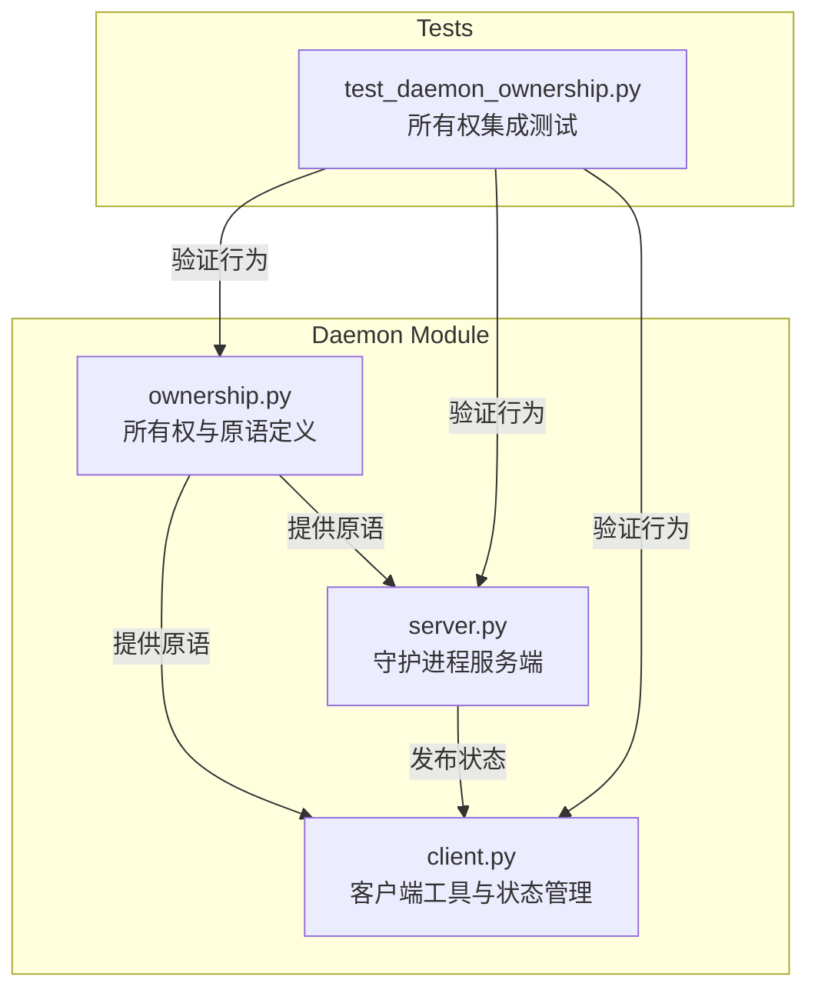
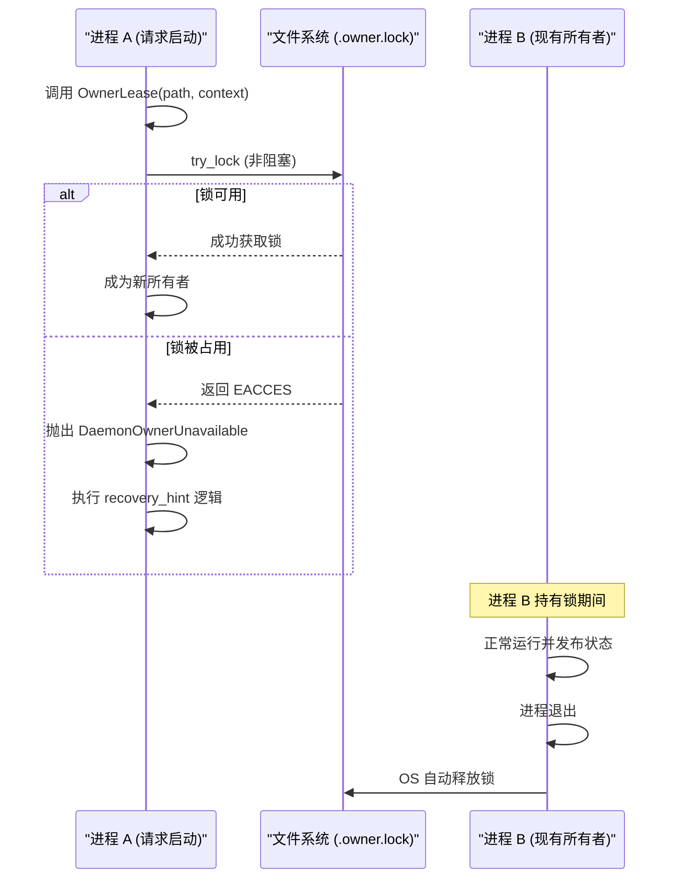
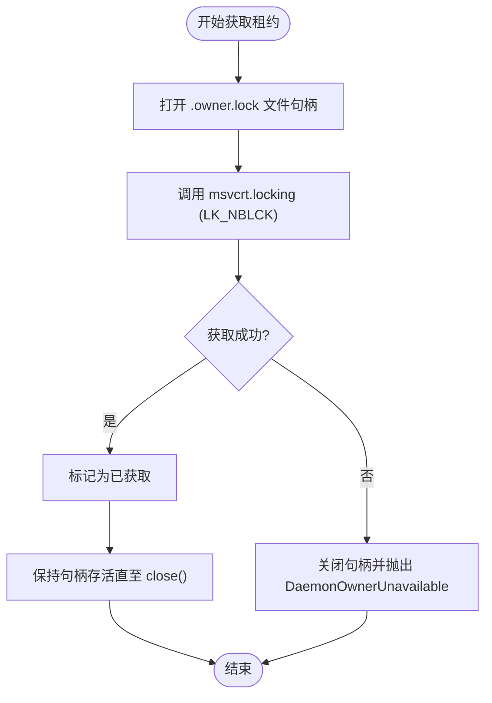
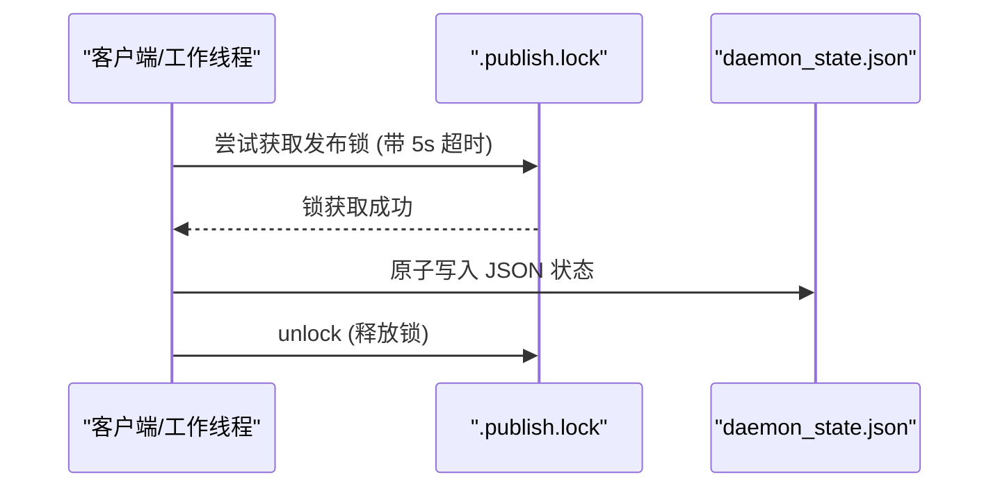
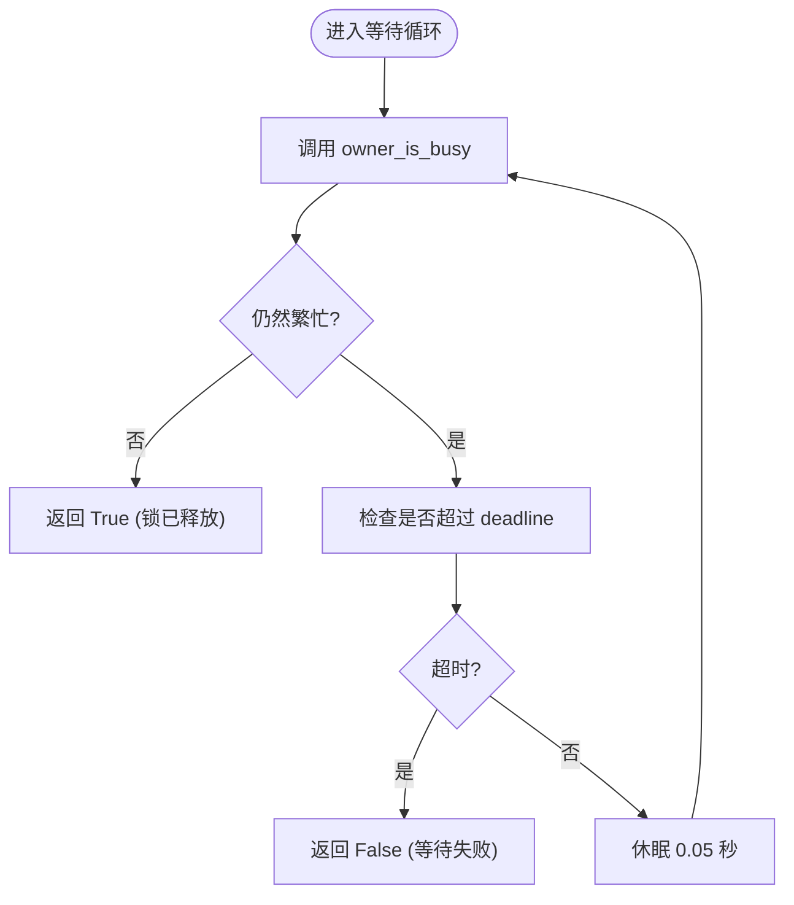
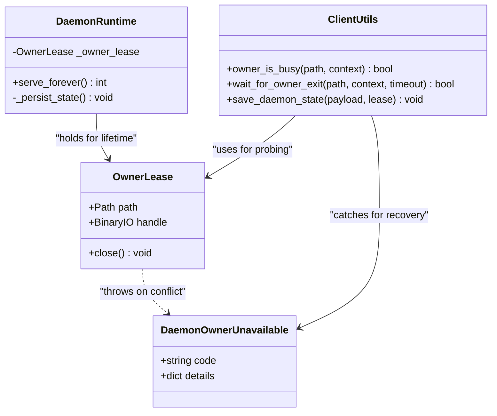

# 守护进程所有权协议

<cite>
**Referenced Files in This Document **
- [ownership.py](file://rdc_tool/daemon/ownership.py)
- [server.py](file://rdc_tool/daemon/server.py)
- [client.py](file://rdc_tool/daemon/client.py)
- [test_daemon_ownership.py](file://tests/test_daemon_ownership.py)
</cite>

## Table of Contents
1. [简介](#简介)
2. [项目结构](#项目结构)
3. [核心组件](#核心组件)
4. [架构概览](#架构概览)
5. [详细组件分析](#详细组件分析)
6. [依赖分析](#依赖分析)
7. [性能考虑](#性能考虑)
8. [故障排除指南](#故障排除指南)
9. [结论](#结论)

## 简介

本文件详细记录了 RDC-Tool 守护进程中的进程级所有权管理机制。该机制通过 Windows 文件锁原语实现，确保在同一时间内只有一个进程能够作为特定上下文的“所有者”运行。它涵盖了 `OwnerLease` 类的设计、`try_lock`/`unlock` 的原语实现、`owner_is_busy` 状态检测逻辑、`wait_for_owner_exit` 超时等待策略，以及 `DaemonOwnerUnavailable` 异常在恢复过程中的提示作用。这套机制对于维护多上下文环境下的资源一致性和防止竞态条件至关重要。

## 项目结构

守护进程的所有权管理主要分布在 `rdc_tool/daemon` 目录下：

**Diagram sources **
- [ownership.py:1-98](file://rdc_tool/daemon/ownership.py#L1-L98)
- [server.py:1-741](file://rdc_tool/daemon/server.py#L1-L741)
- [client.py:1-1115](file://rdc_tool/daemon/client.py#L1-L1115)
- [test_daemon_ownership.py:1-238](file://tests/test_daemon_ownership.py#L1-L238)

## 核心组件

### 1. OwnerLease 类设计
`OwnerLease` 是所有权管理的基石。它在初始化时尝试获取一个非阻塞的文件锁（`.owner.lock`）。如果锁已被占用，它会抛出 `DaemonOwnerUnavailable` 异常。该类的生命周期与拥有它的进程绑定，直到进程退出或显式调用 `close()` 方法释放锁。

### 2. Windows 文件锁原语
系统利用 `msvcrt.locking` 实现了两个核心原语：
*   `try_lock`: 尝试获取长度为 1 字节的非阻塞锁。如果返回 `EACCES` (Windows error 33)，则判定为锁忙。
*   `unlock`: 释放对应的锁，允许其他进程接管所有权。

### 3. owner_is_busy 状态检测
该函数通过尝试实例化一个临时的 `OwnerLease` 来判断当前上下文是否被占用。如果实例化失败（即捕获到 `DaemonOwnerUnavailable`），则说明已有活跃的所有者。

### 4. wait_for_owner_exit 超时等待策略
当检测到所有者繁忙时，客户端可以使用此策略进行轮询。它会在指定的超时时间（默认 3.0 秒）内以 50 毫秒的间隔检查 `owner_is_busy` 状态，直到锁被释放或超时。

### 5. DaemonOwnerUnavailable 异常与恢复提示
这是一个自定义运行时错误，不仅包含错误代码和分类，还提供了一个 `recovery_hint` 字段。该提示指导用户在遇到所有权冲突时如何安全地清理旧进程并重新启动，强调了“保留所有者及其状态”的重要性。

## 架构概览

所有权机制在守护进程的启动、状态发布和清理过程中起到了协调作用。

**Diagram sources **
- [ownership.py:40-60](file://rdc_tool/daemon/ownership.py#L40-L60)
- [ownership.py:12-20](file://rdc_tool/daemon/ownership.py#L12-L20)

## 详细组件分析

### OwnerLease 与锁原语分析

`OwnerLease` 确保了所有权的原子性获取。其内部使用了 `contextmanager` 和二进制文件操作来维持锁的活性。

#### 锁获取流程

**Diagram sources **
- [ownership.py:22-35](file://rdc_tool/daemon/ownership.py#L22-L35)
- [ownership.py:40-55](file://rdc_tool/daemon/ownership.py#L40-L55)

**Section sources**
- [ownership.py:1-98](file://rdc_tool/daemon/ownership.py#L1-L98)

### 状态发布与锁定 (locked_publication)

为了防止在更新守护进程状态文件（JSON）时发生数据损坏，系统引入了 `.publish.lock`。`locked_publication` 装饰器确保了在写入状态前必须先获取发布锁，并在写入完成后立即释放。

**Diagram sources **
- [ownership.py:78-90](file://rdc_tool/daemon/ownership.py#L78-L90)
- [client.py:380-395](file://rdc_tool/daemon/client.py#L380-L395)

### 恢复提示与异常处理

`DaemonOwnerUnavailable` 的设计不仅仅是报错，更是为了引导自动化脚本或用户进行正确的恢复操作。

| 属性 | 描述 | 示例值 |
| :--- | :--- | :--- |
| `code` | 错误代码标识 | `"daemon_owner_unavailable"` |
| `category` | 错误分类 | `"runtime"` |
| `details.context_id` | 发生冲突的上下文 ID | `"default"` |
| `details.reason` | 具体原因 | `"owner_lock_busy"` |
| `details.recovery_hint` | 恢复建议 | `"Preserve the owner and its state..."` |

**Section sources**
- [ownership.py:12-20](file://rdc_tool/daemon/ownership.py#L12-L20)
- [client.py:55-68](file://rdc_tool/daemon/client.py#L55-L68)

### 超时等待策略 (wait_for_owner_exit)

该策略用于在停止旧守护进程后，确保其完全退出并释放文件锁，以便新进程可以顺利启动。

**Diagram sources **
- [ownership.py:68-75](file://rdc_tool/daemon/ownership.py#L68-L75)

## 依赖分析

所有权机制依赖于操作系统底层的文件锁行为。在 Windows 平台上，它强依赖于 `msvcrt` 模块。此外，它与 `client.py` 中的状态持久化逻辑紧密耦合。

**Diagram sources **
- [ownership.py:40-60](file://rdc_tool/daemon/ownership.py#L40-L60)
- [server.py:90-120](file://rdc_tool/daemon/server.py#L90-L120)
- [client.py:380-400](file://rdc_tool/daemon/client.py#L380-L400)

**Section sources**
- [ownership.py:1-98](file://rdc_tool/daemon/ownership.py#L1-L98)
- [server.py:1-741](file://rdc_tool/daemon/server.py#L1-L741)
- [client.py:1-1115](file://rdc_tool/daemon/client.py#L1-L1115)

## 性能考虑

*   **非阻塞锁**: `try_lock` 使用 `LK_NBLCK` 标志，避免了进程在争用锁时陷入长时间的阻塞等待，提高了系统的响应速度。
*   **轮询间隔**: `wait_for_owner_exit` 采用了 50 毫秒的短间隔轮询，在保证检测精度的同时减少了对 CPU 资源的占用。
*   **原子写入**: 结合 `atomic_write_json` 和发布锁，确保了状态文件的完整性，避免了因部分写入导致的解析错误。

## 故障排除指南

| 问题现象 | 可能原因 | 解决方案 |
| :--- | :--- | :--- |
| `DaemonOwnerUnavailable: owner_lock_busy` | 另一个进程正在运行且持有锁 | 检查任务管理器中是否有残留的 `rdc-tool` 进程，或使用 `rdc-tool daemon status` 确认状态 |
| `state_owner_changed` | 状态文件被意外修改或替换 | 遵循 `recovery_hint`，先确认旧进程已退出，再尝试清理状态 |
| `startup_exit_unconfirmed` | 新启动的进程未能成功获取锁 | 增加 `wait_for_owner_exit` 的超时时间，或手动删除 `.owner.lock` 文件（仅在确认无进程运行时） |

**Section sources**
- [ownership.py:12-20](file://rdc_tool/daemon/ownership.py#L12-L20)
- [test_daemon_ownership.py:100-150](file://tests/test_daemon_ownership.py#L100-L150)

## 结论

RDC-Tool 的守护进程所有权协议通过精细的文件锁管理和明确的异常恢复路径，构建了一个健壮的进程间协调机制。它不仅防止了多实例冲突，还通过 `DaemonOwnerUnavailable` 提供了清晰的运维指引，确保了系统在复杂并发场景下的稳定性。