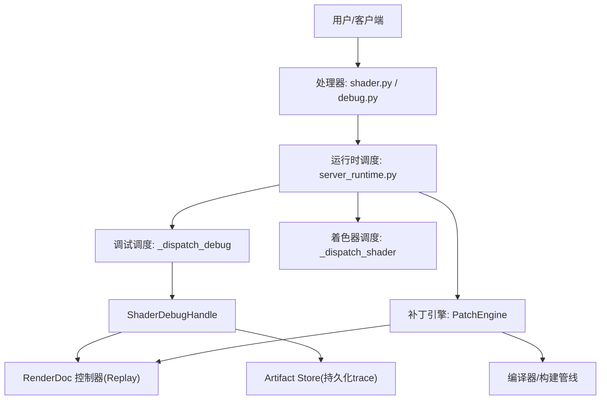
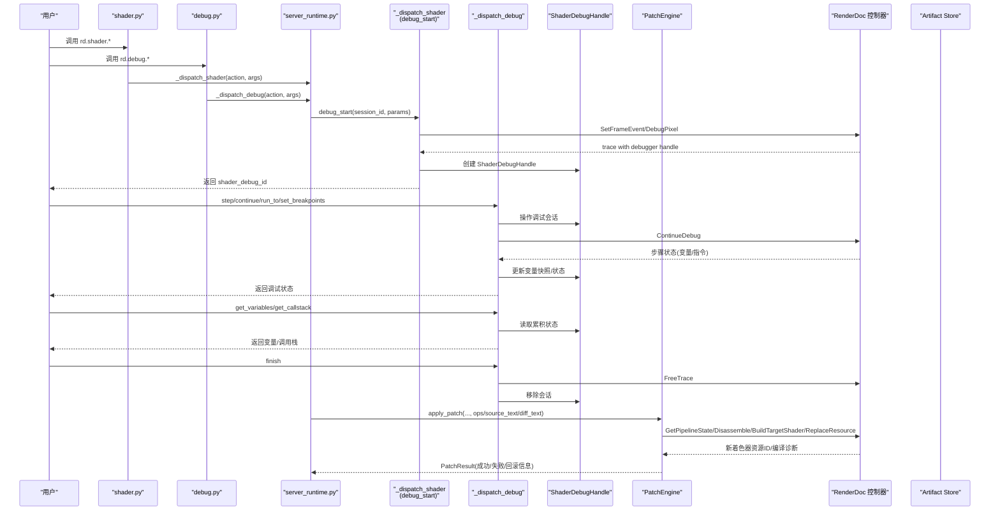

# 着色器调试

<cite>
**本文引用的文件**
- [server_runtime.py](file://rdc_tool/server_runtime.py)
- [patch_engine.py](file://rdc_tool/core/patch_engine.py)
- [models.py](file://rdc_tool/models.py)
- [operation_definitions.py](file://rdc_tool/operation_definitions.py)
- [shader.py](file://rdc_tool/handlers/shader.py)
- [debug.py](file://rdc_tool/handlers/debug.py)
- [engine.py](file://rdc_tool/core/engine.py)
- [cli.py](file://rdc_tool/cli.py)
- [test_shader_replace_contracts.py](file://tests/test_shader_replace_contracts.py)
</cite>

## 更新摘要
**变更内容**
- 删除了对已移除的 `debug_service.py` 的所有引用
- 更新了架构描述，反映调试功能已整合到 `server_runtime.py` 的核心运行时中
- 更新了核心组件说明，使用 `ShaderDebugHandle` 和 `_dispatch_debug` 替代原有的 `DebugService`
- 更新了架构图和流程图以匹配新的实现
- 保留了所有功能性描述，因为它们仍然准确反映了当前的调试能力

## 目录
1. [简介](#简介)
2. [项目结构](#项目结构)
3. [核心组件](#核心组件)
4. [架构总览](#架构总览)
5. [详细组件分析](#详细组件分析)
6. [依赖关系分析](#依赖关系分析)
7. [性能考虑](#性能考虑)
8. [故障排查指南](#故障排查指南)
9. [结论](#结论)
10. [附录](#附录)

## 简介
本文件面向使用 RDC-Tool 进行着色器调试的开发者，系统性说明以下能力：
- 着色器断点与命中控制：通过逐步执行、条件停止（NaN/Inf）与步数上限实现"条件断点"和"命中计数"；以 trace artifact 形式记录命中历史。
- 变量检查与修改：从每步状态中提取寄存器/变量值；结合源码替换与补丁操作间接"修改"着色器行为。
- 调用栈与执行流程：通过逐步骤 trace 理解函数调用顺序与数据流变化。
- SPIR-V 反汇编与源码映射：获取可读的反汇编文本，并在不可用时提供可编辑的 IR/源码替代路径。
- 最佳实践与常见问题：覆盖编译失败、驱动不支持、资源释放等场景。
- 实战示例：基于测试用例展示典型工作流。

## 项目结构
围绕着色器调试的关键代码分布在运行时调度层、处理器层、模型定义与工具契约中：
- 运行时调度层：`server_runtime.py` 中的 `_dispatch_debug` 和 `_dispatch_shader` 封装 RenderDoc 的像素/顶点着色器调试 API，通过 `ShaderDebugHandle` 管理调试会话状态，输出结构化 trace。
- 补丁引擎：`PatchEngine` 在 Replay 环境中对着色器进行源码级修改、编译与热替换，支持多种编码与操作。
- 处理器层：`shader.py` 与 `debug.py` 将外部调用转发至 `server_runtime` 的统一调度入口。
- 核心引擎：`CoreEngine` 提供统一的操作执行框架，集成操作注册表和制品发布器。
- 模型与契约：`models.py` 定义会话、阶段、结果等类型；`operation_definitions.py` 描述工具输入输出契约。
- CLI：`cli.py` 暴露环境检测与依赖可用性信息，辅助定位工具链问题。

图表来源
- [shader.py:8-9](file://rdc_tool/handlers/shader.py#L8-L9)
- [debug.py:8-9](file://rdc_tool/handlers/debug.py#L8-L9)
- [server_runtime.py:10350-10820](file://rdc_tool/server_runtime.py#L10350-L10820)
- [server_runtime.py:11603-11740](file://rdc_tool/server_runtime.py#L11603-L11740)
- [server_runtime.py:184-198](file://rdc_tool/server_runtime.py#L184-L198)
- [patch_engine.py:175-800](file://rdc_tool/core/patch_engine.py#L175-L800)

章节来源
- [shader.py:1-11](file://rdc_tool/handlers/shader.py#L1-L11)
- [debug.py:1-11](file://rdc_tool/handlers/debug.py#L1-L11)
- [server_runtime.py:10350-10820](file://rdc_tool/server_runtime.py#L10350-L10820)
- [server_runtime.py:11603-11740](file://rdc_tool/server_runtime.py#L11603-L11740)
- [server_runtime.py:184-198](file://rdc_tool/server_runtime.py#L184-L198)
- [patch_engine.py:1-800](file://rdc_tool/core/patch_engine.py#L1-L800)

## 核心组件
- **ShaderDebugHandle**
  - 数据结构：包含调试会话 ID、会话 ID、模式、事件 ID、trace 对象、debugger 句柄、当前状态、解析的上下文、像素历史摘要、待处理状态队列、变量字典、断点列表和停止原因。
  - 状态管理：维护当前调试步骤的状态、累积的变量快照、断点配置和停止原因。
  - 资源生命周期：持有 trace 和 debugger 句柄，在调试结束时通过 `finish` 操作释放资源。

- **_dispatch_debug**
  - 提供异步接口用于着色器调试会话管理，支持步进、继续、运行到指定位置、设置断点、获取变量、评估表达式和获取调用栈。
  - 变量提取：从每步状态中抽取变量名与数值，支持 float/uint/sint 及数组形式，按 before/after 更新累积快照。
  - 断点管理：支持基于 trace stepIndex（pc）的断点设置和清除，在 continue 操作中检查断点命中。
  - 自动释放：通过 `finish` 操作显式释放 trace 资源，避免泄漏。

- **_dispatch_shader (debug_start)**
  - 启动事件绑定的像素着色器调试器，支持目标选择、像素历史验证和多次尝试机制。
  - 能力检查：在远程回放时先读取 capability matrix，确认后端支持着色器调试。
  - 目标配置：支持显式 target 或从当前事件输出目标自动选择，配置纹理输出并刷新像素上下文。
  - 像素历史验证：收集像素历史命中，确保目标在当前事件有有效命中，拒绝跨事件回退。
  - 调试启动：通过 DebugPixel API 创建 trace，验证 debugger 句柄有效性，创建 ShaderDebugHandle 并返回调试会话 ID。

- **PatchEngine**
  - 在 Replay 中读取当前事件绑定的着色器，选择最佳可编辑编码进行反汇编。
  - 应用补丁操作（如精度提升、插入 NaN/Inf 保护），编译并通过 ReplaceResource 热替换。
  - 记录已应用的 patch，支持回滚与清理。

- **Models & Operation Definitions**
  - 统一的数据结构与工具契约，明确输入参数、返回字段、错误码与推荐下一步工具。

章节来源
- [server_runtime.py:184-198](file://rdc_tool/server_runtime.py#L184-L198)
- [server_runtime.py:11603-11740](file://rdc_tool/server_runtime.py#L11603-L11740)
- [server_runtime.py:10350-10820](file://rdc_tool/server_runtime.py#L10350-L10820)
- [patch_engine.py:175-800](file://rdc_tool/core/patch_engine.py#L175-L800)
- [models.py:1-200](file://rdc_tool/models.py#L1-L200)
- [operation_definitions.py:2961-3010](file://rdc_tool/operation_definitions.py#L2961-L3010)
- [operation_definitions.py:600-830](file://rdc_tool/operation_definitions.py#L600-L830)

## 架构总览
下图展示了从调用入口到具体实现的端到端流程，包括调试与补丁两条主线。

图表来源
- [shader.py:8-9](file://rdc_tool/handlers/shader.py#L8-L9)
- [debug.py:8-9](file://rdc_tool/handlers/debug.py#L8-L9)
- [server_runtime.py:10350-10820](file://rdc_tool/server_runtime.py#L10350-L10820)
- [server_runtime.py:11603-11740](file://rdc_tool/server_runtime.py#L11603-L11740)
- [server_runtime.py:184-198](file://rdc_tool/server_runtime.py#L184-L198)
- [patch_engine.py:196-800](file://rdc_tool/core/patch_engine.py#L196-L800)

## 详细组件分析

### 着色器调试启动（_dispatch_shader - debug_start）
- 功能要点
  - 模式验证：当前仅支持 `pixel` 模式，其他模式返回结构化 validation_error。
  - 能力检查：远程回放时读取 capability matrix，确认后端支持着色器调试。
  - 目标选择：支持显式 target 或从事件输出自动选择，配置纹理输出并刷新像素上下文。
  - 像素历史验证：收集像素历史命中，确保目标在当前事件有有效命中，拒绝跨事件回退。
  - 多次尝试：基于用户上下文、默认上下文和像素历史匹配生成多个尝试组合，直到获得有效的 trace。
  - 资源管理：创建 ShaderDebugHandle 持