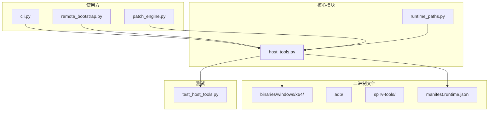
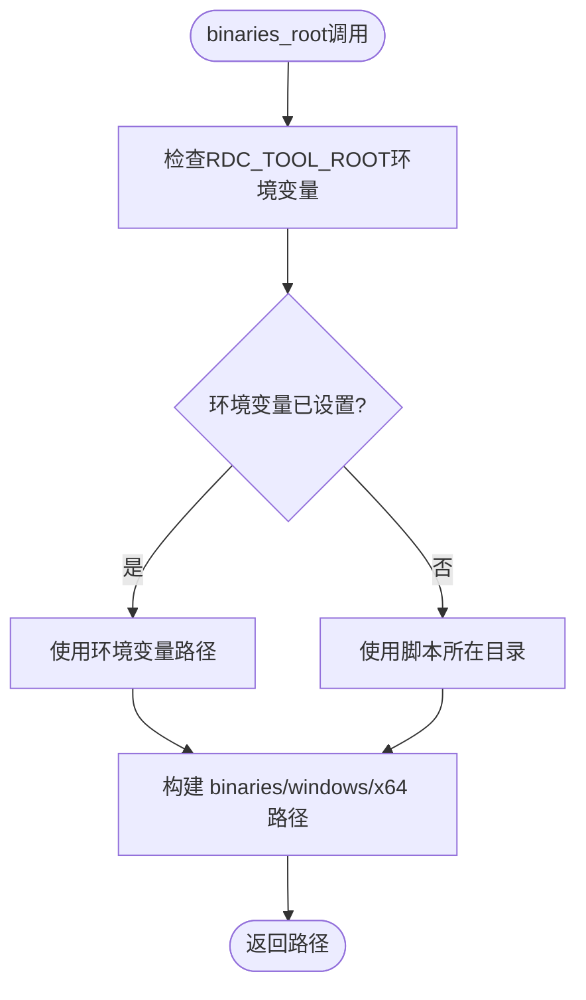
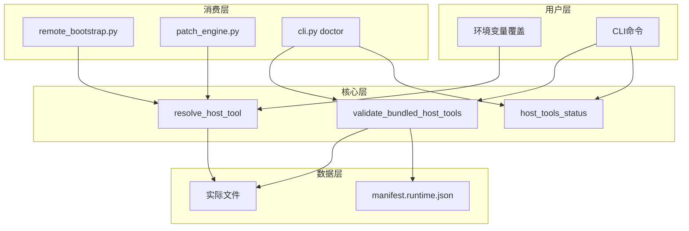
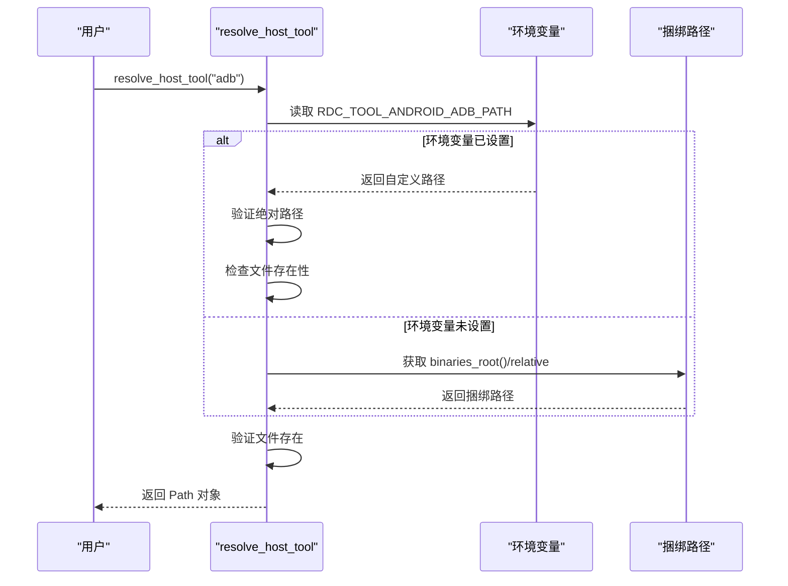
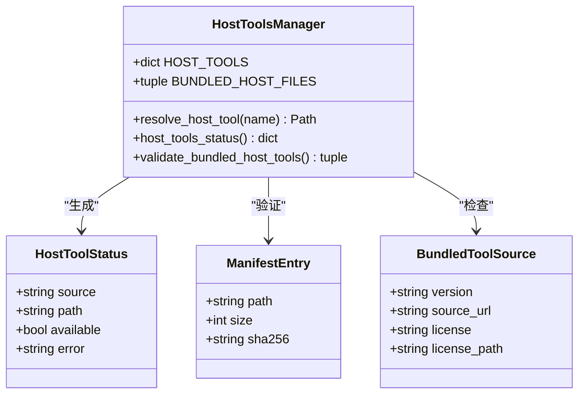
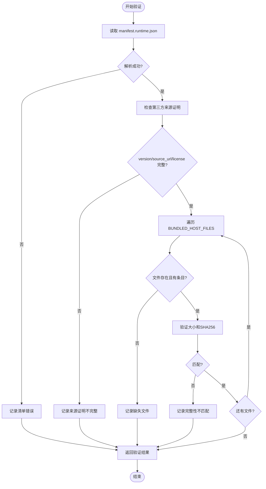
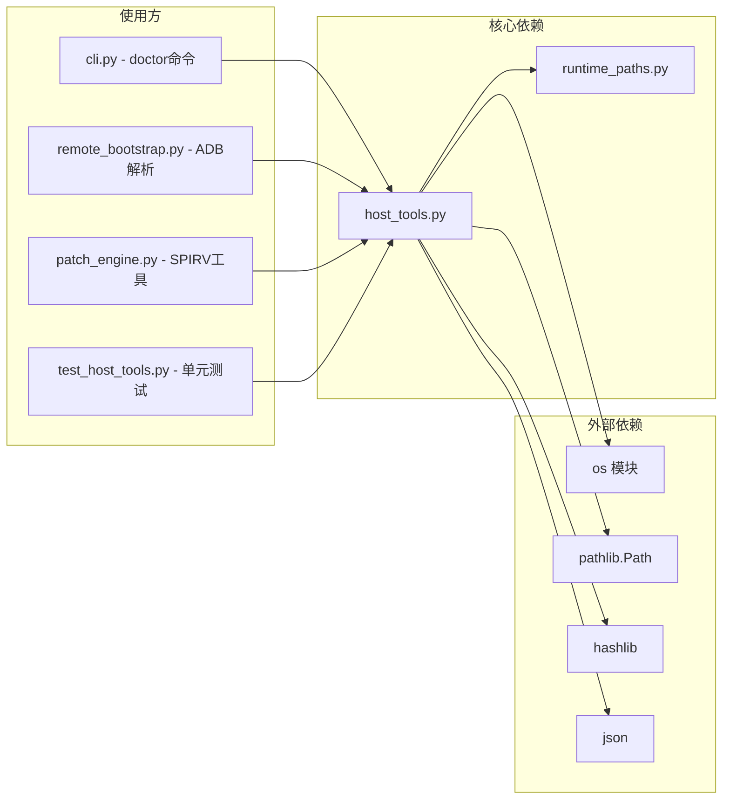

# 主机工具管理

<cite>
**本文档引用的文件**
- [host_tools.py](file://rdc_tool/host_tools.py)
- [runtime_paths.py](file://rdc_tool/runtime_paths.py)
- [manifest.runtime.json](file://binaries/windows/x64/manifest.runtime.json)
- [test_host_tools.py](file://tests/test_host_tools.py)
- [cli.py](file://rdc_tool/cli.py)
- [remote_bootstrap.py](file://rdc_tool/remote_bootstrap.py)
- [patch_engine.py](file://rdc_tool/core/patch_engine.py)
</cite>

## 目录
1. [简介](#简介)
2. [项目结构](#项目结构)
3. [核心组件](#核心组件)
4. [架构概览](#架构概览)
5. [详细组件分析](#详细组件分析)
6. [依赖分析](#依赖分析)
7. [性能考虑](#性能考虑)
8. [故障排除指南](#故障排除指南)
9. [结论](#结论)

## 简介

RDC-Tool 的主机工具管理系统提供了一个集中式的可执行文件发现机制，用于管理第三方工具如 Android ADB 和 SPIRV-Tools。该系统支持通过环境变量进行显式用户覆盖，并包含完整性验证功能以确保捆绑工具的来源可靠性和文件完整性。

主要管理的工具包括：
- **ADB (Android Debug Bridge)**: 用于 Android 设备通信的可执行文件
- **SPIRV-Tools**: SPIR-V 着色器编译和反汇编工具（spirv-as、spirv-dis）

## 项目结构

主机工具相关文件分布在以下位置：



**图表来源**
- [host_tools.py:1-15](file://rdc_tool/host_tools.py#L1-L15)
- [runtime_paths.py:55-60](file://rdc_tool/runtime_paths.py#L55-L60)

**章节来源**
- [host_tools.py:1-70](file://rdc_tool/host_tools.py#L1-L70)
- [runtime_paths.py:1-122](file://rdc_tool/runtime_paths.py#L1-L122)

## 核心组件

### 主机工具解析器

`host_tools.py` 模块提供了核心的工具解析和验证功能：

**主要数据结构：**

| 工具名称 | 相对路径 | 环境变量 |
|---------|---------|---------|
| adb | adb/adb.exe | RDC_TOOL_ANDROID_ADB_PATH |
| spirv_as | spirv-tools/spirv-as.exe | RDC_TOOL_SPIRV_TOOLS_PATH |
| spirv_dis | spirv-tools/spirv-dis.exe | RDC_TOOL_SPIRV_TOOLS_PATH |

**关键函数：**

1. **resolve_host_tool(name)**: 解析指定工具的路径
   - 首先检查环境变量覆盖
   - 如果未设置环境变量，则使用捆绑路径
   - 验证文件存在性

2. **host_tools_status()**: 获取所有工具的状态信息
   - 返回每个工具的来源（bundled/explicit）、路径和可用性

3. **validate_bundled_host_tools()**: 验证捆绑工具的完整性
   - 检查 manifest.runtime.json 中的元数据
   - 验证文件大小和 SHA256 哈希值
   - 检查第三方来源证明（version、source_url、license）

**章节来源**
- [host_tools.py:8-15](file://rdc_tool/host_tools.py#L8-L15)
- [host_tools.py:22-36](file://rdc_tool/host_tools.py#L22-L36)
- [host_tools.py:38-48](file://rdc_tool/host_tools.py#L38-L48)
- [host_tools.py:50-70](file://rdc_tool/host_tools.py#L50-L70)

### 运行时路径管理

`runtime_paths.py` 提供了基础路径解析功能：



**图表来源**
- [runtime_paths.py:15-40](file://rdc_tool/runtime_paths.py#L15-L40)
- [runtime_paths.py:55-58](file://rdc_tool/runtime_paths.py#L55-L58)

**章节来源**
- [runtime_paths.py:1-122](file://rdc_tool/runtime_paths.py#L1-L122)

## 架构概览

主机工具管理系统的整体架构如下：



**章节来源**
- [host_tools.py:1-70](file://rdc_tool/host_tools.py#L1-L70)
- [remote_bootstrap.py:156-160](file://rdc_tool/remote_bootstrap.py#L156-L160)
- [patch_engine.py:1800-1805](file://rdc_tool/core/patch_engine.py#L1800-L1805)
- [cli.py:458-462](file://rdc_tool/cli.py#L458-L462)

## 详细组件分析

### 工具解析机制

#### 环境变量覆盖逻辑



**图表来源**
- [host_tools.py:22-36](file://rdc_tool/host_tools.py#L22-L36)

**章节来源**
- [host_tools.py:22-36](file://rdc_tool/host_tools.py#L22-L36)

#### 工具状态查询



**图表来源**
- [host_tools.py:8-15](file://rdc_tool/host_tools.py#L8-L15)
- [host_tools.py:38-48](file://rdc_tool/host_tools.py#L38-L48)

**章节来源**
- [host_tools.py:8-70](file://rdc_tool/host_tools.py#L8-L70)

### 完整性验证机制

#### 验证流程



**图表来源**
- [host_tools.py:50-70](file://rdc_tool/host_tools.py#L50-L70)

**章节来源**
- [host_tools.py:50-70](file://rdc_tool/host_tools.py#L50-L70)

#### 验证内容详解

验证过程涵盖以下内容：

1. **清单文件完整性**
   - 读取 `manifest.runtime.json`
   - 解析文件列表和 bundled_tools 元数据

2. **第三方来源证明**
   - 检查每个工具的 `version` 字段
   - 检查 `source_url` 字段
   - 检查 `license` 字段

3. **文件完整性**
   - 验证文件是否存在
   - 检查文件大小是否与清单匹配
   - 计算 SHA256 哈希值并与清单对比

**清单示例结构：**

```json
{
  "bundled_tools": {
    "adb": {
      "version": "36.0.2",
      "source_url": "https://dl.google.com/android/repository/platform-tools_r36.0.2-win.zip",
      "license": "LicenseRef-Android-Platform-Tools-NOTICE",
      "license_path": "binaries/windows/x64/adb/NOTICE.txt"
    },
    "spirv_as": {
      "version": "v2026.4",
      "source_url": "https://github.com/KhronosGroup/SPIRV-Tools/archive/refs/tags/v2026.4.zip",
      "license": "Apache-2.0 AND MIT",
      "build": "MSVC 19.51.36257 x64 Release static CRT"
    }
  }
}
```

**章节来源**
- [manifest.runtime.json:14866-14896](file://binaries/windows/x64/manifest.runtime.json#L14866-L14896)
- [host_tools.py:50-70](file://rdc_tool/host_tools.py#L50-L70)

### 捆绑文件清单

系统跟踪以下捆绑文件：

| 文件类型 | 文件路径 |
|---------|---------|
| ADB 可执行文件 | adb/adb.exe |
| ADB DLL | adb/AdbWinApi.dll |
| ADB DLL | adb/AdbWinUsbApi.dll |
| ADB 法律声明 | adb/NOTICE.txt |
| ADB 源属性 | adb/source.properties |
| SPIRV-Tools 许可证 | spirv-tools/LICENSE.txt |
| SPIRV-Headers 许可证 | spirv-tools/SPIRV-Headers-LICENSE.txt |
| SPIRV-AS 可执行文件 | spirv-tools/spirv-as.exe |
| SPIRV-DIS 可执行文件 | spirv-tools/spirv-dis.exe |

**章节来源**
- [host_tools.py:13-15](file://rdc_tool/host_tools.py#L13-L15)

## 依赖分析

### 组件依赖关系



**图表来源**
- [host_tools.py:1-10](file://rdc_tool/host_tools.py#L1-L10)
- [cli.py:458-462](file://rdc_tool/cli.py#L458-L462)
- [remote_bootstrap.py:156-160](file://rdc_tool/remote_bootstrap.py#L156-L160)
- [patch_engine.py:1800-1805](file://rdc_tool/core/patch_engine.py#L1800-L1805)

**章节来源**
- [host_tools.py:1-10](file://rdc_tool/host_tools.py#L1-L10)
- [cli.py:458-540](file://rdc_tool/cli.py#L458-L540)
- [remote_bootstrap.py:156-165](file://rdc_tool/remote_bootstrap.py#L156-L165)
- [patch_engine.py:1800-1810](file://rdc_tool/core/patch_engine.py#L1800-L1810)
- [patch_engine.py:1950-1960](file://rdc_tool/core/patch_engine.py#L1950-L1960)

### 环境变量依赖

| 环境变量 | 用途 | 默认行为 |
|---------|------|---------|
| RDC_TOOL_ANDROID_ADB_PATH | 覆盖 ADB 路径 | 使用捆绑的 adb.exe |
| RDC_TOOL_SPIRV_TOOLS_PATH | 覆盖 SPIRV-Tools 路径 | 使用捆绑的 spirv-as/spirv-dis |
| RDC_TOOL_ROOT | 覆盖工具根目录 | 使用脚本所在目录 |

**章节来源**
- [host_tools.py:9-12](file://rdc_tool/host_tools.py#L9-L12)
- [runtime_paths.py:10-40](file://rdc_tool/runtime_paths.py#L10-L40)

## 性能考虑

### 路径解析性能

- **环境变量检查**: O(1) 操作，几乎无开销
- **文件存在性检查**: 单次文件系统调用
- **完整性验证**: 
  - 读取清单文件: 一次性操作
  - SHA256 计算: 对每个文件进行一次完整读取和哈希计算
  - 建议在安装时验证，而非每次使用时验证

### 优化建议

1. **缓存解析结果**: 对于频繁调用的场景，可以缓存已解析的路径
2. **延迟验证**: 完整性验证应在安装或更新时执行，而非每次启动时
3. **并行哈希计算**: 如果需要验证多个文件，可以考虑并行计算哈希值

## 故障排除指南

### 常见问题

#### 1. 工具找不到错误

**症状**: `HostToolUnavailableError: adb executable not found`

**可能原因**:
- 环境变量指向的路径不存在
- 捆绑文件被删除或损坏
- 环境变量不是绝对路径

**解决方案**:
```bash
# 检查环境变量
echo $RDC_TOOL_ANDROID_ADB_PATH

# 验证文件存在
ls -la binaries/windows/x64/adb/adb.exe

# 运行诊断
python -m rdc_tool.cli doctor
```

**章节来源**
- [host_tools.py:17-18](file://rdc_tool/host_tools.py#L17-L18)
- [host_tools.py:33-35](file://rdc_tool/host_tools.py#L33-L35)

#### 2. 完整性验证失败

**症状**: `validate_bundled_host_tools()` 返回 `(False, [...])`

**可能原因**:
- 文件被修改或损坏
- 清单文件缺失或格式错误
- 文件大小或哈希值不匹配

**解决方案**:
```bash
# 查看详细错误
python -c "from rdc_tool.host_tools import validate_bundled_host_tools; print(validate_bundled_host_tools())"

# 重新安装或修复
# 从官方来源重新下载工具
```

**章节来源**
- [host_tools.py:50-70](file://rdc_tool/host_tools.py#L50-L70)
- [test_host_tools.py:38-48](file://tests/test_host_tools.py#L38-L48)

#### 3. 清单文件格式错误

**症状**: `invalid host tool manifest: ...`

**可能原因**:
- JSON 格式错误
- 缺少必需字段
- 文件编码问题

**解决方案**:
```bash
# 验证 JSON 格式
python -m json.tool binaries/windows/x64/manifest.runtime.json

# 检查必需字段
python -c "import json; m=json.load(open('binaries/windows/x64/manifest.runtime.json')); print(m.get('bundled_tools', {}))"
```

**章节来源**
- [host_tools.py:68-69](file://rdc_tool/host_tools.py#L68-L69)

### 诊断命令

使用 `doctor` 命令进行全面诊断：

```bash
python -m rdc_tool.cli doctor
```

该命令将检查：
- Python 环境
- RenderDoc 运行时
- Android APK
- 主机工具状态
- 工具目录结构

**章节来源**
- [cli.py:458-540](file://rdc_tool/cli.py#L458-L540)

## 结论

RDC-Tool 的主机工具管理系统提供了一个健壮且灵活的机制来管理第三方可执行文件。其主要特点包括：

1. **集中式解析**: 统一的 `resolve_host_tool()` 函数处理所有工具的路径解析
2. **用户覆盖支持**: 通过环境变量允许用户指定自定义工具路径
3. **完整性验证**: `validate_bundled_host_tools()` 确保捆绑工具的来源可靠性和文件完整性
4. **全面的元数据**: manifest.runtime.json 包含版本、来源 URL、许可证和哈希值等信息
5. **详细的错误报告**: 提供清晰的错误消息帮助诊断问题

该系统为 ADB 和 SPIRV-Tools 等关键依赖提供了可靠的管理机制，同时保持了足够的灵活性以适应用户的自定义需求。

**章节来源**
- [host_tools.py:1-70](file://rdc_tool/host_tools.py#L1-L70)
- [test_host_tools.py:1-50](file://tests/test_host_tools.py#L1-L50)