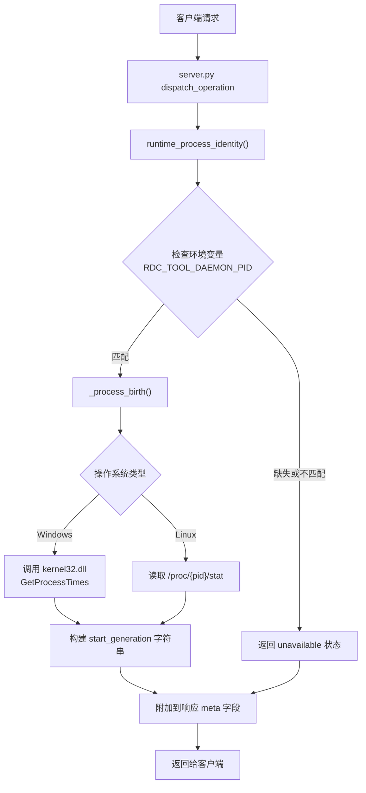
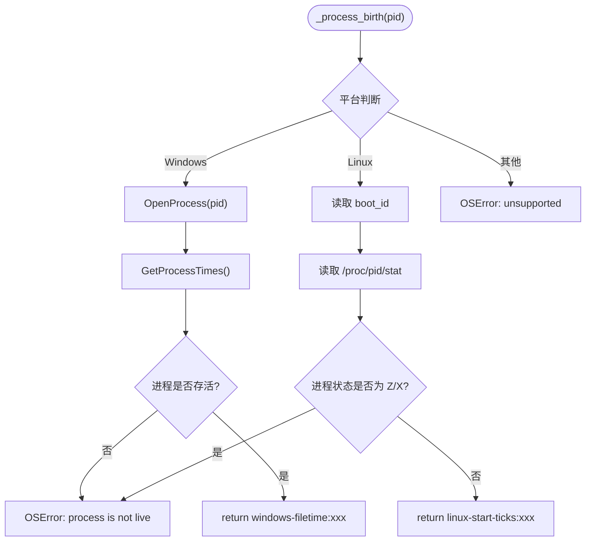
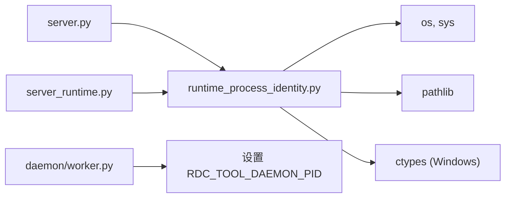

# 进程身份验证

<cite>
**本文档引用的文件**
- [runtime_process_identity.py](file://rdc_tool/runtime_process_identity.py)
- [server.py](file://rdc_tool/server.py)
- [server_runtime.py](file://rdc_tool/server_runtime.py)
- [operation_definitions.py](file://rdc_tool/operation_definitions.py)
- [worker.py](file://rdc_tool/daemon/worker.py)
- [test_runtime_process_identity.py](file://tests/test_runtime_process_identity.py)
</cite>

## 目录
1. [简介](#简介)
2. [核心组件分析](#核心组件分析)
3. [架构概览](#架构概览)
4. [详细组件分析](#详细组件分析)
5. [依赖关系分析](#依赖关系分析)
6. [性能考量](#性能考量)
7. [故障排除指南](#故障排除指南)
8. [结论](#结论)

## 简介

在复杂的守护进程（Daemon）与工作者进程（Worker）架构中，进程标识符（PID）的复用是一个常见的安全隐患。当旧的进程终止而新的进程被分配了相同的 PID 时，仅凭 PID 进行身份验证会导致严重的误判。

`rdc_tool/runtime_process_identity.py` 模块提供了一种只读的“进程出生身份”查询能力。它通过获取操作系统级别的进程启动生成信息（如 Windows 的文件时间或 Linux 的启动滴答数），来唯一标识一个正在运行的进程实例。该机制主要用于验证 Daemon Worker 与其父进程的连续性，确保操作是在预期的、真实的进程中执行，从而防止因 PID 复用导致的逻辑错误和安全风险。

## 核心组件分析

进程身份验证的核心在于 `_process_birth` 函数和 `runtime_process_identity` 接口。它们共同构成了一个轻量级但高可靠性的身份校验层。

### 核心功能特性
*   **跨平台支持**：针对 Windows 和 Linux 提供了不同的底层实现。
*   **只读性**：不修改任何系统状态或目标进程的内部数据。
*   **环境契约**：依赖于特定的环境变量（如 `RDC_TOOL_DAEMON_PID`）来建立父子进程的身份关联。

**Section sources**
- [runtime_process_identity.py:1-66](file://rdc_tool/runtime_process_identity.py#L1-L66)

## 架构概览

进程身份验证流程嵌入在 RDC-Tool 的请求分发链路中。每当处理上下文相关的操作时，系统都会自动注入当前的进程身份信息。

**Diagram sources**
- [server.py:120-135](file://rdc_tool/server.py#L120-L135)
- [runtime_process_identity.py:10-66](file://rdc_tool/runtime_process_identity.py#L10-L66)

**Section sources**
- [server.py:1-153](file://rdc_tool/server.py#L1-L153)
- [server_runtime.py:6822-6832](file://rdc_tool/server_runtime.py#L6822-L6832)

## 详细组件分析

### 进程出生信息查询 (_process_birth)

该函数是底层的身份探针，负责从操作系统内核获取不可伪造的启动时间戳。

#### Windows 实现逻辑
在 Windows 平台上，利用 `kernel32.dll` 的 `OpenProcess` 和 `GetProcessTimes` API。
1.  打开目标进程句柄（权限为 `0x1000`，即 `PROCESS_QUERY_INFORMATION`）。
2.  获取创建时间、退出时间等 FILETIME 结构。
3.  如果进程已退出或创建时间为无效值，则抛出异常。
4.  返回格式为 `windows-filetime:{value}` 的唯一标识。

#### Linux 实现逻辑
在 Linux 平台上，通过解析 `/proc` 文件系统实现。
1.  读取 `/proc/sys/kernel/random/boot_id` 获取系统启动 ID，确保重启后身份重置。
2.  读取 `/proc/{pid}/stat` 获取进程统计信息。
3.  提取第 22 个字段（启动滴答数 `start_time`）。
4.  返回格式为 `linux-start-ticks:{boot_id}:{ticks}` 的唯一标识。

**Diagram sources**
- [runtime_process_identity.py:12-48](file://rdc_tool/runtime_process_identity.py#L12-L48)

**Section sources**
- [runtime_process_identity.py:12-48](file://rdc_tool/runtime_process_identity.py#L12-L48)

### 运行时身份验证 (runtime_process_identity)

这是对外暴露的主要接口，它不仅查询当前进程的身份，还验证其与父进程（Daemon）的逻辑连续性。

#### 验证步骤
1.  **环境变量检查**：读取 `RDC_TOOL_DAEMON_PID`。如果不存在或无法转换为整数，直接返回 `unavailable`。
2.  **父进程一致性校验**：对比环境变量中的 PID 与 `os.getppid()` 返回值。如果不一致，说明进程可能已被非预期的方式启动。
3.  **出生信息查询**：分别调用 `_process_birth` 获取 Worker 自身和父进程的 `start_generation`。
4.  **结果封装**：返回包含 `daemon` 和 `worker` 详细信息的字典。

#### 数据结构定义

| 字段名 | 类型 | 描述 |
| :--- | :--- | :--- |
| status | string | 状态标识，可选值为 `available` 或 `unavailable` |
| reason | string | 当状态为 `unavailable` 时的原因说明 |
| daemon.pid | int | 守护进程的 PID |
| daemon.start_generation | string | 守护进程的出生身份标识 |
| worker.pid | int | 当前工作进程的 PID |
| worker.start_generation | string | 当前工作进程的出生身份标识 |

**Section sources**
- [runtime_process_identity.py:50-66](file://rdc_tool/runtime_process_identity.py#L50-L66)

### 集成与分发

在 `server.py` 中，`dispatch_operation` 函数会在每个操作完成后，将 `runtime_process_identity()` 的结果注入到响应的 `meta` 字段中。这确保了客户端可以随时感知到后端进程的健康状态和身份连续性。

此外，在 `server_runtime.py` 的 `_dispatch_session` 处理中，`get_context` 操作也会显式调用该函数，将其作为上下文快照的一部分返回。

**Section sources**
- [server.py:120-135](file://rdc_tool/server.py#L120-L135)
- [server_runtime.py:6822-6832](file://rdc_tool/server_runtime.py#L6822-L6832)
- [operation_definitions.py:2636-2642](file://rdc_tool/operation_definitions.py#L2636-L2642)

## 依赖关系分析

进程身份验证模块具有极低的耦合度，主要依赖于 Python 标准库和操作系统底层接口。

**Diagram sources**
- [runtime_process_identity.py:1-10](file://rdc_tool/runtime_process_identity.py#L1-L10)
- [worker.py:75-76](file://rdc_tool/daemon/worker.py#L75-L76)

**Section sources**
- [runtime_process_identity.py:1-10](file://rdc_tool/runtime_process_identity.py#L1-L10)
- [worker.py:75-76](file://rdc_tool/daemon/worker.py#L75-L76)

## 性能考量

*   **低开销**：`_process_birth` 的执行时间通常在微秒级别，因为它只涉及少量的系统调用或文件读取。
*   **缓存策略**：目前实现为每次请求实时查询，以确保数据的绝对准确性。由于频率不高且开销极小，暂未引入缓存机制。
*   **异常处理**：在权限不足或进程不存在时会快速失败，避免长时间阻塞。

## 故障排除指南

### 常见问题与解决方案

| 现象 | 可能原因 | 建议操作 |
| :--- | :--- | :--- |
| 返回 `status: unavailable` | 环境变量 `RDC_TOOL_DAEMON_PID` 未设置 | 检查 Worker 是否由 Daemon 正常启动 |
| 返回 `reason: daemon_parent_mismatch` | 父进程 PID 与实际不符 | 确认进程树结构，排查是否有中间进程介入 |
| 返回 `reason: process_birth_unavailable` | 权限不足或进程已终止 | 检查运行用户权限，确认目标进程是否存活 |
| Windows 下报错 `access denied` | 缺少 `PROCESS_QUERY_INFORMATION` 权限 | 尝试以管理员身份运行或检查安全软件拦截 |

### 调试建议
可以通过单元测试 `test_runtime_process_identity.py` 中的模拟场景来验证不同边界条件下的行为。例如，测试 PID 相同但 `start_generation` 不同的情况，以确认系统能正确识别出这是两个不同的进程实例。

**Section sources**
- [test_runtime_process_identity.py:1-70](file://tests/test_runtime_process_identity.py#L1-L70)

## 结论

`rdc_tool/runtime_process_identity.py` 为 RDC-Tool 提供了一套严谨的进程身份验证机制。通过利用操作系统底层的不可变属性（如启动时间），它有效地解决了 PID 复用带来的身份混淆问题。该模块设计简洁、跨平台兼容性好，并已深度集成到系统的核心分发链路中，为分布式调试和远程回放任务提供了坚实的安全基础。