# 发布打包

<cite>
**本文引用的文件**
- [scripts/package_release.py](file://scripts/package_release.py)
- [scripts/package_runtime.py](file://scripts/package_runtime.py)
- [scripts/release_gate.py](file://scripts/release_gate.py)
- [scripts/verify_release_package.py](file://scripts/verify_release_package.py)
- [scripts/release_runtime.py](file://scripts/release_runtime.py)
- [scripts/generate_release_checksums.py](file://scripts/generate_release_checksums.py)
- [scripts/_shared.py](file://scripts/_shared.py)
- [rdc_tool/python_runtime.py](file://rdc_tool/python_runtime.py)
- [rdc_tool/runtime_paths.py](file://rdc_tool/runtime_paths.py)
- [rdc_tool/runtime_requirements.py](file://rdc_tool/runtime_requirements.py)
- [bin/rdc-tool.cmd](file://bin/rdc-tool.cmd)
- [pyproject.toml](file://pyproject.toml)
- [rdc_tool/__init__.py](file://rdc_tool/__init__.py)
- [binaries/windows/x64/manifest.runtime.json](file://binaries/windows/x64/manifest.runtime.json)
</cite>

## 更新摘要
**所做更改**
- **新增源码门控验证机制**：强制要求clean committed source，拒绝dirty source tree/stale runtime identities/package mismatches；在release_gate.py中增加完整的repository-source-gate验证流程
- **增强候选包隔离验证**：支持--candidate-dir/--runtime-root参数，实现本地验证候选包的独立构建与验证
- **新增ZIP归档后身份验证**：在package_release.py中增加_qualify_package步骤，确保完整归档通过verify_release_package.py验证
- **扩展目录结构与文件存在性检查**：release_gate.py增加禁止扩展名过滤、敏感标记文本扫描和smoke CLI执行验证
- **新增强制完整测试执行前置条件**：require-smoke-reports标志强制执行1172+2子测试并通过doctor验证
- **优化隔离运行时上下文管理器**：改进环境变量隔离、临时状态管理和自动清理机制

## 目录
1. [简介](#简介)
2. [项目结构](#项目结构)
3. [核心组件](#核心组件)
4. [架构总览](#架构总览)
5. [详细组件分析](#详细组件分析)
6. [依赖关系分析](#依赖关系分析)
7. [性能考虑](#性能考虑)
8. [故障排查指南](#故障排查指南)
9. [结论](#结论)
10. [附录](#附录)

## 简介
本文件系统化说明 RDC 工具的发布打包流程与自动化脚本，覆盖以下方面：
- 发布包构建：文件收集、元数据生成、压缩包创建与校验和输出。
- 运行时打包：Python 环境集成、平台特定文件处理与清单生成。
- **新增** 源码门控验证：强制要求干净的工作区状态，拒绝脏源码树、过时的运行时身份标识和包不匹配情况。
- **新增** 候选包隔离验证：提供独立的本地验证候选包构建与验证机制，支持--candidate-dir/--runtime-root参数。
- **新增** ZIP归档后身份验证：在打包完成后对完整归档进行身份验证，确保包完整性。
- **增强** 许可证完整性验证：使用字节级比较确保许可证文件的完整性和真实性。
- **改进** 打包安全性：采用临时暂存目录和独占zip创建模式，防止并发冲突和数据损坏。
- 版本检查与一致性验证：源码与制品的一致性、清单完整性、入口点与公共命令契约。
- 包结构规范：目录布局、入口点定义、清单文件格式。
- 许可证清单与 SBOM：自动生成与校验。
- 参数定制与输出格式：各脚本的参数与产物说明。
- 质量检查与安全验证：发布门禁、内容扫描、负面用例验证。

## 项目结构
发布相关的关键目录与文件：
- scripts：发布与验证脚本集合（打包、运行时打包、门禁、校验、校验和）。
- rdc：运行时路径解析、Python 运行时布局校验、依赖过滤策略。
- binaries/windows/x64：平台二进制与内嵌 Python 运行时及清单。
- bin/rdc-tool.cmd：跨平台启动器与 Windows 引导。
- pyproject.toml：包名、版本、入口点与依赖声明。

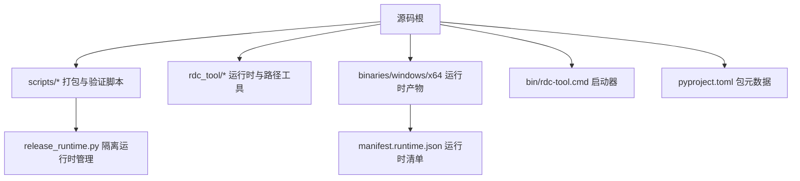

**图表来源**
- [scripts/package_release.py:1-354](file://scripts/package_release.py#L1-L354)
- [scripts/package_runtime.py:1-358](file://scripts/package_runtime.py#L1-L358)
- [scripts/release_runtime.py:1-76](file://scripts/release_runtime.py#L1-L76)
- [rdc_tool/runtime_paths.py:1-123](file://rdc_tool/runtime_paths.py#L1-L123)
- [bin/rdc-tool.cmd:1-18](file://bin/rdc-tool.cmd#L1-L18)
- [pyproject.toml:1-45](file://pyproject.toml#L1-L45)

**章节来源**
- [scripts/package_release.py:1-354](file://scripts/package_release.py#L1-L354)
- [scripts/package_runtime.py:1-358](file://scripts/package_runtime.py#L1-L358)
- [scripts/release_runtime.py:1-76](file://scripts/release_runtime.py#L1-L76)
- [rdc_tool/runtime_paths.py:1-123](file://rdc_tool/runtime_paths.py#L1-L123)
- [bin/rdc-tool.cmd:1-18](file://bin/rdc-tool.cmd#L1-L18)
- [pyproject.toml:1-45](file://pyproject.toml#L1-L45)

## 核心组件
- 发布打包脚本：负责从源码树复制受控文件、生成 RELEASE_MANIFEST.json、LICENSE_INVENTORY.json、SBOM.json，并输出 zip 与 SHA256SUMS。
- 运行时打包脚本：将 RenderDoc 等第三方二进制与内嵌 Python 运行时复制到 binaries/windows/x64，生成 manifest.runtime.json。
- **新增** 隔离运行时上下文管理器：为发布验证提供独立的环境隔离，确保验证过程的纯净性和可恢复性。
- **新增** 源码门控验证：强制要求干净的工作区状态，拒绝脏源码树、过时的运行时身份标识和包不匹配情况。
- **新增** 候选包隔离验证：支持本地验证候选包的独立构建与验证，提供--candidate-dir/--runtime-root参数。
- **新增** ZIP归档后身份验证：在打包完成后对完整归档进行身份验证，确保包完整性。
- 发布门禁：执行结构、文档、清单、运行契约、安全扫描与制品一致性检查。
- **增强** 制品验证：解压 zip，校验清单、许可证清单、SBOM、公共命令契约、负面用例与敏感内容，支持字节级许可证验证。
- 辅助工具：共享函数、路径解析、子进程调用、JSON 提取；Python 运行时布局校验；依赖白名单/黑名单。

**章节来源**
- [scripts/package_release.py:1-354](file://scripts/package_release.py#L1-L354)
- [scripts/package_runtime.py:1-358](file://scripts/package_runtime.py#L1-L358)
- [scripts/release_runtime.py:1-76](file://scripts/release_runtime.py#L1-L76)
- [scripts/release_gate.py:1-711](file://scripts/release_gate.py#L1-L711)
- [scripts/verify_release_package.py:1-474](file://scripts/verify_release_package.py#L1-L474)
- [scripts/_shared.py:1-92](file://scripts/_shared.py#L1-L92)
- [rdc_tool/python_runtime.py:1-172](file://rdc_tool/python_runtime.py#L1-L172)
- [rdc_tool/runtime_paths.py:1-123](file://rdc_tool/runtime_paths.py#L1-L123)
- [rdc_tool/runtime_requirements.py:1-73](file://rdc_tool/runtime_requirements.py#L1-L73)

## 架构总览
发布流水线由"运行时打包 → 源码门控验证 → 发布打包 → 隔离运行时验证 → 发布门禁 → 制品验证 → ZIP归档后身份验证"组成，形成闭环的质量保障。

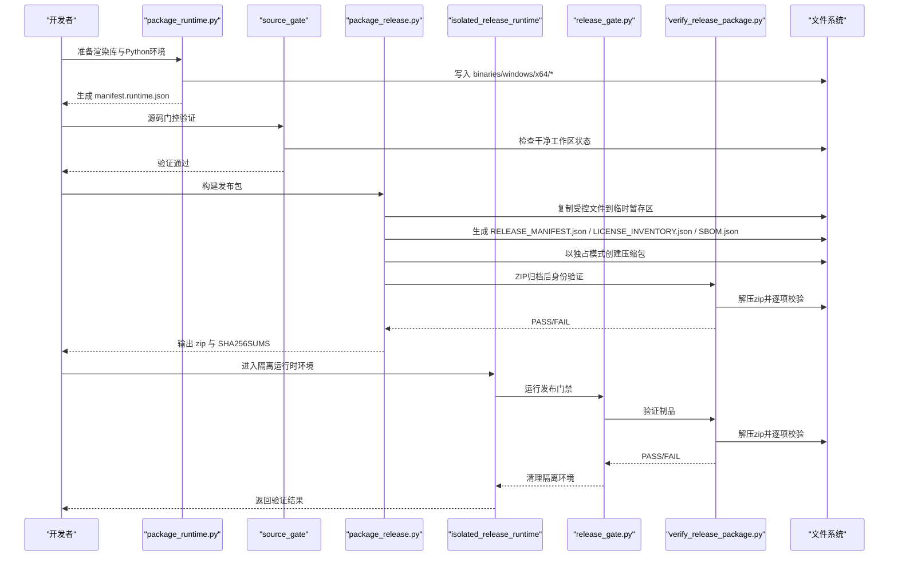

**图表来源**
- [scripts/package_runtime.py:289-353](file://scripts/package_runtime.py#L289-L353)
- [scripts/package_release.py:267-354](file://scripts/package_release.py#L267-L354)
- [scripts/release_runtime.py:49-76](file://scripts/release_runtime.py#L49-L76)
- [scripts/release_gate.py:521-696](file://scripts/release_gate.py#L521-L696)
- [scripts/verify_release_package.py:351-474](file://scripts/verify_release_package.py#L351-L474)

## 详细组件分析

### 发布打包脚本（package_release.py）
- 文件收集：仅复制允许的文件与目录，排除测试、缓存、中间产物与调试符号。
- **改进** 临时暂存目录：使用 `tempfile.TemporaryDirectory` 创建隔离的暂存区域，确保构建过程的原子性和安全性。
- **改进** 独占zip创建：使用 `zipfile.ZipFile(zip_path, "x")` 模式，防止覆盖现有文件或并发写入冲突。
- **新增** 源码门控验证：在打包前执行 `_qualify_source(root)` 验证源码状态，确保干净的工作区。
- **新增** ZIP归档后身份验证：在打包完成后执行 `_qualify_package(staged_zip)` 验证完整归档。
- **新增** 候选包隔离验证：支持 `--candidate-dir` 和 `--runtime-root` 参数，构建本地验证候选包。
- 元数据生成：
  - RELEASE_MANIFEST.json：包含名称、版本、平台、公共命令、入口点、文件清单（含大小与 sha256）。
  - LICENSE_INVENTORY.json：遍历 site-packages 的 dist-info/METADATA 汇总第三方许可信息。
  - SBOM.json：基于许可证清单生成软件物料清单。
- 压缩包创建：以 rdc-tool-<version>-windows-x64.zip 命名，压缩级别最高。
- 校验和与报告：生成 SHA256SUMS 与 release_report.md。

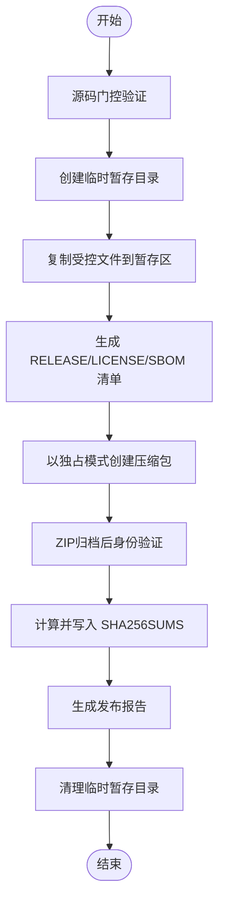

**图表来源**
- [scripts/package_release.py:267-275](file://scripts/package_release.py#L267-L275)
- [scripts/package_release.py:89-108](file://scripts/package_release.py#L89-L108)
- [scripts/package_release.py:139-159](file://scripts/package_release.py#L139-L159)
- [scripts/package_release.py:162-167](file://scripts/package_release.py#L162-L167)
- [scripts/package_release.py:186-195](file://scripts/package_release.py#L186-L195)
- [scripts/package_release.py:310-314](file://scripts/package_release.py#L310-L314)

**章节来源**
- [scripts/package_release.py:1-354](file://scripts/package_release.py#L1-L354)

### 运行时打包脚本（package_runtime.py）
- 输入源：RenderDoc 或其他第三方二进制目录、CPython home、site-packages 源。
- Python 集成：
  - 探测或指定 Python 版本，复制 python.exe、pythonw.exe、python3.dll、版本化 DLL、DLLs、Lib（跳过顶层不需要的目录）。
  - 选择性拷贝 site-packages，依据排除前缀过滤开发/测试依赖。
  - 生成 .pth 文件与必要的 pth 配置，确保运行时导入路径正确。
- 清单生成：遍历 binaries/windows/x64 下所有文件，记录 path/size/sha256，写入 manifest.runtime.json。

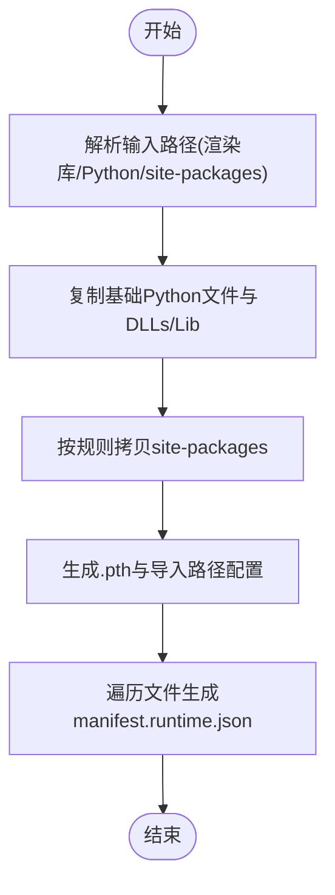

**图表来源**
- [scripts/package_runtime.py:136-216](file://scripts/package_runtime.py#L136-L216)
- [scripts/package_runtime.py:289-353](file://scripts/package_runtime.py#L289-L353)
- [rdc_tool/runtime_requirements.py:60-73](file://rdc_tool/runtime_requirements.py#L60-L73)

**章节来源**
- [scripts/package_runtime.py:1-358](file://scripts/package_runtime.py#L1-L358)
- [rdc_tool/runtime_requirements.py:1-73](file://rdc_tool/runtime_requirements.py#L1-L73)

### 隔离运行时上下文管理器（release_runtime.py）
**新增功能** 为发布验证提供完全隔离的运行环境：
- 环境变量隔离：设置独立的 `RDC_TOOL_INTERMEDIATE_ROOT` 和 `RDC_TOOL_ROOT` 环境变量。
- 临时状态管理：使用 `tempfile.mkdtemp` 创建临时状态目录，确保验证过程不影响宿主环境。
- 自动清理机制：无论成功还是失败，都会清理运行时状态，停止守护进程，移除临时文件。
- 异常安全：在异常情况下也能保证环境清理，避免资源泄漏。
- 错误恢复：如果清理失败，保留临时状态供后续恢复分析。

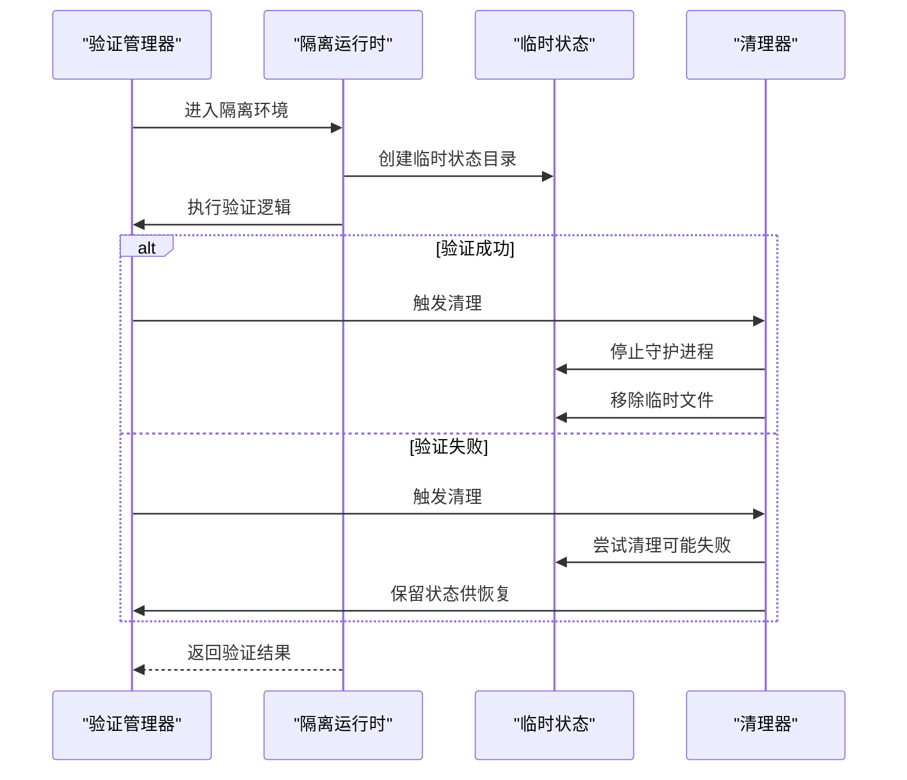

**图表来源**
- [scripts/release_runtime.py:49-76](file://scripts/release_runtime.py#L49-L76)
- [scripts/release_runtime.py:17-47](file://scripts/release_runtime.py#L17-L47)

**章节来源**
- [scripts/release_runtime.py:1-76](file://scripts/release_runtime.py#L1-L76)

### 源码门控验证机制
**新增功能** 强制要求干净的工作区状态，拒绝脏源码树、过时的运行时身份标识和包不匹配情况：
- **干净工作区检查**：通过 `git status --porcelain --untracked-files=normal` 检查工作区状态，拒绝任何未提交的更改。
- **运行时身份验证**：验证配对的本地运行时构建状态，确保 native_manifest_status 为 "verified"。
- **完整源码门控**：执行 repository-source-gate 验证，包括目录结构、文件存在性、禁止扩展名过滤、敏感标记文本扫描等。
- **前置条件验证**：强制执行完整的测试套件（1172+2子测试）并通过 doctor 验证。

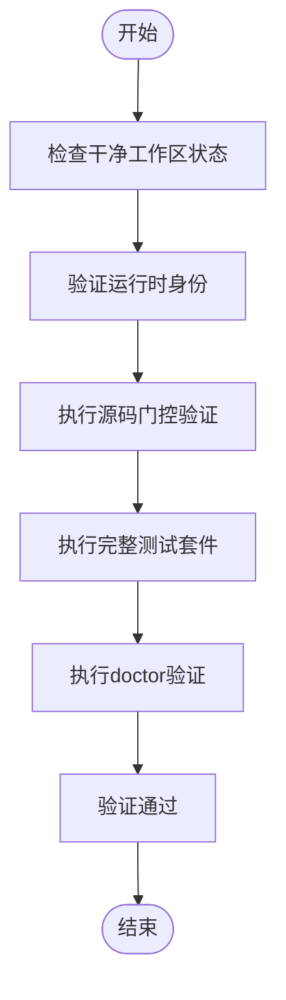

**图表来源**
- [scripts/package_release.py:170-177](file://scripts/package_release.py#L170-L177)
- [scripts/package_release.py:267-275](file://scripts/package_release.py#L267-L275)
- [scripts/release_gate.py:521-696](file://scripts/release_gate.py#L521-L696)

**章节来源**
- [scripts/package_release.py:170-177](file://scripts/package_release.py#L170-L177)
- [scripts/package_release.py:267-275](file://scripts/package_release.py#L267-L275)
- [scripts/release_gate.py:521-696](file://scripts/release_gate.py#L521-L696)

### 候选包隔离验证
**新增功能** 支持本地验证候选包的独立构建与验证：
- **独立构建**：使用 `--candidate-dir` 参数指定候选包输出目录，支持 `--runtime-root` 参数指定验证的运行时根目录。
- **隔离验证**：候选包在独立的目录中构建和验证，不影响主发布流程。
- **身份验证**：对候选包执行完整的身份验证，包括清单验证、许可证验证和运行时身份验证。
- **源快照记录**：记录候选包的源快照信息，包括基础修订版、工作区差异哈希和已发货源文件哈希。

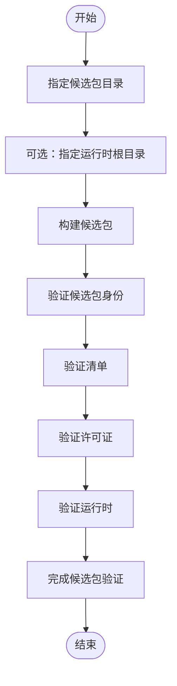

**图表来源**
- [scripts/package_release.py:203-240](file://scripts/package_release.py#L203-L240)
- [scripts/verify_release_package.py:420-440](file://scripts/verify_release_package.py#L420-L440)

**章节来源**
- [scripts/package_release.py:203-240](file://scripts/package_release.py#L203-L240)
- [scripts/verify_release_package.py:420-440](file://scripts/verify_release_package.py#L420-L440)

### ZIP归档后身份验证
**新增功能** 在打包完成后对完整归档进行身份验证：
- **完整归档验证**：对生成的 ZIP 文件执行完整的身份验证，确保包完整性。
- **校验和验证**：验证 SHA256SUMS 文件中的校验和与 ZIP 文件实际校验和一致。
- **预GA标记扫描**：扫描 ZIP 内容，禁止预 GA 路径/文本标记与 MCP 公开入口。
- **清单验证**：验证 RELEASE_MANIFEST.json 的 public_commands 与 entrypoints。
- **许可证完整性验证**：使用 `read_bytes()` 进行字节级比较，确保 LICENSE 文件与源代码完全一致。
- **多清单版本一致性**：验证 RELEASE_MANIFEST.json、SBOM.json、LICENSE_INVENTORY.json、pyproject.toml 中的版本号一致性。

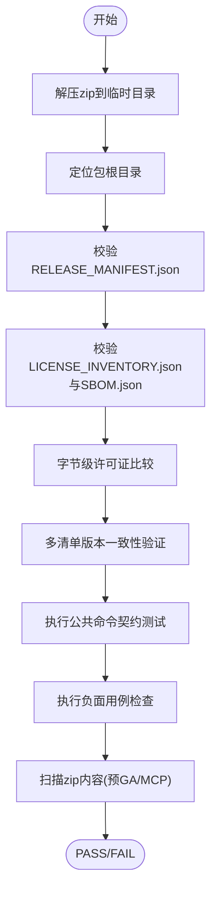

**图表来源**
- [scripts/verify_release_package.py:130-156](file://scripts/verify_release_package.py#L130-L156)
- [scripts/verify_release_package.py:158-188](file://scripts/verify_release_package.py#L158-L188)
- [scripts/verify_release_package.py:202-224](file://scripts/verify_release_package.py#L202-L224)
- [scripts/verify_release_package.py:351-474](file://scripts/verify_release_package.py#L351-L474)

**章节来源**
- [scripts/verify_release_package.py:1-474](file://scripts/verify_release_package.py#L1-L474)

### 发布门禁（release_gate.py）
- 结构与文档：检查必需目录与文件，用户文档不得包含 venv/pip 等引导命令，禁止使用 bin/rdc-tool.cmd 作为用户命令示例。
- 清单与运行时：校验 manifest.runtime.json 中每个文件的 size/sha256 与实际一致，验证内嵌 Python 布局。
- **增强** 隔离环境执行：使用 `isolated_release_runtime` 上下文管理器执行所有验证逻辑，确保环境隔离。
- **新增** 目录结构检查：增加禁止扩展名过滤、敏感标记文本扫描和smoke CLI执行验证。
- **新增** 强制测试执行：通过 `--require-smoke-reports` 标志强制执行完整的测试套件（1172+2子测试）。
- 公共命令契约：通过 rdc-tool --help、doctor、version、tools list、context/vfs 等命令验证行为与返回结构。
- 安全扫描：禁止调试符号后缀、禁止 MCP 公开入口、禁止预 GA 标记泄露。
- 制品一致性：若提供 zip，则校验其 RELEASE_MANIFEST.json 与源码清单一致，并执行 verify_release_package.py。

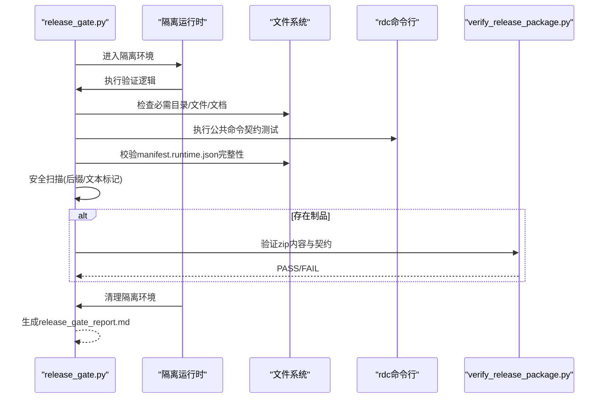

**图表来源**
- [scripts/release_gate.py:255-284](file://scripts/release_gate.py#L255-L284)
- [scripts/release_gate.py:521-696](file://scripts/release_gate.py#L521-L696)
- [scripts/release_runtime.py:49-76](file://scripts/release_runtime.py#L49-L76)

**章节来源**
- [scripts/release_gate.py:1-711](file://scripts/release_gate.py#L1-L711)

### 制品验证（verify_release_package.py）
- 解压后定位包根，校验 RELEASE_MANIFEST.json 的 public_commands 与 entrypoints。
- **增强** 许可证完整性验证：使用 `read_bytes()` 进行字节级比较，确保 LICENSE 文件与源代码完全一致。
- **增强** 多清单版本一致性：验证 RELEASE_MANIFEST.json、SBOM.json、LICENSE_INVENTORY.json、pyproject.toml 中的版本号一致性。
- **新增** 候选包验证：支持 `--candidate-dir` 参数验证本地候选包，执行 CANDIDATE_MANIFEST.json 验证。
- 运行 doctor、物理启动器、version、tools list 等契约测试。
- 检查负面用例（不支持的投影、缺失操作、已移除别名等）。
- 扫描 zip 内容，禁止预 GA 路径/文本标记与 MCP 公开入口。

**图表来源**
- [scripts/verify_release_package.py:130-156](file://scripts/verify_release_package.py#L130-L156)
- [scripts/verify_release_package.py:158-188](file://scripts/verify_release_package.py#L158-L188)
- [scripts/verify_release_package.py:202-224](file://scripts/verify_release_package.py#L202-L224)
- [scripts/verify_release_package.py:351-474](file://scripts/verify_release_package.py#L351-L474)

**章节来源**
- [scripts/verify_release_package.py:1-474](file://scripts/verify_release_package.py#L1-L474)

### 启动器与入口点
- 跨平台入口：
  - bin/rdc-tool.cmd：Windows 上调用 PowerShell 启动器。
  - 当前入口为 bin/rdc-tool.cmd 与 cli/run_cli.py。
- 包元数据：
  - pyproject.toml：声明包名、版本、依赖与脚本入口 rdc = rdc_tool.cli:main。
  - rdc_tool/__init__.py：__version__ 用于版本一致性检查。

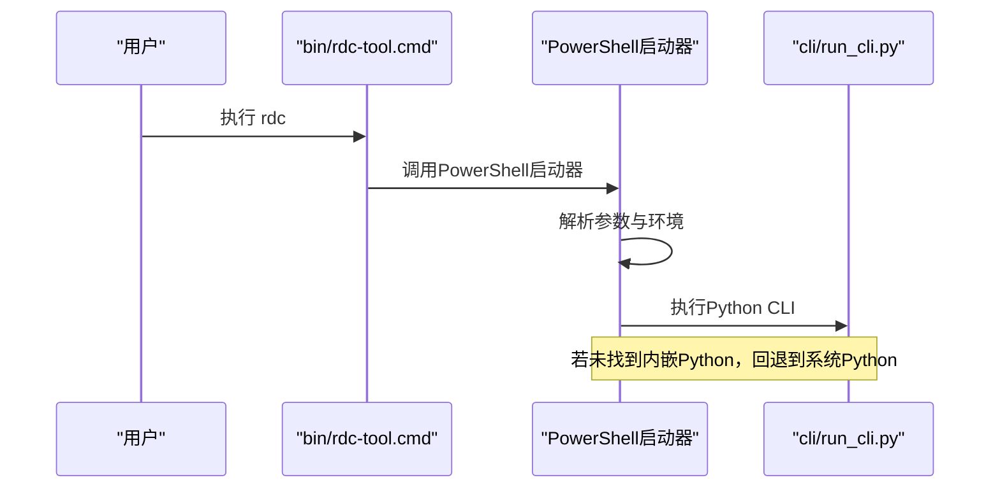

**图表来源**
- [bin/rdc-tool.cmd:1-18](file://bin/rdc-tool.cmd#L1-L18)
- [pyproject.toml:21-23](file://pyproject.toml#L21-L23)
- [rdc_tool/__init__.py:1-4](file://rdc_tool/__init__.py#L1-L4)

**章节来源**
- [bin/rdc-tool.cmd:1-18](file://bin/rdc-tool.cmd#L1-L18)
- [pyproject.toml:1-45](file://pyproject.toml#L1-L45)
- [rdc_tool/__init__.py:1-4](file://rdc_tool/__init__.py#L1-L4)

### 版本检查与一致性验证机制
- **增强** 版本一致性：
  - package_release.py 比较传入 --version 与 rdc_tool.__version__，不一致即失败。
  - release_gate.py 通过 rdc-tool version --json 与 tools list 对比 catalog 与代码定义。
  - **新增** 多清单版本验证：verify_release_package.py 同时验证 RELEASE_MANIFEST.json、SBOM.json、LICENSE_INVENTORY.json、pyproject.toml 中的版本号。
- 清单一致性：
  - release_gate.py 校验 manifest.runtime.json 中每个文件的 size/sha256。
  - verify_release_package.py 校验 RELEASE_MANIFEST.json 的 public_commands/entrypoints/files。
- 源码与制品一致性：
  - release_gate.py 将源码树生成的清单与 zip 中的清单比对，检测缺失/多余项与哈希不一致。
  - **新增** 源修订版验证：验证 release package 的 source_revision 与 clean source HEAD 一致。

**章节来源**
- [scripts/package_release.py:169-177](file://scripts/package_release.py#L169-L177)
- [scripts/release_gate.py:255-284](file://scripts/release_gate.py#L255-L284)
- [scripts/release_gate.py:483-518](file://scripts/release_gate.py#L483-L518)
- [scripts/verify_release_package.py:158-188](file://scripts/verify_release_package.py#L158-L188)
- [rdc_tool/__init__.py:1-4](file://rdc_tool/__init__.py#L1-L4)

### 包结构规范
- 目录布局：
  - binaries/windows/x64：平台二进制与内嵌 Python 运行时。
  - intermediate：运行时状态、日志、pytest 与 artifacts。
  - rdc、bin、cli、spec、policy、docs、scripts：源码与脚本。
- 入口点定义：
  - 公共命令：rdc-tool。
  - 入口点：bin/rdc-tool.cmd、bin/rdc-tool、cli/run_cli.py。
- 清单文件格式：
  - RELEASE_MANIFEST.json：name/version/platform/public_commands/entrypoints/file_count/files。
  - LICENSE_INVENTORY.json：数组，每项包含 name/version/license/path。
  - SBOM.json：schema/name/version/platform/components。
  - manifest.runtime.json：file_count/files，可选 bundled_python 元数据。

**章节来源**
- [scripts/package_release.py:139-159](file://scripts/package_release.py#L139-L159)
- [scripts/package_runtime.py:344-351](file://scripts/package_runtime.py#L344-L351)
- [scripts/verify_release_package.py:130-156](file://scripts/verify_release_package.py#L130-L156)
- [binaries/windows/x64/manifest.runtime.json:1-800](file://binaries/windows/x64/manifest.runtime.json#L1-L800)

### 许可证清单自动生成与 SBOM 生成过程
- 许可证清单：
  - 遍历 binaries/windows/x64/python/Lib/site-packages/*.dist-info/METADATA，提取 Name/Version/License。
  - 加入 rdc-tools 自身条目（Apache-2.0）。
- SBOM：
  - 基于许可证清单生成 SBOM.json，包含 schema、name、version、platform、components。
- **增强** 验证：
  - verify_release_package.py 检查 LICENSE_INVENTORY.json 与 SBOM.json 的存在性与关键字段。
  - **新增** 字节级许可证验证：确保 LICENSE 文件与源代码完全一致。

**章节来源**
- [scripts/package_release.py:111-159](file://scripts/package_release.py#L111-L159)
- [scripts/verify_release_package.py:158-188](file://scripts/verify_release_package.py#L158-L188)
- [scripts/verify_release_package.py:202-224](file://scripts/verify_release_package.py#L202-L224)

### 打包参数定制选项与输出格式
- package_release.py：
  - --out-dir：输出目录（默认 dist）。
  - --version：期望包版本（需与 rdc_tool.__version__ 一致）。
  - **新增** --candidate-dir：构建非发布本地验证目录。
  - **新增** --runtime-root：候选包专用的已验证运行时根目录。
  - 输出：zip、SHA256SUMS、release_report.md、RELEASE_MANIFEST.json、LICENSE_INVENTORY.json、SBOM.json。
- package_runtime.py：
  - --source：渲染库源目录（相对仓库根）。
  - --python-home：CPython home（绝对或相对）。
  - --site-packages-source：site-packages 源（默认 .venv/Lib/site-packages）。
  - --python-version：覆盖 Python 版本元数据。
  - 输出：binaries/windows/x64/* 与 manifest.runtime.json。
- generate_release_checksums.py：
  - paths：文件或目录列表。
  - --out：输出校验和文件（默认 intermediate/logs/release_checksums.sha256）。

**章节来源**
- [scripts/package_release.py:280-354](file://scripts/package_release.py#L280-L354)
- [scripts/package_runtime.py:280-353](file://scripts/package_runtime.py#L280-L353)
- [scripts/generate_release_checksums.py:29-51](file://scripts/generate_release_checksums.py#L29-L51)

### 打包质量检查与安全验证步骤
- 结构检查：必需目录与文件存在性。
- 文档检查：用户文档不包含 venv/pip 引导命令，不使用 bin/rdc-tool.cmd 作为用户命令示例。
- 清单检查：manifest.runtime.json 完整性与哈希一致性。
- **新增** 源码门控验证：强制要求干净的工作区状态，拒绝脏源码树。
- **新增** 隔离环境验证：所有发布验证在隔离的运行时环境中执行，确保环境纯净性。
- 运行契约：公共命令帮助、doctor、version、tools list、context/vfs 等行为验证。
- 安全扫描：禁止调试符号后缀、禁止 MCP 公开入口、禁止预 GA 标记。
- **增强** 制品验证：解压 zip，校验清单、许可证清单、SBOM、契约与负面用例，支持字节级许可证验证。
- **新增** 强制测试执行：通过 --require-smoke-reports 标志强制执行完整的测试套件。

**章节来源**
- [scripts/release_gate.py:29-105](file://scripts/release_gate.py#L29-L105)
- [scripts/release_gate.py:255-397](file://scripts/release_gate.py#L255-L397)
- [scripts/release_gate.py:521-696](file://scripts/release_gate.py#L521-L696)
- [scripts/verify_release_package.py:130-474](file://scripts/verify_release_package.py#L130-L474)

## 依赖关系分析
- 脚本间依赖：
  - release_gate.py 依赖 package_release.py 的受控文件规则与入口点常量。
  - verify_release_package.py 依赖 _shared.py 的 JSON 提取与子进程封装。
  - package_runtime.py 依赖 runtime_requirements.py 的 site-packages 过滤策略。
  - **新增** release_gate.py 和 verify_release_package.py 都依赖 release_runtime.py 的隔离运行时管理。
  - **新增** package_release.py 依赖 release_gate.py 的源码门控验证和 verify_release_package.py 的归档后身份验证。
- 运行时依赖：
  - rdc_tool/python_runtime.py 读取 manifest.runtime.json 并校验内嵌 Python 布局。
  - rdc_tool/runtime_paths.py 提供工具根、二进制根、中间目录等路径解析。
- 外部依赖：
  - 通过 pyproject.toml 声明运行时依赖（如 pydantic、numpy、Pillow、jinja2、aiofiles）。

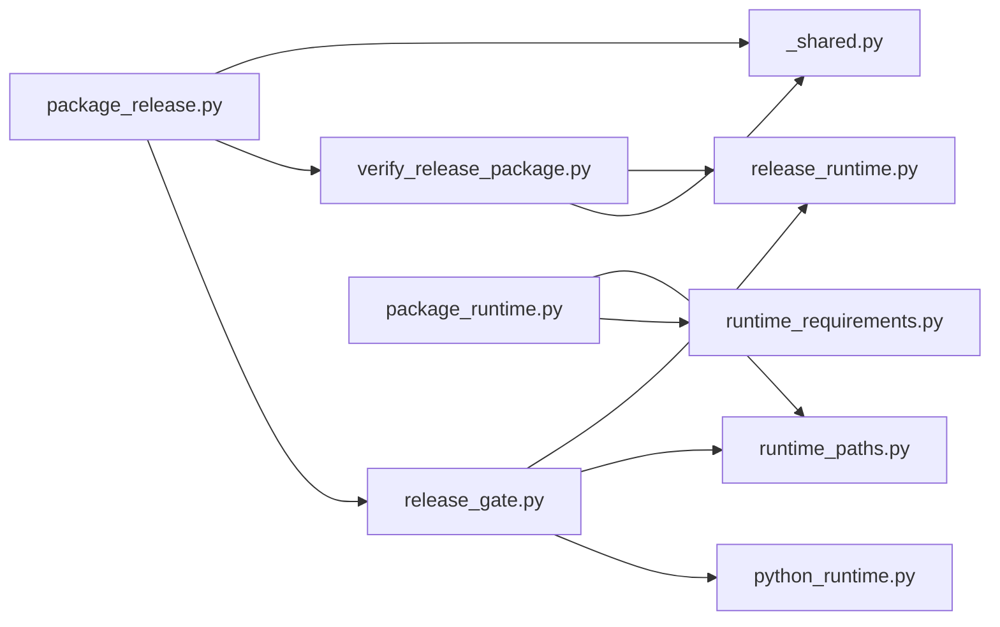

**图表来源**
- [scripts/release_gate.py:21-26](file://scripts/release_gate.py#L21-L26)
- [scripts/verify_release_package.py:22-24](file://scripts/verify_release_package.py#L22-L24)
- [scripts/package_runtime.py:19-21](file://scripts/package_runtime.py#L19-L21)
- [rdc_tool/python_runtime.py:1-12](file://rdc_tool/python_runtime.py#L1-L12)
- [rdc_tool/runtime_paths.py:1-12](file://rdc_tool/runtime_paths.py#L1-L12)
- [scripts/release_runtime.py:14](file://scripts/release_runtime.py#L14)

**章节来源**
- [scripts/release_gate.py:1-711](file://scripts/release_gate.py#L1-L711)
- [scripts/verify_release_package.py:1-474](file://scripts/verify_release_package.py#L1-L474)
- [scripts/package_runtime.py:1-358](file://scripts/package_runtime.py#L1-L358)
- [rdc_tool/python_runtime.py:1-172](file://rdc_tool/python_runtime.py#L1-L172)
- [rdc_tool/runtime_paths.py:1-123](file://rdc_tool/runtime_paths.py#L1-L123)
- [rdc_tool/runtime_requirements.py:1-73](file://rdc_tool/runtime_requirements.py#L1-L73)
- [pyproject.toml:1-45](file://pyproject.toml#L1-L45)

## 性能考虑
- 文件复制与扫描：
  - 使用递归遍历与后缀过滤减少无关文件处理。
  - 大文件分块计算 sha256，避免内存峰值。
- 压缩：
  - 发布包使用高压缩级别，平衡体积与构建时间。
- 子进程调用：
  - 限制超时与捕获输出，避免长时间阻塞。
- 清单生成：
  - 增量式遍历与过滤，减少 I/O 次数。
- **新增** 隔离环境优化：
  - 临时目录自动清理，避免磁盘空间占用。
  - 环境变量隔离，减少配置冲突。
- **新增** 源码门控验证优化：
  - 快速检查 git 状态，避免不必要的完整验证。
  - 缓存验证结果，减少重复验证开销。

## 故障排查指南
- 找不到 Python：
  - 检查 binaries/windows/x64/python/python.exe 是否存在，或设置 RDC_TOOL_PYTHON。
  - 参考启动器逻辑与错误提示。
- 清单不一致：
  - 重新运行 package_runtime.py 与 package_release.py，确保 manifest.runtime.json 与 RELEASE_MANIFEST.json 同步更新。
- 版本不匹配：
  - 确保 --version 与 rdc_tool.__version__ 一致。
- **新增** 源码门控验证失败：
  - 检查工作区状态，确保没有未提交的更改。
  - 运行 `git status` 确认干净的工作区状态。
  - 验证运行时身份，确保 native_manifest_status 为 "verified"。
- **新增** 隔离环境问题：
  - 检查临时目录权限和磁盘空间。
  - 查看隔离环境的清理日志，确认守护进程是否正确停止。
- **增强** 许可证验证失败：
  - 检查 LICENSE 文件是否与源代码完全一致（字节级比较）。
  - 确认许可证清单中的版本信息与源代码一致。
- 安全扫描失败：
  - 清理调试符号、移除 MCP 公开入口与预 GA 标记。
- 契约测试失败：
  - 检查 rdc 命令输出是否符合预期，必要时调整入口点或命令实现。

**章节来源**
- [bin/rdc-tool.cmd:1-18](file://bin/rdc-tool.cmd#L1-L18)
- [scripts/package_release.py:169-177](file://scripts/package_release.py#L169-L177)
- [scripts/release_gate.py:255-397](file://scripts/release_gate.py#L255-L397)
- [scripts/verify_release_package.py:158-188](file://scripts/verify_release_package.py#L158-L188)
- [scripts/release_runtime.py:17-47](file://scripts/release_runtime.py#L17-L47)

## 结论
该发布体系通过严格的文件收集、清单生成、版本一致性检查、安全扫描与契约验证，确保发布包的完整性、可追溯性与安全性。**新增的源码门控验证机制**强制要求干净的工作区状态，拒绝脏源码树、过时的运行时身份标识和包不匹配情况，显著提升了发布质量。**新增的候选包隔离验证**为本地验证提供了独立的构建与验证环境，支持更灵活的测试流程。**新增的ZIP归档后身份验证**确保完整归档通过严格的身份验证，进一步保障了包的完整性。**增强的隔离运行时上下文管理器**为发布验证提供了完全独立的环境，确保验证过程的纯净性和可靠性。**增强的许可证完整性验证**通过字节级比较确保许可证文件的真实性和完整性。**改进的打包安全性**采用临时暂存目录和独占zip创建模式，有效防止并发冲突和数据损坏。运行时打包与内嵌 Python 集成为跨平台用户提供开箱即用的体验，而发布门禁与制品验证构成双重质量保障，适合持续集成与发布流水线。

## 附录
- 关键路径与环境变量：
  - RDC_TOOL_ROOT：工具根目录（优先级最高）。
  - RDC_TOOL_INTERMEDIATE_ROOT：中间目录覆盖。
  - RDC_TOOL_PYTHON：指定 Python 解释器。
- 常用命令：
  - 运行时打包：python scripts/package_runtime.py --python-home ... --site-packages-source ...
  - 发布打包：python scripts/package_release.py --out-dir dist --version <ver>
  - **新增** 源码门控验证：python scripts/release_gate.py --require-release-package
  - **新增** 候选包构建：python scripts/package_release.py --candidate-dir <dir> --runtime-root <root>
  - **新增** ZIP归档后身份验证：python scripts/verify_release_package.py --zip dist/rdc-tool-*.zip
  - 制品验证：python scripts/verify_release_package.py --zip dist/rdc-tool-*.zip
  - 校验和生成：python scripts/generate_release_checksums.py <paths> --out intermediate/logs/release_checksums.sha256

**章节来源**
- [rdc_tool/runtime_paths.py:10-86](file://rdc_tool/runtime_paths.py#L10-L86)
- [scripts/package_runtime.py:280-353](file://scripts/package_runtime.py#L280-L353)
- [scripts/package_release.py:280-354](file://scripts/package_release.py#L280-L354)
- [scripts/release_gate.py:521-696](file://scripts/release_gate.py#L521-L696)
- [scripts/verify_release_package.py:351-474](file://scripts/verify_release_package.py#L351-L474)
- [scripts/generate_release_checksums.py:29-51](file://scripts/generate_release_checksums.py#L29-L51)